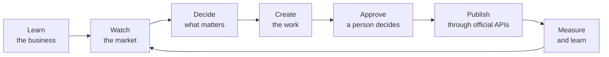

# Product Brief — Botella Aura

> **Your AI marketing co-pilot — safe by design.**
> Aura learns a business, watches its market, decides what is worth doing next, drafts the work, and hands it to a
> person to approve before anything is published or sent.

| | |
| --- | --- |
| **Product** | Botella Aura (`botella-aura`) |
| **Version** | 0.14.0 milestone (package `0.1.0`) — see [05-RELEASE-NOTES.md](05-RELEASE-NOTES.md) |
| **Status** | Feature-complete through Sprint 10; live on Vercel + Neon; social publishing awaiting platform approvals |
| **Date** | 30 October 2026 |
| **Related** | [SRS](02-SRS.md) · [Architecture](03-ARCHITECTURE.md) · [Changelog](04-CHANGELOG.md) · [Release notes](05-RELEASE-NOTES.md) · [Feature documentation](feature-docs/README.md) |

---

## 1. The problem

Every week a marketing team — or a founder doing marketing alone — has to know what its market is talking about,
publish content that sounds like the business, find prospects worth talking to, write outreach that is not
generic, watch competitors and learn from what worked. Each of these is a research task, then a writing task, then
a judgement call.

Generic AI writing tools help only with the writing, and they bring two problems of their own:

| Problem | Why it matters |
| --- | --- |
| **Off-brand, generic output** | A model that does not know the business writes about a topic, not to a customer. It invents facts and figures. |
| **No sense of what to do next** | A prompt box waits to be told. It does not notice a competitor's price change or a trend worth acting on. |
| **Unsafe automation** | Tools that auto-post, scrape or automate clicks put real accounts at risk of being banned. |
| **No accountability** | When content is wrong, nobody can tell where a claim came from or who approved it. |

## 2. The solution

Aura does the **research** and the **first draft** for every part of the marketing week, grounds all of it in the
business's own facts, and leaves the **decision and the send button** to a person.

1. **Learn** — onboarding, the website, uploaded documents and brand voice become one trusted **Business Context**,
   where every fact records its source, confidence and freshness.
2. **Watch** — trends, competitor changes, results and learned patterns become **signals**.
3. **Decide** — rules plus validated AI find **opportunities** with evidence; the recommendation engine says what to
   do, why, and what to expect (**Aura Suggests**).
4. **Create** — one click turns a suggestion into a content brief, a draft in nine formats, and a branded image.
5. **Approve** — every piece is checked for quality, facts, compliance and brand safety, then a person approves it.
6. **Publish** — the execution engine publishes through official APIs (Facebook, Instagram, LinkedIn).
7. **Measure** — results feed Marketing Memory, so the next suggestions learn from what worked.

## 3. Who it is for

| Persona | Need | What Aura gives them |
| --- | --- | --- |
| **Founder-marketer** at a small business | Marketing without a team or the time | A weekly briefing, ready-to-approve posts and one clear next step |
| **In-house marketing team** (B2B or B2C) | Consistent, on-brand output at volume | Shared workspace, roles, one review queue, brand voice in every draft |
| **Agency** managing several clients | Many brands, kept separate | Multiple workspaces with strict isolation, per-workspace policies |
| **Regulated or sensitive brands** (e.g. alcohol) | Never publish a claim that breaks the rules | Compliance packs, fact check, brand-safety classifier, mandatory approval |

Aura's first real test case was **SIPN**, a consumer drinks brand. It showed that business-buyer writing rules do not
suit consumer brands, which is why Aura adapts its strategy to B2B or B2C.

Workspace roles: **Owner**, **Admin**, **Member** (creates and drafts), **Viewer** (read-only).

## 4. Key capabilities

| Area | Capabilities |
| --- | --- |
| **Understand** | Business Context with provenance · About My Business page · Aura asks for missing information instead of guessing · Knowledge base (website, PDF, DOCX, PPTX) · Brand voice profile |
| **Market intelligence** | Trend insights localised by country and industry · Competitor website, pricing and news tracking · Marketing health score |
| **Decide** | Signals → opportunities (5 deterministic rules + validated AI) · Recommendation engine with guardrails and ranking · Aura Suggests · What Matters Now on Aura Home · Weekly briefing |
| **Create** | Content Studio with 9 formats (social post, image post, carousel, thread, blog, email, ad, campaign copy, promo) · Platform-aware copy · Variations with a facts guardrail · Monthly content plan · Campaigns |
| **Visuals** | Photorealistic images from 6 providers · Branded creatives (6 layouts, 4 sizes) with the real logo · Image refinement and version history |
| **Trust** | Fact check · Independent AI reviewer (11 dimensions) · Configurable compliance policy · Brand-safety classifier · Unified review and approval · Numbered versions · Full traceability from business fact to published post |
| **Publish** | Connection Manager with health checks · Execution engine with scheduling, timezones and retries · Facebook Pages, Instagram (posts, carousels, Reels), LinkedIn |
| **Grow** | Lead discovery with fit scores · Personalised outreach · Engagement copilot · Chrome extension that acts in the user's own LinkedIn session |
| **Learn** | Marketing Memory (insights only after 10 measured posts) · Analytics dashboard |
| **Anywhere** | WhatsApp assistant: ask what is waiting, write a post, approve and publish — with an explicit "yes" |
| **Business** | Stripe plans (Starter, Growth, Agency) with entitlements |

## 5. What makes Aura different

| Principle | In practice |
| --- | --- |
| **A person approves everything** | Nothing publishes or sends without approval. Any change after approval reopens it. |
| **Never invents** | Every business fact carries its source; figures not in a source are blocked; thin data gets an honest empty state. |
| **Explains itself** | Every suggestion shows its evidence; every post can show "why this exists", back to the original signal. |
| **Safe for real accounts** | Official APIs only; the server never logs in to LinkedIn or scrapes it. |
| **Proactive** | Aura suggests on its own and says why when it cannot. |
| **Fails visibly** | A missing key or provider gives a labelled fallback, never a silent failure. |

## 6. Scope

**In scope (built):** everything in section 4 — 25 features, 181 API route files, 61 data models. See the
[feature documentation](feature-docs/README.md).

**Out of scope by design:** automated clicking, scraping of authenticated pages, auto-connecting or auto-commenting
on LinkedIn, and publishing without approval (Autopilot can publish only under an explicit per-workspace setting).

**Not yet available:**

| Item | Blocked on |
| --- | --- |
| Live Facebook / Instagram publishing for customers | Meta App Review |
| WhatsApp on a production number | Meta business verification and message templates |
| LinkedIn Company Page publishing | LinkedIn Community Management API approval |
| Chrome Web Store listing | Developer account and store review |
| Trend forecasting, period-over-period analytics | Real metrics accumulating over time |

## 7. How success is measured

Aura Home already tracks these weekly, each compared with the previous week:

| Measure | What it shows |
| --- | --- |
| Suggestions acted on | Whether recommendations are useful enough to accept |
| Posts published | Output the team actually ships |
| Engagement | Response to what was published (organic insights from Meta) |
| Marketing health | Setup completeness and activity across modules |

Targets for these measures are a business decision and are not set in the product.

## 8. Platform at a glance

| | |
| --- | --- |
| Stack | Next.js 14 · TypeScript · Prisma · PostgreSQL · NextAuth · Tailwind |
| AI | Anthropic Claude (primary), Google Gemini (fallback); 6 image providers |
| Hosting | Vercel (Singapore) + Neon PostgreSQL |
| Clients | Web app (responsive), Chrome extension, WhatsApp |
| Quality | 2,141 automated tests · 66 end-to-end verification suites · typecheck, lint and build clean |
| History | Started 23 July 2026 · 204 commits · 15 milestone releases (0.1.0 → 0.14.0) |

## 9. Roadmap — next steps

1. Complete Meta App Review and the WhatsApp production setup; prove live publishing.
2. Move production text generation to a paid Anthropic key.
3. Close the permission gaps and schedule all background jobs (see [SRS §7](02-SRS.md)).
4. Write recommendation outcomes back into Marketing Memory to close the learning loop.
5. Turn on execution for campaigns and outreach once publishing is live.
6. Publish the Chrome extension and start LinkedIn API review.
