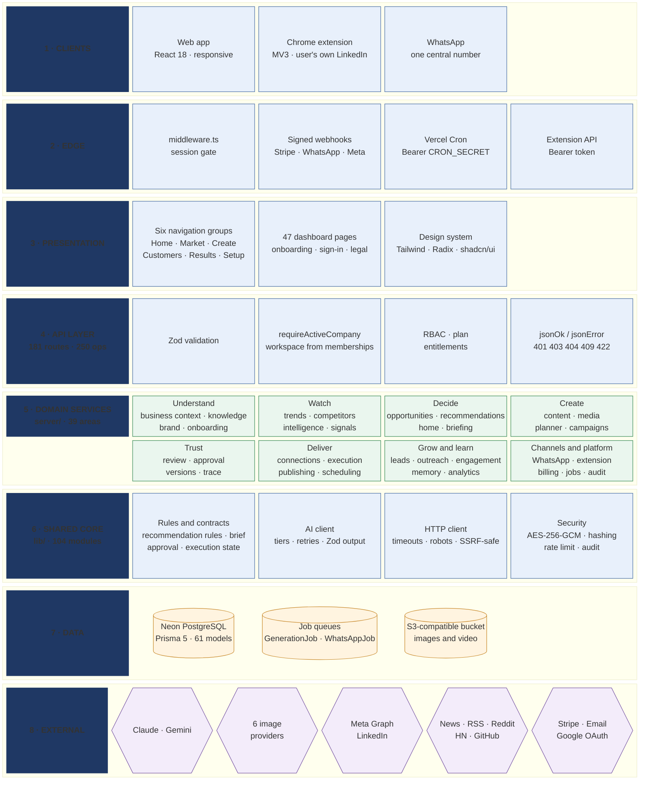
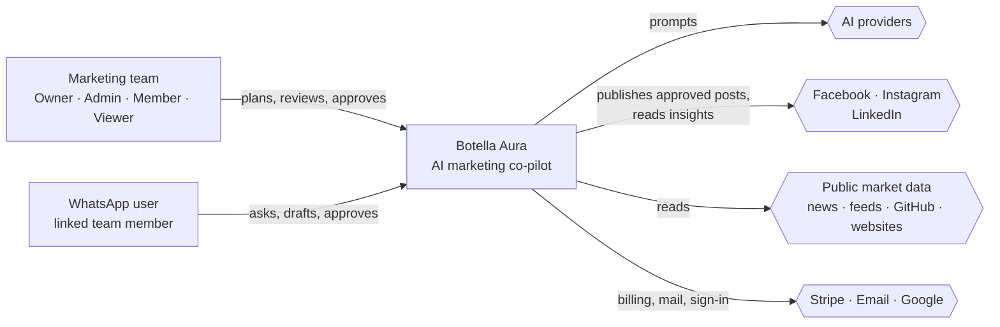
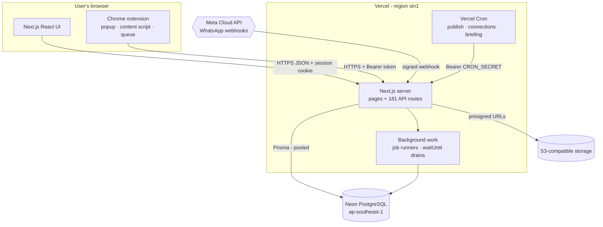
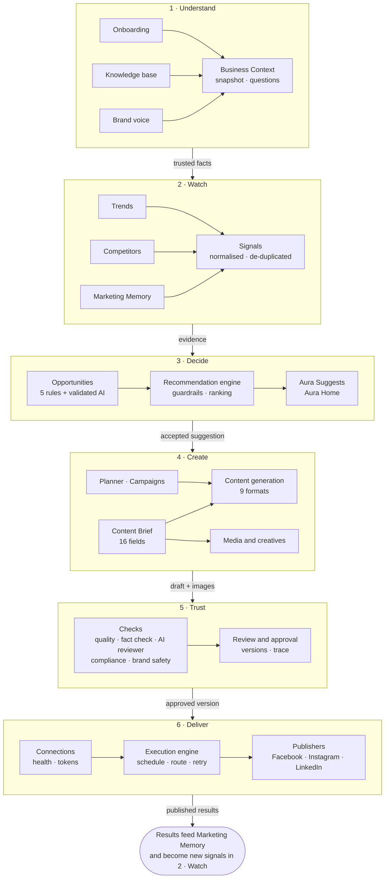
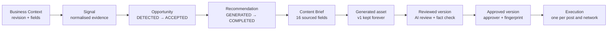
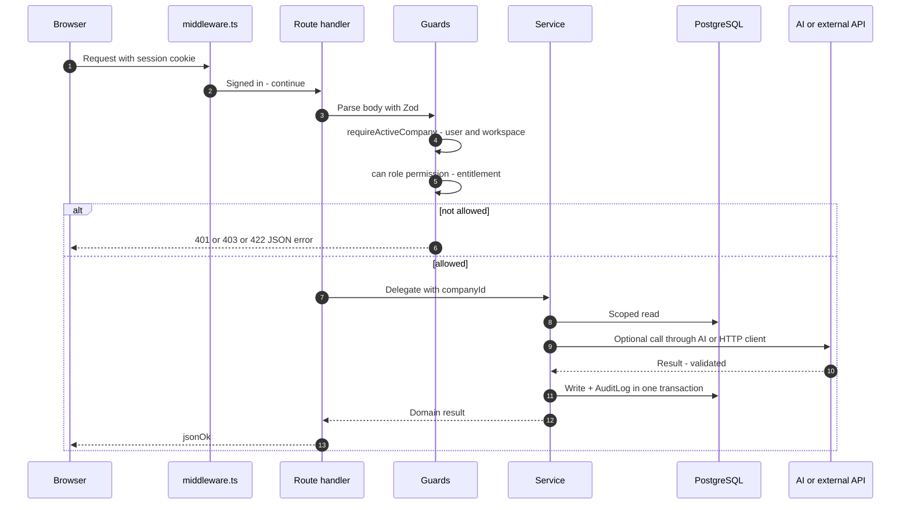
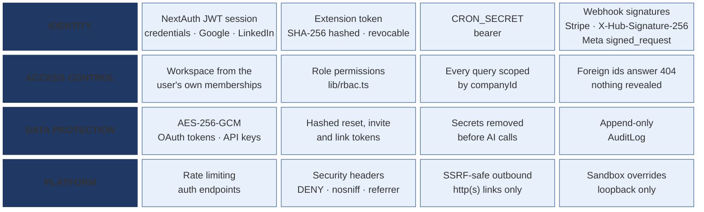
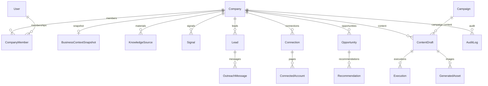
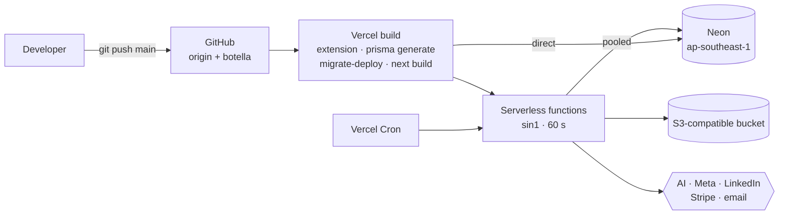

# Application Architecture — Botella Aura

How Botella Aura is built: one master view of the whole application, then the same system at C4 levels
(context → containers → components), the core intelligence pipeline, the request lifecycle, security, data and
deployment. Each feature's own architecture is in [`feature-docs/02-features/`](feature-docs/README.md#features).

| | |
| --- | --- |
| **Architecture style** | Modular monolith — one Next.js 14 deployable with strict layering (route → service → data) |
| **Clients** | Responsive web app · Chrome MV3 extension · WhatsApp (Meta Cloud API) |
| **Runtime** | Vercel serverless functions (`sin1`, 60 s limit) + Vercel Cron + a Postgres-backed job queue |
| **Data** | Neon PostgreSQL via Prisma 5 (61 models, 49 migrations); optional S3-compatible media bucket |
| **AI** | One AI client: Anthropic Claude primary, Google Gemini fallback, 3 model tiers; 6 image providers |
| **Size** | 181 API route files (250 operations) · 39 service areas · 104 shared modules · 47 dashboard pages |

---

## 1. Master architecture diagram

The whole application in one picture: who uses it, the layers every request passes, the domain modules, and
everything they depend on.

**How to read it.** Each row is a layer; a request travels down the rows, and each layer talks only to the one below it. Clients reach the app through the edge
(session middleware, signed webhooks, authenticated cron, the extension's bearer token). Every API route applies the same guards (input validation, workspace
resolution, role and plan checks) before delegating to a domain service. Services hold all business logic and
writes; they share pure rules and contracts from `lib/`, and reach the outside world only through two clients —
the AI client and the HTTP client. All data is in PostgreSQL, with an optional bucket for media.

---

## 2. System context (C4 level 1)

Aura sits between a marketing team and the platforms it publishes to. It reads public market data, uses AI to
think and write, and publishes only what a person has approved.

---

## 3. Containers (C4 level 2)

| Container | Technology | Responsibility |
| --- | --- | --- |
| Web UI | Next.js 14 App Router, React 18, Tailwind, Radix | Server-rendered pages and client components for all modules |
| API | Next.js route handlers | 250 operations; validation, auth, delegation |
| Background work | Postgres job queue + `waitUntil` + cron sweeps | Long AI generation, WhatsApp replies, publishing, health checks |
| Chrome extension | Manifest V3, plain JS | Paired by token; inserts approved text into LinkedIn's own composer; syncs visible metrics |
| Database | PostgreSQL (Neon), Prisma 5 | All tenant data, queues, audit log |
| Media storage | Postgres (default) or S3-compatible bucket | Generated images, creatives, video for Reels |

---

## 4. Components — domain modules (C4 level 3)

---

## 5. The core intelligence pipeline

Every published post can be traced back through this chain; the trace is stored on the draft
(`aiMetadata.trace`) and shown in the "Why this exists" panel.

| Stage | Guarantee |
| --- | --- |
| Business Context | Every fact has a source, confidence and freshness; AI-derived facts are labelled as assumptions |
| Signals | De-duplicated per workspace; repeat sightings corroborate, re-reads do not |
| Opportunities | Need minimum evidence; confidence capped by evidence and by unconfirmed context |
| Recommendations | Guardrails: eligibility, minimum evidence, frequency limits, duplicates, supported channels only |
| Content | Writer held to the brief; facts not in a source are blocked; independent reviewer; compliance policy |
| Approval | Covers text + network + images; any change reopens it |
| Execution | Compare-and-swap state machine; refuses content that no longer matches its approval |

---

## 6. Request lifecycle

---

## 7. Security architecture

Defences are layered: identity is established once per request, the workspace is derived only from the user's own
memberships, every service call carries the `companyId`, and sensitive values are encrypted or hashed at rest.
Details and the open gaps: [feature-docs/02-features/24-platform-jobs-and-deployment](feature-docs/02-features/24-platform-jobs-and-deployment/01-FEATURE-DETAILS.md)
and [SRS §7](02-SRS.md).

---

## 8. Data architecture

| Concern | Approach |
| --- | --- |
| Tenancy | `companyId` on every business table; cascade delete with the workspace |
| Concurrency | Optimistic revisions (409 on stale writes), compare-and-swap status transitions, advisory locks |
| Flexible structures | JSON columns for approval records, versions, trace, compliance policy and fact metadata |
| Migrations | 49 Prisma migrations, additive or with backfill; applied on deploy with connection retries |
| Retention | WhatsApp message text 90 days by default; Meta data-deletion callback supported |

---

## 9. Deployment architecture

| Environment | How |
| --- | --- |
| Local | `docker compose up -d` (Postgres 16) → `pnpm db:migrate` → `pnpm db:seed` → `pnpm dev`; Meta and WhatsApp through `npm run sandbox` |
| Production | Vercel + Neon; migrations on every deploy; three scheduled crons |
| Alternatives | Netlify (`netlify.toml`) and Railway (`railway.json`) configurations kept |

---

## 10. Architecture decisions

| Decision | Why |
| --- | --- |
| Modular monolith on Next.js | One deployable, types and Zod schemas shared by client and server, fast iteration |
| All logic in services, thin routes | Every entry point (web, WhatsApp, cron, extension) reuses the same rules and gates |
| One AI client, one HTTP client | Retries, timeouts, tiers, robots.txt and safety enforced in one place |
| Deterministic rules before AI | Detection, guardrails, fact check and brand safety must hold even when a model is wrong |
| Human approval as a hard gate | Trust and platform safety; enforced in the service layer, not the UI |
| JSON for evolving structures | Approval, versions and trace shipped without migrations |
| Postgres as the queue | No extra infrastructure; leases, retries and dead letters in SQL |
| Extension for LinkedIn actions | The server never holds LinkedIn cookies or automates clicks |
