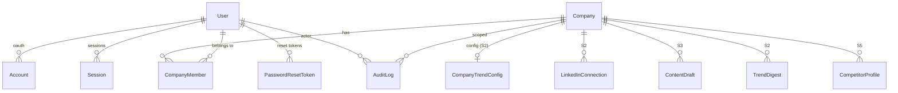
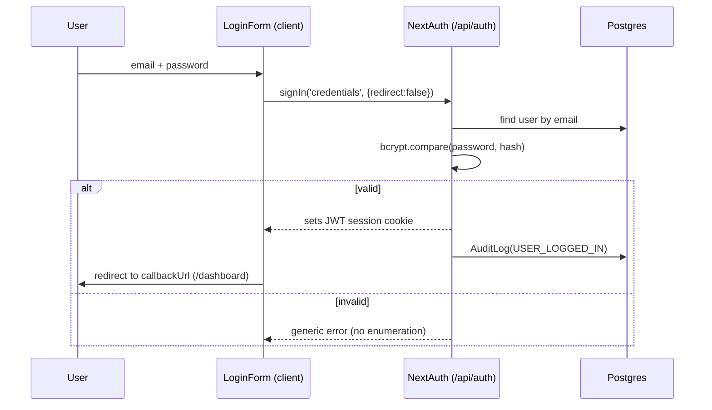
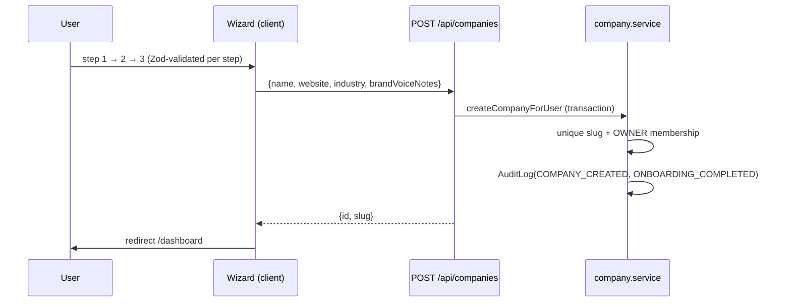

# Botella Aura — Sprint 1 (Foundation) — Technical Documentation

> Complete technical reference for the Sprint 1 foundation: architecture,
> data model, authentication, services, multi-tenancy, the design system, and
> every meaningful implementation decision — with the file that implements each.
>
> Audience: any engineer joining the project (or future-you in a later sprint).
> Companion docs: [`README.md`](../README.md) (setup), [`DESIGN.md`](../DESIGN.md)
> (design tokens), [`BACKLOG.md`](../BACKLOG.md) (open items).

---

## 1. What Sprint 1 delivers

Sprint 1 is the **production-grade foundation** every later sprint builds on. It
ships six things:

1. **Project scaffolding** — Next.js 14 (App Router) + TypeScript strict, ESLint/
   Prettier, Tailwind, Vitest, pnpm, Prisma, one-command local Postgres.
2. **A database schema designed for the full 10-sprint roadmap** (not just Sprint 1).
3. **Authentication** — email/password + Google OAuth, sessions, password reset,
   protected routes, and an RBAC scaffold.
4. **Company onboarding** — a 3-step wizard that creates the tenant.
5. **The dashboard shell** — sidebar, topbar with a multi-tenant company switcher,
   overview, and settings — the persistent frame every feature renders inside.
6. **A design system** — HSL token theme (light/dark) + reusable primitives.

Cross-cutting principle: **an append-only `AuditLog`** records every meaningful
action from day one (transparency/trust is a product principle, not an add-on).

---

## 2. Tech stack & why

| Layer | Choice | Rationale |
|---|---|---|
| Framework | **Next.js 14, App Router** | One deployable unit; server components + API routes share types/Zod schemas; NextAuth integrates natively. A separate backend service would add ops overhead with zero Sprint-1 benefit. |
| Language | **TypeScript (strict)** | `strict` + `noUncheckedIndexedAccess` + `noImplicitOverride` catch whole classes of bugs at compile time. |
| DB / ORM | **PostgreSQL + Prisma 5** | Typed data access; migrations; the schema is future-proofed for all 10 sprints so later work needs no painful migrations. |
| Auth | **NextAuth v4 (Auth.js)** | Stable, production-proven. Credentials + Google now; **LinkedIn slots in as one provider entry** in Sprint 2 with no refactor (the `Account` table already models arbitrary OAuth providers). |
| Validation | **Zod** | Single source of truth for input shapes across client forms, API routes, and tests. |
| Passwords | **bcryptjs** (pure-JS) | Avoids native build steps on Windows/CI; well-vetted adaptive hash. |
| Data fetching | **TanStack Query** | Mounted app-wide; used from Sprint 2 onward. |
| Styling | **Tailwind + shadcn-style primitives** | Token-driven; premium look; dark mode for free. |
| Tests | **Vitest** | Fast, ESM-native, JSX support via `@vitejs/plugin-react`. |
| Package manager | **pnpm** | Lean, fast, content-addressed store. |

**No extra frameworks were added** — every dependency is justified because 9
more sprints of features are coming and the codebase must stay lean.

---

## 3. Repository structure

```
app/
  (auth)/                     route group — auth pages (no dashboard chrome)
    login, signup, forgot-password, reset-password
    layout.tsx                centered card on the branded gradient
  dashboard/                  protected shell + pages
    layout.tsx                server layout: auth + active-company guard
    page.tsx                  overview (empty-state cards)
    settings/page.tsx         company profile + team members
    trends|content|…/page.tsx "Coming in Sprint N" placeholders
  onboarding/page.tsx         post-signup wizard (outside the shell)
  api/
    auth/[...nextauth]/route  NextAuth handler
    auth/signup|forgot-password|reset-password
    companies/route.ts        GET (list) + POST (create)
    companies/[id]/route.ts   PATCH (update)
  layout.tsx                  root layout (fonts, metadata, providers)
  providers.tsx               SessionProvider + QueryClient + Toaster
  globals.css                 design tokens (HSL vars, light + .dark)
components/
  ui/                         design-system primitives (Button, Card, …)
  auth/                       login/signup/reset forms
  onboarding/                 the wizard
  dashboard/                  sidebar, topbar, company switcher, forms
  brand/logo.tsx
lib/
  db.ts                       Prisma client singleton
  auth.ts                     NextAuth config (providers, callbacks, events)
  auth-helpers.ts             server session + company RBAC guards
  password.ts                 bcrypt hash/verify
  crypto.ts                   AES-256-GCM + sha256 + token gen
  rbac.ts                     role → permission matrix
  api.ts                      JSON response + error mapping helpers
  validations/                Zod schemas (auth, company)
  active-company.ts           server-side active-company resolution (cookie)
  cookies.ts                  client-safe cookie-name constant
  email.ts, logger.ts, nav.ts, utils.ts
server/
  services/                   business logic, kept OUT of route handlers
    user.service, company.service, audit.service, auth-token.service
prisma/
  schema.prisma               the full data model
  migrations/                 committed SQL migrations
  seed.ts                     demo user + company
types/
  index.ts, next-auth.d.ts    shared types + session augmentation
tests/                        vitest (password, crypto, validations, service)
middleware.ts                 edge auth guard
```

**Architectural rule enforced by this layout:** route handlers are **thin** —
they validate input (Zod) and delegate to `server/services/*`. All DB writes and
business rules live in services, so logic is reusable and testable in isolation.

---

## 4. Tooling & configuration

- **TypeScript** ([`tsconfig.json`](../tsconfig.json)): `strict`,
  `noUncheckedIndexedAccess` (array/object access yields `T | undefined`),
  `noImplicitOverride`, `moduleResolution: bundler`, path alias `@/* → ./*`,
  `target ES2022`.
- **ESLint** ([`.eslintrc.json`](../.eslintrc.json)): `next/core-web-vitals` +
  `next/typescript` + `prettier`; warns on `any`, unused vars, and stray
  `console` (only `warn`/`error`/`info` allowed).
- **Prettier** ([`.prettierrc`](../.prettierrc)): single quotes, trailing commas,
  `prettier-plugin-tailwindcss` (auto-sorts class names).
- **Tailwind** ([`tailwind.config.ts`](../tailwind.config.ts)): `darkMode: class`,
  colors mapped to CSS variables, custom shadow scale, `tailwindcss-animate`.
- **Vitest** ([`vitest.config.ts`](../vitest.config.ts)): node environment,
  globals, `@` alias, tests under `tests/`.
- **pnpm build approvals** ([`pnpm-workspace.yaml`](../pnpm-workspace.yaml)):
  pnpm 10+ blocks dependency build scripts by default; Prisma engines, esbuild,
  and the ESLint resolver are explicitly approved so a clean-clone
  `pnpm install` needs no manual step.
- **Local DB** ([`docker-compose.yml`](../docker-compose.yml)): Postgres 16 with
  a healthcheck; `docker compose up -d` matches the default `DATABASE_URL`.
- **Env** ([`.env.example`](../.env.example)): every variable documented;
  `.env` is gitignored.

**Required env (Sprint 1):** `DATABASE_URL`, `NEXTAUTH_URL`, `NEXTAUTH_SECRET`,
`ENCRYPTION_KEY` (32-byte base64). `GOOGLE_CLIENT_ID/SECRET` optional.

---

## 5. Data model (Prisma)

Defined in [`prisma/schema.prisma`](../prisma/schema.prisma). The schema is
designed **up front for all 10 sprints**. Sprint 1 actively *uses* the identity,
tenancy, and audit models; the rest are scaffolded with proper enums + FKs so
later sprints add behavior without migrations.

### 5.1 Entity relationships (Sprint 1 core)



### 5.2 Models used in Sprint 1

| Model | Purpose | Notable fields / decisions |
|---|---|---|
| `User` | Identity | `passwordHash` **nullable** (OAuth-only users have none); `role` is a **system-level** `SystemRole`. |
| `Company` | **Tenant boundary** | `slug` unique; `preferences Json` — an extensible bag so later sprints add signals without a migration; `onboardedAt`. |
| `CompanyMember` | **User ↔ Company join** | Per-company `CompanyRole` (RBAC). `@@unique([userId, companyId])`. Enables the topbar switcher (a user can belong to many companies). |
| `Account` / `Session` / `VerificationToken` | NextAuth adapter tables | `Account` models arbitrary OAuth providers → LinkedIn (S2) needs **no schema change**. |
| `PasswordResetToken` | Reset flow | Stores only a **SHA-256 hash** of the token; `expiresAt`, `usedAt` (single-use). |
| `AuditLog` | **Append-only trail** | Typed `AuditAction` enum (not free strings); nullable `userId`/`companyId` for system/pre-company events; indexed on `[companyId, createdAt]`, `[userId, createdAt]`, `action`. |

### 5.3 Placeholder models (scaffolded, wired later)

`LinkedInConnection` (encrypted token columns), `ContentDraft` (approval-lifecycle
enum), `TrendDigest`, `CompetitorProfile`. Each carries its FKs and enums so the
sprint that owns it only adds behavior.

### 5.4 Key schema decisions

- **Multi-tenant from day one.** `Company` + `CompanyMember` (not a single
  `companyId` on `User`) so a user can own/join multiple workspaces — the topbar
  switcher and per-company RBAC depend on this.
- **Two role scopes.** `SystemRole` on `User` (global) vs `CompanyRole` on
  `CompanyMember` (per-workspace, drives RBAC). Kept distinct deliberately.
- **`AuditAction` as an enum**, so the trail stays queryable and consistent as
  new sprints add actions.
- **Encrypted-at-rest token columns** on `LinkedInConnection` (ciphertext only),
  ready for Sprint 2.

### 5.5 Migrations & seed

- Migrations live in [`prisma/migrations/`](../prisma/migrations/) and are
  committed, so `prisma migrate deploy` reproduces the schema anywhere.
- [`prisma/seed.ts`](../prisma/seed.ts) upserts a demo user + company
  (`demo@botella.ai` / `Password123`, company `botella-demo`) so the dashboard is
  never empty. It calls `process.loadEnvFile()` so `pnpm db:seed` works
  standalone (running via `tsx`, unlike the Prisma CLI, doesn't auto-load `.env`).

---

## 6. Authentication system

The heart of Sprint 1. Configured in [`lib/auth.ts`](../lib/auth.ts).

### 6.1 NextAuth configuration

- **Adapter:** `PrismaAdapter(db)` — persists `Account`/`Session`/users.
- **Session strategy:** **JWT** (`maxAge` 30 days). JWT is *required* to support
  the Credentials provider; it also keeps session reads off the DB.
- **Providers** (built conditionally so the app runs with only credentials):
  - **Credentials** — `authorize()` validates with `signInSchema`, loads the
    user, rejects OAuth-only accounts (no `passwordHash`) and bad passwords with
    the **same generic failure** (no user enumeration), returns `{id, email,
    name, image, role}`.
  - **Google** — added only when `GOOGLE_CLIENT_ID`/`SECRET` are present;
    `allowDangerousEmailAccountLinking: true` links by verified email.
  - **`>>> Sprint 2: LinkedIn plugs in here <<<`** — a marked spot; adding a
    provider requires no other change.
- **Callbacks:**
  - `jwt` — on sign-in copies `id` + `role` onto the token (backfills `role` for
    older tokens).
  - `session` — exposes `session.user.id` and `session.user.role` to the app.
- **Events → audit:** `signIn`, `signOut`, and `createUser` (OAuth first login)
  each write an `AuditLog` entry via `recordAudit`.
- **Types:** [`types/next-auth.d.ts`](../types/next-auth.d.ts) augments
  `Session`/`JWT` so `id`/`role` are typed everywhere.

### 6.2 Login flow



### 6.3 Signup flow

`POST /api/auth/signup` ([route](../app/api/auth/signup/route.ts)) → validate
`signUpSchema` → [`createUserWithPassword`](../server/services/user.service.ts):
inside a transaction it checks email uniqueness, hashes the password (bcrypt cost
12), creates the user as `SystemRole.OWNER`, and writes `USER_SIGNED_UP`. The
client then auto-signs-in and routes to `/onboarding`. The password hash is never
returned.

### 6.4 Password reset (token-based, safe)

Implemented in [`auth-token.service.ts`](../server/services/auth-token.service.ts):

- **Request** (`POST /api/auth/forgot-password`): generates a random token, stores
  only its **SHA-256 hash** with a 1-hour expiry, and "emails" a link (console
  transport in Sprint 1). **Unknown emails are a silent no-op** → the endpoint
  can't enumerate accounts. The API always returns the same message.
- **Complete** (`POST /api/auth/reset-password`): hashes the presented token,
  looks it up, checks `usedAt`/`expiresAt`, sets the new password, marks the
  token used, and **invalidates the user's other outstanding tokens** — all in a
  transaction. Audited (`PASSWORD_RESET_REQUESTED` / `_COMPLETED`).

Email is abstracted in [`lib/email.ts`](../lib/email.ts) (console transport now;
swapping in Resend later changes no call sites).

### 6.5 Password hashing & crypto

- [`lib/password.ts`](../lib/password.ts): bcrypt cost **12**; `verifyPassword`
  returns `false` for a null hash (OAuth-only accounts can never authenticate via
  credentials); minimum length enforced both here and in the Zod schema (defense
  in depth).
- [`lib/crypto.ts`](../lib/crypto.ts): **AES-256-GCM** for tokens at rest
  (`iv.tag.ciphertext`, all base64), key from `ENCRYPTION_KEY` (validated to be
  exactly 32 bytes); plus `sha256()` (reset-token hashing) and `generateToken()`
  (URL-safe random). Used by Sprint 2 for LinkedIn tokens.

### 6.6 Route protection (defense in depth)

- **Edge middleware** ([`middleware.ts`](../middleware.ts)): `withAuth` with
  `matcher: ['/dashboard/:path*', '/onboarding/:path*']` — unauthenticated
  requests are redirected to `/login?callbackUrl=…` before any code runs.
- **Server helpers** ([`lib/auth-helpers.ts`](../lib/auth-helpers.ts)):
  `requireUser()`, `requireCompanyMembership()`, `requireCompanyRole()` — used
  where data is loaded, so protection is enforced twice (edge + data layer).

### 6.7 RBAC scaffold

[`lib/rbac.ts`](../lib/rbac.ts) is the **single source of truth** for
"can this company-role do X":

- `Permission` union (`company:update`, `members:invite`, `content:approve`, …).
- `ROLE_PERMISSIONS` matrix for `OWNER` / `ADMIN` / `MEMBER`.
- `can(role, perm)` / `assertCan(role, perm)` + a `ForbiddenError` (status 403).

Sprint 1 establishes the **pattern**; later sprints add permissions and call
`can()` at the boundaries that need them (e.g. settings edit is OWNER/ADMIN only).

---

## 7. Service layer

Business logic lives in [`server/services/`](../server/services/) — never in
route handlers.

- **`audit.service.ts`** — `recordAudit(input, client?)`. Accepts an optional
  transaction client so an audit row is written **atomically with the action it
  describes**. Crucially, **audit failures never break the primary action**: an
  error is logged and swallowed (transparency must not become a availability
  risk).
- **`user.service.ts`** — `createUserWithPassword` (transaction + audit),
  `getUserByEmail/ById`, `EmailAlreadyInUseError` (409).
- **`company.service.ts`** — `createCompanyForUser` (transaction:
  unique-slug generation, OWNER membership, `COMPANY_CREATED` +
  `ONBOARDING_COMPLETED` audits), `getCompaniesForUser`, `getMembership`,
  `updateCompany` (audits **which fields changed**).
- **`auth-token.service.ts`** — the password-reset lifecycle (§6.4).

**Transaction pattern:** every write that must stay consistent with its audit
entry uses `db.$transaction(async (tx) => { … recordAudit(…, tx) })`.

---

## 8. Validation & API conventions

- **Zod schemas** ([`lib/validations/`](../lib/validations/)) are the single
  source of truth. `auth.ts`: email normalization (lowercase/trim), password
  rules (≥8, letter+number, ≤72 for bcrypt), sign-in/up, forgot/reset.
  `company.ts`: company create/update, with website normalization (bare domain →
  `https://…`).
- **Response envelope** ([`lib/api.ts`](../lib/api.ts)): `jsonOk`, `jsonError`,
  and `handleRouteError` which maps `ZodError → 422` (field errors),
  `ForbiddenError → 403`, any `status`-annotated error → that status, else
  `500` (with the internals logged, never leaked). `getRequestMeta` extracts
  IP/user-agent for audit entries.
- **Every API route validates with Zod before touching the DB** (NON-NEGOTIABLE).

---

## 9. Multi-tenancy & active-company resolution

A user can belong to multiple companies, so the app tracks an **active company**:

- The topbar **company switcher** ([client](../components/dashboard/company-switcher.tsx))
  writes a cookie `aura.activeCompany` and calls `router.refresh()`.
- Server code reads it via
  [`resolveActiveCompany(userId)`](../lib/active-company.ts) — returns the cookie's
  company (validated against membership) or falls back to the user's first
  company + the full membership list.
- **RSC boundary fix:** the cookie *name* lives in
  [`lib/cookies.ts`](../lib/cookies.ts) (a client-safe module), because
  `active-company.ts` imports `next/headers` (server-only) and importing it into
  the client switcher would pull server code into the browser bundle. This split
  is a deliberate App-Router pattern.

The dashboard layout ([`app/dashboard/layout.tsx`](../app/dashboard/layout.tsx))
resolves the active company server-side, redirects to `/onboarding` if the user
has none, and feeds the switcher + guards.

---

## 10. Onboarding

[`app/onboarding/page.tsx`](../app/onboarding/page.tsx) (server) redirects users
who already have a company straight to `/dashboard`; otherwise it renders the
3-step wizard ([client](../components/onboarding/onboarding-wizard.tsx)):

1. **Company** — name, website, industry (validated with `companyStep1Schema`).
2. **Brand voice** — free-text notes (feeds AI prompts in later sprints).
3. **Confirmation** — value-prop + the human-in-the-loop promise.

On finish it `POST`s to `/api/companies` → `createCompanyForUser` (transaction +
dual audit) → routes to `/dashboard`. Onboarding lives **outside** the dashboard
shell so new users focus on setup.



---

## 11. Dashboard shell

The persistent frame every feature renders inside.

- **Layout** ([`app/dashboard/layout.tsx`](../app/dashboard/layout.tsx)) — server
  component: `requireUser()` + `resolveActiveCompany()`; passes user + companies
  to the client shell.
- **Shell** ([`dashboard-shell.tsx`](../components/dashboard/dashboard-shell.tsx))
  — responsive: fixed sidebar on desktop, slide-over drawer on mobile, sticky
  topbar.
- **Sidebar nav** ([`sidebar-nav.tsx`](../components/dashboard/sidebar-nav.tsx))
  — driven by [`lib/nav.ts`](../lib/nav.ts), the single source of truth: each
  item has a `ready` flag; not-yet-shipped features render a "Coming in Sprint N"
  placeholder ([`coming-soon.tsx`](../components/dashboard/coming-soon.tsx)) and
  show an `SN` chip.
- **Topbar** — the **company switcher** + **user menu**
  ([`user-menu.tsx`](../components/dashboard/user-menu.tsx), logout via
  `signOut`).
- **Overview** ([`app/dashboard/page.tsx`](../app/dashboard/page.tsx)) — premium
  empty-state cards + the trust reminder ("nothing goes live without you").
- **Settings** ([`app/dashboard/settings/page.tsx`](../app/dashboard/settings/page.tsx))
  — company profile editor (RBAC-gated via `can(role, 'company:update')`; a
  MEMBER sees a read-only form) that `PATCH`es `/api/companies/[id]`, plus a
  view-only team members list.

---

## 12. Design system

Documented fully in [`DESIGN.md`](../DESIGN.md); implementation summary:

- **Tokens** ([`app/globals.css`](../app/globals.css)) — all colors are **HSL CSS
  variables** defined for light (`:root`) and dark (`.dark`), so Tailwind applies
  opacity modifiers and dark mode comes for free. Neutral slate surfaces + one
  confident **indigo-violet** accent (`--primary: 250 84% 60%`). Custom soft
  shadow scale; a branded `.aura-gradient` wash. Typography: **Inter** via
  `next/font` exposed as `--font-sans`.
- **Primitives** ([`components/ui/`](../components/ui/)) — shadcn-style: Radix +
  `class-variance-authority` + the `cn()` merge helper
  ([`lib/utils.ts`](../lib/utils.ts)). Sprint 1 ships `Button`, `Card`, `Input`,
  `Textarea`, `Label`, `Badge` (+ a `statusBadgeVariant` mapping for the content
  lifecycle), `Dialog`, `DropdownMenu`, `Avatar`, `EmptyState`, and the `Toaster`
  (sonner). All accept `className`, forward refs, and expose a `variant`/`size`
  API via `cva`.
- **Accessibility baseline** — semantic HTML, `<Label htmlFor>` on every field,
  `aria-invalid` + `role="alert"` on errors, a global visible `:focus-visible`
  ring, keyboard-navigable/focus-trapped Radix dialogs, color never the sole
  signal.

---

## 13. Security posture (Sprint 1)

| Concern | How it's handled |
|---|---|
| Secrets | Never hardcoded; all via `.env`, documented in `.env.example`; `.env` gitignored. |
| Password storage | bcrypt (cost 12); hashes never leave the server. |
| Tokens at rest | AES-256-GCM helper ready (`lib/crypto.ts`); used for LinkedIn tokens in S2. |
| Account enumeration | Login and forgot-password return generic responses; unknown emails are silent no-ops. |
| Reset tokens | Only SHA-256 hashes stored; single-use; 1-hour expiry; siblings invalidated on use. |
| Route protection | Edge middleware + server-side `requireUser`/`requireCompanyMembership`. |
| Authorization | Central RBAC matrix; settings edit gated to OWNER/ADMIN. |
| Transparency | Append-only `AuditLog` on signup, login, logout, company create, settings update. |
| Injection | Prisma parameterizes all queries; Zod validates all inputs. |
| No LinkedIn scraping | Sprint 1 has **zero** LinkedIn integration beyond a placeholder table. |

---

## 14. Testing

[`tests/`](../tests/) with Vitest — **23 tests in Sprint 1**, focused on core
logic rather than coverage theater:

- **`password.test.ts`** — hash ≠ plaintext, random salt (two hashes differ),
  verify true/false, null-hash rejection, min-length guard.
- **`crypto.test.ts`** — AES-GCM round-trip, distinct ciphertexts (random IV),
  tamper detection (auth tag), deterministic sha256, unique tokens.
- **`validations.test.ts`** — email lowercasing, password letter+number rule,
  website normalization (`acme.com → https://acme.com`), full onboarding payload.
- **`company-service.test.ts`** — `createCompanyForUser` with **Prisma mocked**:
  unique-slug suffixing, OWNER membership, and that **both** audit entries fire in
  the transaction.

Run: `pnpm test` (or `pnpm typecheck`, `pnpm lint`).

---

## 15. End-to-end request flows (recap)

- **Signup:** form → `POST /api/auth/signup` (Zod) → `createUserWithPassword`
  (tx: hash + create OWNER + `USER_SIGNED_UP`) → auto sign-in → `/onboarding`.
- **Login:** `signIn('credentials')` → `authorize()` (bcrypt compare) → JWT
  session → `USER_LOGGED_IN` → `/dashboard`.
- **Onboarding:** wizard → `POST /api/companies` → `createCompanyForUser` (tx:
  slug + OWNER membership + `COMPANY_CREATED` + `ONBOARDING_COMPLETED`) →
  `/dashboard`.
- **Settings update:** form → `PATCH /api/companies/[id]` →
  `requireCompanyRole(['OWNER','ADMIN'])` → `updateCompany` (tx + `COMPANY_UPDATED`
  with changed-field list).
- **Every protected navigation:** middleware checks the session cookie first;
  server components re-check and load the active company.

---

## 16. Key files quick reference

| Area | File |
|---|---|
| Prisma schema | `prisma/schema.prisma` |
| Seed | `prisma/seed.ts` |
| NextAuth config | `lib/auth.ts` |
| Session/RBAC guards | `lib/auth-helpers.ts` |
| RBAC matrix | `lib/rbac.ts` |
| Passwords | `lib/password.ts` |
| Crypto | `lib/crypto.ts` |
| API helpers | `lib/api.ts` |
| Zod schemas | `lib/validations/{auth,company}.ts` |
| Active company | `lib/active-company.ts`, `lib/cookies.ts` |
| Services | `server/services/{user,company,audit,auth-token}.service.ts` |
| Middleware | `middleware.ts` |
| Design tokens | `app/globals.css`, `tailwind.config.ts` |
| Shell | `app/dashboard/layout.tsx`, `components/dashboard/dashboard-shell.tsx` |

---

## 17. Decisions & tradeoffs worth remembering

1. **Monolith over microservices** — one Next.js app; shared types/Zod/Prisma.
   Long-running/agentic work is decoupled into a worker *later* (see BACKLOG I1),
   not by forking the language.
2. **NextAuth v4 (stable) over v5 (beta)** — battle-tested; LinkedIn adds cleanly.
3. **JWT sessions** — required for Credentials; keeps session reads off the DB.
4. **Schema future-proofed for 10 sprints** — placeholder tables now to avoid
   painful migrations later.
5. **Audit-log-first** — transparency is a product principle; writes are atomic
   with their action and never break it.
6. **Two role scopes** (`SystemRole` vs `CompanyRole`) — global identity vs
   per-workspace permissions.
7. **bcryptjs (pure JS)** — no native build headaches on Windows/CI.

---

_Sprint 1 status: complete and verified — `pnpm install → db:migrate → db:seed →
dev` works from a clean clone; 23 tests pass; production build is clean._
