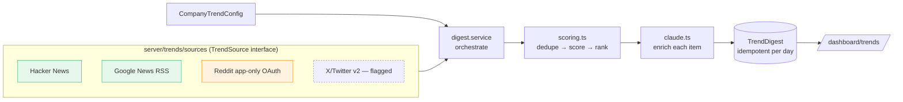
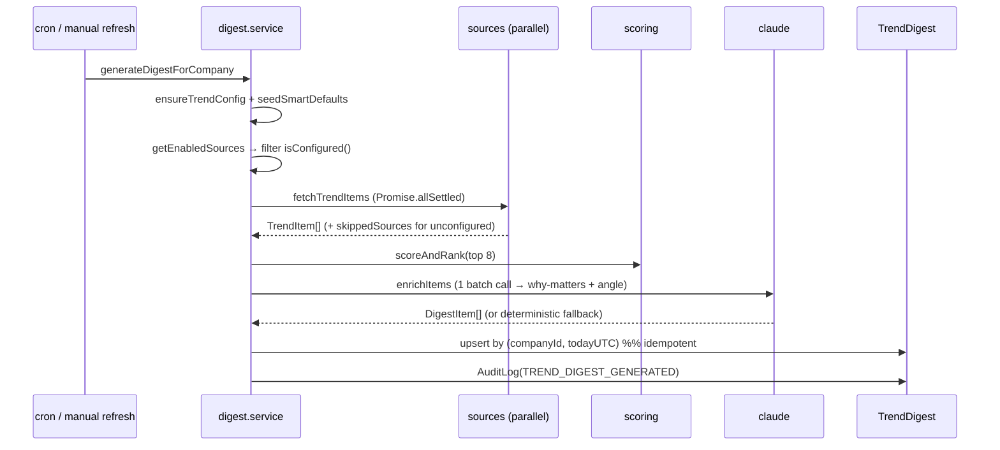

# Botella Aura — Sprint 2 (LinkedIn Connect + AI Trend Intelligence) — Technical Documentation

> Complete technical reference for Sprint 2: the official LinkedIn OAuth
> connection and the AI Trend Intelligence engine (multi-source ingestion →
> scoring → Claude-enriched digest). Grounded in the actual code.
>
> Builds on Sprint 1 (see [`SPRINT-1-TECHNICAL.md`](./SPRINT-1-TECHNICAL.md)).
> Companion docs: [`README.md`](../README.md), [`BACKLOG.md`](../BACKLOG.md).

---

## 1. What Sprint 2 delivers

Sprint 2 adds the first real "intelligence" feature plus the first external
account connection:

1. **LinkedIn Official OAuth Connection** — company-scoped OpenID Connect connect/
   disconnect, tokens **encrypted at rest**, CSRF-protected, RBAC-gated, audited.
2. **External trend data pipeline** — modular, ToS-compliant connectors: Hacker
   News + Google News (keyless), Reddit (official app-only OAuth), X/Twitter
   (feature-flagged, official API v2).
3. **Trend scoring + digest generation** — a pure scoring engine (recency ×
   engagement × relevance) and an idempotent daily digest that ranks the top
   items and enriches each with a Claude "why this matters" + suggested angle.
4. **Trend Intelligence dashboard** — a real feed at `/dashboard/trends` with
   history, manual refresh, and honest source-status transparency.
5. **Keyword & source configuration** — `/dashboard/settings/trends` with
   AI-seeded smart defaults.

**Two guiding principles carried through the whole sprint:**

- **Never scrape / never fake.** Only official, ToS-compliant APIs. A source that
  isn't configured is *skipped and shown as "not connected"* — never faked
  (enforced by the `TrendSource.isConfigured()` contract).
- **Honest LinkedIn scope.** We integrate only the self-serve OIDC product (basic
  profile). The public feed and posting are **not** available on that scope and
  are clearly flagged as pending Marketing/Community API approval — never
  worked around.

---

## 2. Architecture at a glance



Every outbound call goes through one HTTP client
([`lib/http.ts`](../lib/http.ts)); every source implements one interface
([`server/trends/types.ts`](../server/trends/types.ts)); every AI call goes
through one wrapper ([`server/ai/claude.ts`](../server/ai/claude.ts)). This is
the "one seam per concern" discipline that keeps the code lean.

---

## 3. Schema additions

Migrations: `…_sprint2_trend_config` and `…_sprint2_linkedin_fields` in
[`prisma/migrations/`](../prisma/migrations/).

### 3.1 `CompanyTrendConfig` (1:1 with Company)

Per-company trend configuration. Uses native Postgres `text[]` arrays.

| Field | Type | Purpose |
|---|---|---|
| `keywords` | `String[]` | Topics/phrases to monitor |
| `subreddits` | `String[]` | Subreddits (names, no `r/`) |
| `rssFeeds` | `String[]` | Extra RSS feeds beyond keyword-based Google News |
| `competitorNames` | `String[]` | Lightweight competitor watch list (also boosts scoring) |
| `enabledSources` | `Json` | `{reddit, hackernews, news, twitter}` flags |
| `defaultsSeeded` | `Boolean` | Prevents overwriting user edits with AI defaults |

### 3.2 `LinkedInConnection` (extended)

Added `displayName`, `avatarUrl` (safe, non-secret profile display),
`errorMessage`, and made `companyId` **`@@unique`** (one connection per company →
enables `upsert` on connect). Token columns remain **ciphertext only**
(`accessTokenEnc`, `refreshTokenEnc`).

### 3.3 `TrendDigest` (used, from Sprint 1 scaffold)

`payload Json` holds the structured digest; `@@unique([companyId, date])` is the
**idempotency key** — one digest per company per calendar day.

### 3.4 New `AuditAction` values

`LINKEDIN_CONNECTED`, `LINKEDIN_DISCONNECTED`, `LINKEDIN_TOKEN_REFRESHED`,
`TREND_CONFIG_UPDATED`, `TREND_DIGEST_GENERATED`, `TREND_DIGEST_REQUESTED`,
`AI_SUGGESTION_GENERATED`.

---

## 4. The shared HTTP client

[`lib/http.ts`](../lib/http.ts) — **NON-NEGOTIABLE #2**: no inline `fetch()` in
route handlers; every third-party call goes through here so timeouts, retries,
and error handling are consistent.

- `httpRequest(url, {timeoutMs=10_000, retries=2})` — `AbortController` timeout;
  retries on **network errors and 5xx** with exponential-ish backoff
  (`250·2^attempt` ms); **4xx (incl. 429) is returned to the caller as-is** so
  each source can respect its own rate-limit rules.
- `getJson<T>()` / `getText()` — throw a typed `HttpError(status, url, body?)` on
  non-2xx.

The client deliberately **does not hammer on 429** — rate-limit posture is the
caller's responsibility, documented per source (§5).

---

## 5. Trend source connectors

All implement [`TrendSource`](../server/trends/types.ts):

```ts
interface TrendSource {
  id: TrendSourceId;                 // 'reddit' | 'hackernews' | 'news' | 'twitter'
  label: string;
  isConfigured(ctx): boolean;        // false → orchestrator SKIPS it (never faked)
  fetchTrendItems(ctx): Promise<TrendItem[]>;
}
```

Each returns normalized `TrendItem`s (`id`, `source`, `sourceLabel`, `title`,
`url`, `publishedAt` ISO, `engagement {points, comments}`, `matchedKeywords`).
Adding a new source later = one file in `server/trends/sources/` — nothing
downstream changes.

### 5.1 Hacker News — [`hackernews.ts`](../server/trends/sources/hackernews.ts)

- **Official Firebase API**, **keyless**. `isConfigured() = true`.
- Loads top-story index, scans the top **120** stories in concurrent batches of
  **12**, keeps those whose title matches a configured keyword.
- Rate posture: bounded scan + polite concurrency (no hard limit documented by HN).

### 5.2 Reddit — [`reddit.ts`](../server/trends/sources/reddit.ts)

- **Official Reddit API, read-only, app-only ("client credentials") OAuth** — no
  user login, no scraping.
- Module-level **token cache** (shared across companies, refreshed before expiry).
- One `/r/{sub}/hot` listing per configured subreddit, bounded to **8** subs.
- **Rate limit documented in code:** Reddit allows **100 queries/min per client
  ID**, averaged over 10 minutes — we stay well under.
- `isConfigured()` requires `REDDIT_CLIENT_ID/SECRET` + at least one subreddit.

### 5.3 Google News (RSS) — [`rss.ts`](../server/trends/sources/rss.ts)

- **Pure RSS parsing, keyless, never scraping.** Two inputs: Google News RSS
  search per keyword (bounded to 8) + any custom feed URLs.
- Parses **both RSS and Atom** via `fast-xml-parser`; dedupes by guid/URL hash.

### 5.4 X / Twitter — [`twitter.ts`](../server/trends/sources/twitter.ts)

- **Official API v2 recent-search only**, behind a feature flag.
  `isConfigured()` requires `TWITTER_BEARER_TOKEN`; absent → skipped and the UI
  shows "not connected".
- Issues **one combined-query request per digest** to conserve tight recent-search
  quota (commented so future engineers don't fan out per keyword).

### 5.5 Registry — [`sources/index.ts`](../server/trends/sources/index.ts)

`ALL_SOURCES` keyed by id; `getEnabledSources(flags)` returns the sources the
company enabled (default: all but Twitter).

---

## 6. Scoring engine

[`server/trends/scoring.ts`](../server/trends/scoring.ts) — a **pure function**
(no I/O), so it's trivially unit-testable. Each item gets a **0–100** score from
three weighted signals:

| Signal | Weight | Formula |
|---|---|---|
| **Recency** | 0.35 | Exponential time decay, 24-hour half-life: `0.5^(ageHours/24)` |
| **Engagement** | 0.30 | Log-scaled `points + 2·comments`, saturating at ~500 (`log1p`) |
| **Relevance** | 0.35 | `min(1, matchedKeywords/3)` + **competitor-mention boost (+0.25)** + **title-hit boost (+0.1)** |

- `scoreItem(item, ctx, now)` returns the score **plus a per-signal breakdown**
  (transparency; `now` is injected so tests are deterministic).
- `dedupe()` removes duplicates by id **and** by normalized title (cross-source
  dupes, e.g. the same story on HN and News).
- `scoreAndRank(items, ctx, {limit:8})` → dedupe → score → sort desc (tie-break:
  newer first) → top N.

---

## 7. The Claude AI service

[`server/ai/claude.ts`](../server/ai/claude.ts) — the **single** place the app
talks to the model; reused by Sprint 3 (Content Studio) and beyond.

- **Model:** `claude-opus-4-8` (override via `ANTHROPIC_MODEL`), **adaptive
  thinking**.
- `isClaudeConfigured()` — presence of `ANTHROPIC_API_KEY`; lets every feature
  degrade gracefully (a `fallback` path) when no key is set.
- `complete({system, prompt, maxTokens, effort})` — **streams** when
  `maxTokens ≥ 8000` (avoids HTTP timeouts on large outputs), **retries once** on
  transient failure, extracts text blocks (ignores empty thinking blocks).
- `completeJson<T>()` — tolerant JSON extraction (strips ```json fences and
  surrounding prose) then `JSON.parse`.
- `ClaudeNotConfiguredError` — thrown when a real AI call is required but no key
  exists.

> Sprint 3 adds `completeStructured()` (Zod-validated, retry-once) on top of this.

---

## 8. Trend configuration + smart defaults

[`server/services/trend-config.service.ts`](../server/services/trend-config.service.ts):

- `ensureTrendConfig(companyId)` — creates the row on first access (default source
  flags).
- `toFetchContext(config)` / `getEnabledFlags(config)` — adapt the stored row into
  what sources consume.
- `updateTrendConfig(...)` — persists user edits + audits `TREND_CONFIG_UPDATED`;
  sets `defaultsSeeded = true` so AI never overwrites intentional edits.
- **`seedSmartDefaults(company)`** — one-time: analyzes the company's industry +
  brand voice via Claude to suggest keywords/subreddits/competitors; falls back
  to a **deterministic heuristic** (industry + name + generic subreddits) when
  Claude isn't configured. Idempotent (only runs when `defaultsSeeded` is false).

Validation for the config form/API lives in
[`lib/validations/trends.ts`](../lib/validations/trends.ts) (subreddit
normalization, URL validation, bounded array lengths so one tenant can't blow
through third-party rate limits).

---

## 9. Digest generation (the orchestrator)

[`server/trends/digest.service.ts`](../server/trends/digest.service.ts) —
`generateDigestForCompany({companyId, userId, trigger})`:



Key properties:

- **Honest skipping.** Only sources that are enabled *and* `isConfigured(ctx)` run;
  the rest are recorded in `payload.skippedSources` and surfaced in the UI. A
  failing source is caught (`allSettled`) and counts as 0 — **never faked**.
- **AI enrichment is one batched call** (cost-efficient) keyed by item id, with a
  **deterministic fallback** so the digest still ships (clearly labeled
  `payload.model = "fallback"`) when Claude is unavailable.
- **Idempotent** per company/day via `upsert` on `[companyId, date=todayUTC]`
  (NON-NEGOTIABLE #6) — a double-fire overwrites, never duplicates.
- `payload` (`DigestPayload`) stores `items[]`, `generatedAt`, `model`,
  `sourceCounts`, `skippedSources` — full provenance.

Read helpers: `getRecentDigests(companyId, 7)`, `getLatestDigest`.

---

## 10. LinkedIn official OAuth

[`server/services/linkedin.service.ts`](../server/services/linkedin.service.ts).

### 10.1 Scope reality (documented in code)

We integrate **"Sign In with LinkedIn using OpenID Connect"** — scopes
`openid profile email`. That grants the connected user's basic profile
(id/name/photo/email), which is what we use to personalize content. It does
**not** grant the public feed, other users' posts, or posting — those need the
**Community Management API / Marketing Developer Platform** (separate approval).
Those capabilities are stubbed and flagged, never faked. **No scraping, no
unofficial endpoints, ever.**

### 10.2 Why a dedicated flow (not NextAuth sign-in)

Connecting a LinkedIn account to a **company** is a different action from
authenticating a **user**. So LinkedIn connect uses **dedicated company-scoped
routes**, keeping it cleanly separate from the NextAuth session.

### 10.3 The flow

```mermaid
sequenceDiagram
  participant U as User
  participant C as /api/linkedin/connect
  participant LI as LinkedIn OAuth
  participant CB as /api/linkedin/callback
  participant S as linkedin.service
  U->>C: click "Connect LinkedIn"
  C->>C: RBAC (linkedin:connect) + generate nonce
  C->>U: set httpOnly cookie sha256(nonce); redirect with state=base64({companyId,nonce})
  U->>LI: consent (scopes openid profile email)
  LI->>CB: redirect ?code&state
  CB->>CB: verify state.nonce == sha256 cookie (CSRF)
  CB->>S: connectCompany(code)
  S->>LI: exchange code → tokens
  S->>LI: GET /v2/userinfo (profile)
  S->>S: AES-256-GCM encrypt tokens → upsert LinkedInConnection (ACTIVE)
  S->>S: AuditLog(LINKEDIN_CONNECTED)
  CB->>U: redirect /dashboard/settings/connections?connected=1
```

- **CSRF:** a random nonce; its **SHA-256 hash** is stored in an httpOnly cookie,
  and the raw nonce travels inside the OAuth `state`. The callback verifies they
  match.
- **Tokens encrypted at rest** via [`lib/crypto.ts`](../lib/crypto.ts)
  (AES-256-GCM) — a DB leak never exposes a usable LinkedIn token.
- **Disconnect** ([route](../app/api/linkedin/disconnect/route.ts)) →
  `disconnectCompany`: best-effort token **revoke** with LinkedIn, then **delete**
  the row (no ciphertext lingers), audited.
- `getLinkedInStatus(companyId)` returns a **safe, non-secret** view (connected,
  displayName, avatar, needsReconnect, expiry) for the Connections UI.
- `getPublishContext(companyId)` (used by Sprint 3) returns a decrypted token
  **only** for an ACTIVE, non-expired connection.

---

## 11. API routes

| Route | Method | Purpose |
|---|---|---|
| [`/api/cron/trends`](../app/api/cron/trends/route.ts) | POST | Scheduled daily digest job. `Bearer CRON_SECRET`; loops companies **sequentially** (gentle on shared third-party limits); idempotent. |
| [`/api/trends/refresh`](../app/api/trends/refresh/route.ts) | POST | Manual "Refresh" for the active company; audits `TREND_DIGEST_REQUESTED`. |
| [`/api/trends/config`](../app/api/trends/config/route.ts) | GET / PUT | Read / update the active company's trend config (Zod-validated). |
| [`/api/linkedin/connect`](../app/api/linkedin/connect/route.ts) | GET | Begin OAuth (RBAC + CSRF nonce). |
| [`/api/linkedin/callback`](../app/api/linkedin/callback/route.ts) | GET | Verify state, exchange code, store encrypted tokens. |
| [`/api/linkedin/disconnect`](../app/api/linkedin/disconnect/route.ts) | POST | Revoke + delete connection (RBAC + audit). |

### Scheduling decision (documented)

A **protected HTTP endpoint** triggered by any cron scheduler — the leanest,
platform-agnostic option for a single-app deploy (Vercel Cron, GitHub Actions, or
a crontab all work), with no queue/worker infra. If volume grows, the same
endpoint can enqueue per-company jobs instead of looping inline. (Moving heavy
fan-out onto a worker/queue is tracked as BACKLOG **I1**.)

```
Vercel Cron (vercel.json): { "crons": [{ "path": "/api/cron/trends", "schedule": "0 13 * * *" }] }
Local: curl -X POST localhost:3000/api/cron/trends -H "authorization: Bearer $CRON_SECRET"
```

---

## 12. Frontend

### 12.1 Trend Intelligence dashboard — [`app/dashboard/trends/page.tsx`](../app/dashboard/trends/page.tsx)

Server component:

- Loads the past 7 days of digests; selects one by `?date=` or the latest.
- **First-run empty state** with a friendly "Generate your first digest — usually
  about a minute" CTA.
- **Source transparency banner** — lists `payload.skippedSources` (not connected),
  linking to config. Never pretends a skipped source ran.
- Renders a grid of **trend cards** ([`trend-card.tsx`](../components/dashboard/trends/trend-card.tsx)):
  source badge, relative time, score, AI summary, suggested angle, and
  **"Generate content from this"** → `/dashboard/content/new?trendId=…` (the
  Sprint 3 hand-off point).
- **Refresh** ([`refresh-button.tsx`](../components/dashboard/trends/refresh-button.tsx))
  and **7-day history** ([`digest-history.tsx`](../components/dashboard/trends/digest-history.tsx)).

### 12.2 Trend config — [`app/dashboard/settings/trends/page.tsx`](../app/dashboard/settings/trends/page.tsx)

Seeds smart defaults on first visit (best-effort), then renders
[`trend-config-form.tsx`](../components/dashboard/trends/trend-config-form.tsx):
tag inputs for keywords/subreddits/competitors/feeds (via the reusable
[`TagInput`](../components/ui/tag-input.tsx)) + per-source toggles.

### 12.3 Connections — [`app/dashboard/settings/connections/page.tsx`](../app/dashboard/settings/connections/page.tsx)

Renders [`linkedin-connection-card.tsx`](../components/dashboard/linkedin-connection-card.tsx):
status, connected profile name/photo, a **Reconnect** state, RBAC-gated
connect/disconnect, and the **transparency copy** ("We read basic profile info to
personalize your content. We never post, connect, or comment on your behalf
without your click.") plus the honest note about pending Marketing API approval.

Nav: `lib/nav.ts` flips **Trend Intelligence** to `ready: true`; the Settings page
gains a **Trend sources** sub-card.

---

## 13. Testing

[`tests/`](../tests/) — **+18 tests** (41 total after Sprint 2):

- **`scoring.test.ts`** — ranking (fresher > older, higher-engagement > lower,
  more keyword matches → higher relevance), **competitor boost**, dedupe (id +
  title), `scoreAndRank` ordering/limit.
- **`claude.test.ts`** — the wrapper with the **Anthropic SDK mocked**: text
  extraction (ignores thinking blocks), JSON tolerance, the not-configured guard,
  and retry-once.
- **`hackernews-source.test.ts`** — the connector with **HTTP mocked**: keyword
  filtering, TrendItem normalization, empty-keywords behavior.

**Live-verified** during the build: a real digest from Google News (59 items) +
Hacker News (23 items) → scored → top 8; Reddit correctly **skipped** (no keys);
`model: fallback` (no Anthropic key) — nothing fabricated.

---

## 14. Environment variables (Sprint 2)

| Var | Required | Enables / breaks |
|---|---|---|
| `ANTHROPIC_API_KEY` | for AI | Real digest summaries + smart defaults; without it → basic non-AI summaries. |
| `REDDIT_CLIENT_ID` / `_SECRET` / `_USER_AGENT` | optional | Reddit source (else skipped). |
| `LINKEDIN_CLIENT_ID` / `_SECRET` | optional | "Connect LinkedIn". Redirect: `…/api/linkedin/callback`. |
| `TWITTER_BEARER_TOKEN` | optional | X source (off by default). |
| `CRON_SECRET` | for scheduled job | Protects `/api/cron/trends`. |

Hacker News + Google News need **no** credentials. Reused from Sprint 1:
`ENCRYPTION_KEY` (LinkedIn token encryption).

---

## 15. Design decisions & tradeoffs

1. **One interface, many sources.** `TrendSource` makes adding YouTube/Mastodon/
   GitHub-trending a one-file change; scoring/enrichment are source-agnostic.
2. **Honest-by-construction.** `isConfigured()` gates every source; the digest
   records `skippedSources`; the UI shows them. There is no code path that
   fabricates data for an unconfigured source.
3. **LinkedIn: OIDC only, dedicated flow.** Company-scoped connect ≠ user login;
   posting/feed reads are honestly deferred to Marketing/Community API approval.
4. **Keyword scoring now, semantic later.** Deterministic and cheap; semantic/
   vector retrieval is a documented backlog upgrade (a future Python ML service).
5. **HTTP cron over a queue.** Leanest for a single-app deploy; the same endpoint
   can enqueue when scale demands it (BACKLOG I1).
6. **Idempotent digests + centralized rate posture.** `upsert` per company/day;
   per-source rate limits documented; the HTTP client never hammers 429.
7. **One AI seam.** `claude.ts` is reused unchanged by Sprint 3 — model choice,
   streaming, retry, and JSON parsing live in exactly one place.

---

## 16. Key files quick reference

| Area | File |
|---|---|
| HTTP client | `lib/http.ts` |
| Source interface + types | `server/trends/types.ts` |
| Sources | `server/trends/sources/{hackernews,reddit,rss,twitter,index}.ts` |
| Scoring | `server/trends/scoring.ts` |
| Claude wrapper | `server/ai/claude.ts` |
| Trend config + defaults | `server/services/trend-config.service.ts` |
| Digest orchestrator | `server/trends/digest.service.ts` |
| LinkedIn service | `server/services/linkedin.service.ts` |
| Trend validation | `lib/validations/trends.ts` |
| Trends UI | `app/dashboard/trends/page.tsx` + `components/dashboard/trends/*` |
| Config UI | `app/dashboard/settings/trends/page.tsx` |
| Connections UI | `app/dashboard/settings/connections/page.tsx` + `components/dashboard/linkedin-connection-card.tsx` |
| Cron / refresh / config / linkedin routes | `app/api/{cron/trends,trends/refresh,trends/config,linkedin/*}/route.ts` |

---

_Sprint 2 status: complete and verified — typecheck + build clean; 41 tests pass;
a live digest was generated end-to-end from real keyless sources with honest
source-skipping._
