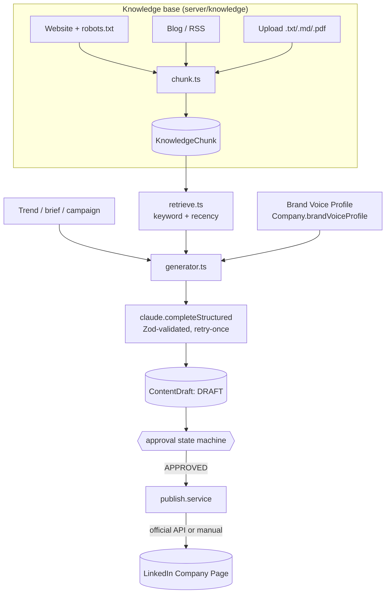
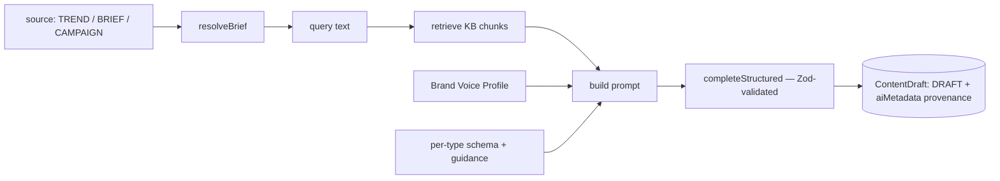
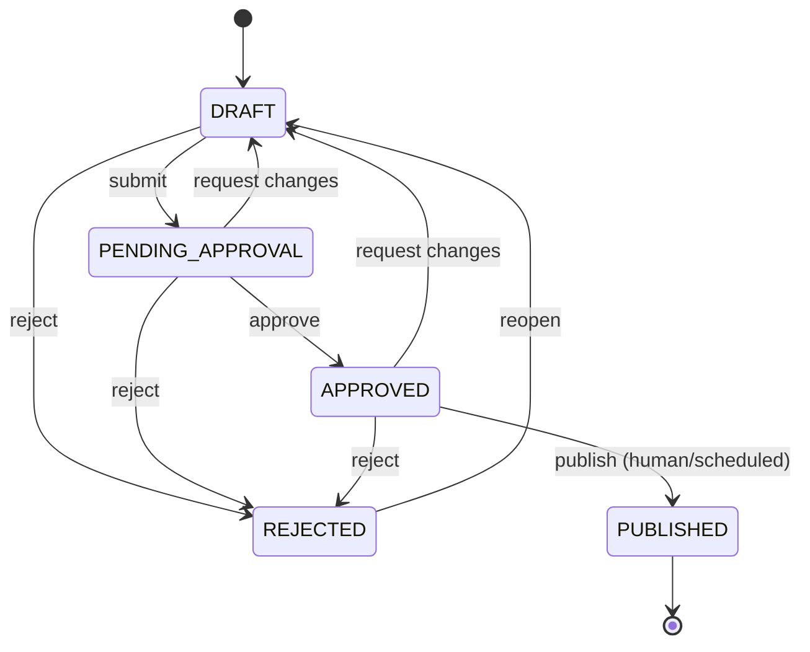
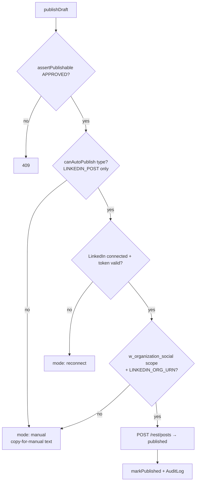

# Botella Aura — Sprint 3 (Content Studio) — Technical Documentation

> Complete technical reference for Sprint 3: the Content Studio — a knowledge
> base the AI grounds its writing in, an AI-analyzed brand voice, a multi-type
> content generator, a human approval loop, and honest official-API publishing.
> Grounded in the actual code.
>
> Builds on Sprint 1 ([`SPRINT-1-TECHNICAL.md`](./SPRINT-1-TECHNICAL.md)) and
> Sprint 2 ([`SPRINT-2-TECHNICAL.md`](./SPRINT-2-TECHNICAL.md)).
> Companion docs: [`README.md`](../README.md), [`BACKLOG.md`](../BACKLOG.md).

---

## 1. What Sprint 3 delivers

The flagship feature — where AI learns a company's voice and writes on-brand
content that a human approves before anything publishes:

1. **Knowledge base ingestion** — website (robots-compliant), blog/RSS, and
   `.txt/.md/.pdf` uploads → chunked, stored, and retrievable.
2. **Brand Voice Profile** — AI-analyzed from the company's own content, human-
   editable, injected into **every** generation.
3. **Content generator** — LinkedIn posts, carousels, X threads, blog drafts, as
   validated structured output.
4. **Approval queue** — the core daily-use screen: draft → pending → approved →
   published/rejected, with edit/refine/regenerate/bulk actions.
5. **Official-API publishing** — LinkedIn Company Page via the official API, with
   an honest "copy for manual posting" fallback; scheduled publish.
6. **Content calendar**.

### The non-negotiable that shapes the whole sprint

**Nothing auto-publishes.** Every path to `PUBLISHED` must pass an explicit human
`Approve` first — and this is enforced **in the service layer**, not just the UI,
so no code path can publish an unapproved draft even by mistake (§7). Publishing
happens only through LinkedIn's **official** Company Page API; where that isn't
available, the app offers copy-for-manual and **never fakes a published state**.

---

## 2. Architecture at a glance

Reuses Sprint 2's Claude wrapper ([`server/ai/claude.ts`](../server/ai/claude.ts))
and adds `completeStructured()` (Zod-validated). New deps: **`unpdf`** (PDF text,
serverless-safe), **`node-html-parser`** (HTML→text), **`robots-parser`**.

---

## 3. Schema additions

Migration `…_sprint3_content_studio` in
[`prisma/migrations/`](../prisma/migrations/). Full model:
[`prisma/schema.prisma`](../prisma/schema.prisma).

| Model / field | Purpose |
|---|---|
| `KnowledgeSource` | Tracks a website/blog source's **sync status** (`PENDING/SYNCING/SYNCED/ERROR`, `lastSyncedAt`, `error`). `@@unique([companyId, type, url])`. |
| `KnowledgeChunk` | A retrievable chunk: `sourceType`, `sourceUrl`, `title`, `content (Text)`, `tokenCount`. Indexed `[companyId, sourceType]`. |
| `Company.brandVoiceProfile Json?` | The AI-analyzed, human-editable voice profile injected into every prompt. |
| `Campaign` (stub) | `name`, `goal`, `status` — content can be tagged to a campaign now; full builder UI is a later sprint. |
| `ContentDraft` (extended) | `+ campaignId`, `scheduledFor`, `publishedAt`, `publishedUrl`, `rejectionReason`. Source kind/ref + brief live in existing `aiMetadata` JSON. Indexed `[companyId, status]`, `[companyId, scheduledFor]`. |
| Enums | `KnowledgeSourceType`, `KnowledgeSourceStatus`, `CampaignStatus` + Content Studio audit actions. |

---

## 4. Knowledge base ingestion

Directory: [`server/knowledge/`](../server/knowledge/).

### 4.1 Extraction — [`extract.ts`](../server/knowledge/extract.ts)

- `htmlToText(html)` — `node-html-parser`; strips `script/style/nav/footer/header/
  svg/form`, prefers `<main>`/`<article>`, collapses whitespace, returns
  `{title, text}`. **Never executes page JS** — reads only served HTML.
- `pdfToText(buffer)` — `unpdf` (`getDocumentProxy` → `extractText({mergePages})`).
  Pure JS, no native deps. (Text-layer only; scanned/OCR PDFs are a backlog item.)
- `stripHtml(blob)` — for RSS `<description>`/`<content>` → plain text.

### 4.2 Chunking — [`chunk.ts`](../server/knowledge/chunk.ts)

Targets **~500–1000 tokens/chunk** (~3200 chars). Splits on **paragraph
boundaries** and accumulates to the target so chunks stay coherent (never cut
mid-sentence); a single huge paragraph is sentence-split. Drops trivially short
fragments (<200 chars). `estimateTokens()` gives a tokenizer-free size for storage.

### 4.3 robots.txt compliance — [`robots.ts`](../server/knowledge/robots.ts)

**NON-NEGOTIABLE #3.** `KB_USER_AGENT = 'BotellaAuraBot/0.1'`. Per origin, fetches
and caches `robots.txt` (`robots-parser`); `isAllowed(url)` honours Disallow rules
for our UA; `politeFetchHtml(url)` skips disallowed URLs and applies a **1.2 s
throttle** between requests. We only read publicly-served pages — no auth bypass.

### 4.4 Ingestion orchestrator — [`ingest.service.ts`](../server/knowledge/ingest.service.ts)

- `ingestWebsite(companyId, website)` — fetches homepage + `/about`, `/about-us`,
  `/company`, `/blog` (robots-gated, throttled), extracts text, **discovers an
  RSS/Atom feed link** in the homepage, and stores chunks. Updates the
  `KnowledgeSource` status.
- `ingestBlog(companyId, feedUrl)` — parses RSS **and** Atom (`fast-xml-parser`),
  takes recent entries (≤12), stores title+content chunks.
- `ingestUpload({filename, mime, data})` — `.pdf` → `pdfToText`, else `TextDecoder`;
  10 MB cap; rejects unreadable files; audited `KNOWLEDGE_DOCUMENT_UPLOADED`.
- **`replaceChunks(...)`** — **idempotent per source**: deletes existing chunks for
  `(company, sourceType, sourceUrl)` and re-inserts inside one transaction, so
  re-syncing never duplicates.
- `resyncCompany(company)` — website + discovered blog end-to-end.
- `getKnowledgeStatus(companyId)` — sources + per-source chunk counts + upload
  summary for the ingestion page (via Prisma `groupBy`).

### 4.5 Retrieval — [`retrieve.ts`](../server/knowledge/retrieve.ts)

`retrieve(companyId, query, {limit})` — a **keyword + recency heuristic**:

- Tokenizes the query (stopwords removed); scores each chunk by
  `termOverlap/queryTerms` × **source weight** (`PAST_POST 1.25 > BLOG 1.15 >
  UPLOAD 1.1 > WEBSITE 1.0`) × a 30-day recency factor.
- **Fallback:** when the KB has content but nothing matches, returns the most
  **recent** chunks — so generation is still grounded in the company's material.
- `chunksToContext(chunks)` renders the compact block injected into prompts.

> **Flagged upgrade (BACKLOG):** semantic/vector retrieval via embeddings — the
> natural home for a small Python ML service (pgvector). The `retrieve()`
> interface stays identical, so callers won't change.

---

## 5. Brand Voice Profile

Schema [`brandVoiceProfileSchema`](../lib/validations/content.ts) →
service [`brand-voice.service.ts`](../server/content/brand-voice.service.ts).

Shape: `toneDescriptors[]`, `sentenceLength`, `vocabulary[]`, `commonPhrases[]`,
`topicsToAvoid[]`, `formatting {emojiUsage, hashtagStyle, notes}`, `summary`.

- `generateBrandVoiceProfile({company, force})` — returns the stored profile
  unless `force`; otherwise **retrieves knowledge chunks** and asks Claude
  (`completeStructured`) to produce the structured profile; **heuristic fallback**
  (from onboarding notes) when Claude isn't configured. Stored on
  `Company.brandVoiceProfile`; audited `BRAND_VOICE_GENERATED`.
- `updateBrandVoiceProfile(...)` — validated human edits (AI-suggested,
  human-confirmed — the same trust pattern as everywhere).
- **`brandVoiceToPrompt(profile)`** — renders the profile into the instruction
  block injected into **every** generation. This is the single biggest quality
  lever in the sprint; a generation without it is treated as a bug (§8).

---

## 6. Content-type schemas

[`lib/validations/content.ts`](../lib/validations/content.ts) — the contracts
Claude output is validated against (**NON-NEGOTIABLE #4**). `bodySchemaFor(type)`
maps a type to its schema.

| Type | `body` shape (Zod) |
|---|---|
| `LINKEDIN_POST` | `{ hook, paragraphs[3..5], hashtags[] }` |
| `CAROUSEL` | `{ title, slides[5..8]{headline, body}, hashtags[] }` |
| `TWEET_THREAD` | `{ tweets: string[2..12] }` (each ≤280 chars; first = hook) |
| `BLOG` | `{ headline, subtitle?, sections[2..10]{heading, body}, tags[] }` |

Plus input schemas: `generateContentSchema`, `refineContentSchema`,
`updateDraftSchema`, `scheduleDraftSchema`.

---

## 7. Schema-validated generation (the AI seam)

`completeStructured<S>()` in [`server/ai/claude.ts`](../server/ai/claude.ts) —
added this sprint on top of Sprint 2's `complete()`:

1. Generate JSON via `complete()`.
2. `parseJson` → `schema.safeParse`.
3. On failure, **retry once** with a clarifying instruction that echoes the
   validation error and the exact required shape.
4. Still invalid → throw `SchemaValidationError`.

This is the mechanism behind "never save malformed content." It's generic over
the Zod schema (`<S extends ZodTypeAny>` → `z.infer<S>`), so it handles defaults
and unions cleanly.

---

## 8. Content generator

[`server/content/generator.ts`](../server/content/generator.ts).

- **`resolveBrief(company, source)`** — TREND: looks the item up in a recent
  `TrendDigest.payload` (the Sprint 2 hand-off); BRIEF: the user's text; CAMPAIGN:
  the campaign name+goal (+ optional brief).
- **Every call** retrieves knowledge, injects the brand voice, injects the brief,
  and prompts with `TYPE_SPECS[type]` (guidance + exact JSON shape). Output is
  `completeStructured`-validated, then saved as a `DRAFT`.
- **`aiMetadata` provenance** — `{source, model, promptVersion, knowledgeChunkIds,
  brandVoiceApplied}` — so every draft records what grounded it.
- **`refineDraft({draft, feedback})`** — regenerate with feedback ("make it
  punchier"), passing the prior body + feedback back in; returns the draft to
  `DRAFT` (must be re-approved). Audited `CONTENT_REGENERATED`.

**Verifiability (checklist item):** two differently-voiced companies produce
noticeably different output because the brand-voice block + retrieved chunks
differ — the generation is grounded, not generic.

---

## 9. Approval state machine (the trust backbone)

[`server/content/content.service.ts`](../server/content/content.service.ts).

- **The invariant:** `PUBLISHED` is reachable **only** from `APPROVED`. This is a
  hard rule in the `TRANSITIONS` table; `isValidTransition(from, to)` is a pure,
  unit-tested function.
- `transition(...)` loads the company-owned draft, validates the transition
  (`InvalidTransitionError` → 409), updates, and **audits every change**
  (`CONTENT_SUBMITTED_FOR_APPROVAL` / `_APPROVED` / `_REJECTED` /
  `_CHANGES_REQUESTED`) — the transparency backbone.
- `bulkTransition(...)` — the queue's multi-select approve/reject.
- `updateDraftBody(...)` — manual edits (validated per type); editing an
  **APPROVED** draft sends it **back to DRAFT** (re-approval required); PUBLISHED
  drafts are immutable.
- `scheduleDraft(...)` — only APPROVED drafts can be scheduled.
- **`assertPublishable(draft)` + `markPublished(...)`** — the hard gate:
  `markPublished` *re-asserts* APPROVED before flipping to PUBLISHED, so even an
  internal/scheduled path can't publish an unapproved draft.

---

## 10. Publishing (honest, official-API-only)

[`server/content/publish.service.ts`](../server/content/publish.service.ts) +
[`render.ts`](../server/content/render.ts).

- **`canAutoPublish(type)`** — only `LINKEDIN_POST` is natively auto-publishable.
- **Scope reality (documented in code):** Company Page auto-publish needs
  LinkedIn's **Community Management API** — product approval + `w_organization_
  social` scope + an org URN (`LINKEDIN_ORG_URN`). Sprint 2 connected via
  self-serve OIDC, which **cannot post**. So today `publishDraft` returns the
  **`manual`** result (copy-for-manual text) for every type — **never a fake
  published state**. The real `/rest/posts` call is fully wired and runs the
  moment scope + org URN exist.
- **`render.ts`** — `renderForManual(draft)` formats each type into copy-paste
  text (post/carousel/thread/blog); `renderLinkedInCommentary(draft)` builds the
  `commentary` for the official API.
- **`runScheduledPublishes(now)`** — the scheduled-publish job: finds due,
  APPROVED, not-yet-published drafts and publishes them; **idempotent** (a
  successful publish flips to PUBLISHED so it's never picked again).

---

## 11. API routes

| Route | Method | Purpose |
|---|---|---|
| [`/api/knowledge/sync`](../app/api/knowledge/sync/route.ts) | POST | Re-ingest active company's website + blog |
| [`/api/knowledge/upload`](../app/api/knowledge/upload/route.ts) | POST | Multipart `.txt/.md/.pdf` upload (Web `FormData`, no dep) |
| [`/api/brand-voice`](../app/api/brand-voice/route.ts) | GET/POST/PUT | Read / (re)generate / edit the voice profile |
| [`/api/content/generate`](../app/api/content/generate/route.ts) | POST | Generate a draft from trend/brief/campaign |
| [`/api/content/drafts/[id]`](../app/api/content/drafts/[id]/route.ts) | GET/PATCH | Read / manual-edit body (validated per type) |
| `…/drafts/[id]/status` | POST | submit / approve / reject / request-changes |
| `…/drafts/[id]/refine` | POST | Regenerate with feedback |
| `…/drafts/[id]/publish` | POST | Publish (RBAC `content:publish`) → `PublishResult` |
| `…/drafts/[id]/schedule` | POST | Schedule an APPROVED draft |
| `…/drafts/bulk` | POST | Bulk approve/reject |
| [`/api/campaigns`](../app/api/campaigns/route.ts) | GET/POST | Minimal campaign CRUD for tagging |
| [`/api/cron/publish`](../app/api/cron/publish/route.ts) | POST | Scheduled-publish job (`Bearer CRON_SECRET`, idempotent) |

Boilerplate is cut by **`requireActiveCompany()`**
([`lib/auth-helpers.ts`](../lib/auth-helpers.ts)) — resolves user + active
company + membership in one call. Publish/schedule are RBAC-gated
(`content:publish`).

---

## 12. Frontend

- **Approval queue** — [`app/dashboard/content/page.tsx`](../app/dashboard/content/page.tsx)
  + [`queue-board.tsx`](../components/dashboard/content/queue-board.tsx): kanban by
  status, multi-select **bulk approve/reject** bar, and the
  [`create-content-dialog`](../components/dashboard/content/create-content-dialog.tsx)
  (pick type + source → generate → open editor).
- **Draft detail/editor** — [`app/dashboard/content/[id]/page.tsx`](../app/dashboard/content/[id]/page.tsx)
  renders [`draft-preview.tsx`](../components/dashboard/content/draft-preview.tsx)
  (LinkedIn-style card / swipeable carousel / numbered thread / blog layout) +
  [`draft-actions.tsx`](../components/dashboard/content/draft-actions.tsx)
  (submit/approve/reject/request-changes, **Refine** with feedback, **Regenerate**,
  edit, **Publish** handling all three result modes, **Schedule**, **Copy for
  manual posting**). A sidebar note states plainly whether the type auto-publishes
  or needs manual paste.
- **Trend hand-off** — [`app/dashboard/content/new/page.tsx`](../app/dashboard/content/new/page.tsx):
  reads `?trendId=` (the Sprint 2 "Generate content from this" button), picks a
  type, generates, opens the editor.
- **Content calendar** — [`app/dashboard/content/calendar/page.tsx`](../app/dashboard/content/calendar/page.tsx):
  server-rendered month grid, color-coded by status, month nav, click-through.
- **Knowledge base & brand voice** — [`app/dashboard/settings/knowledge-base/page.tsx`](../app/dashboard/settings/knowledge-base/page.tsx)
  with [`knowledge-manager.tsx`](../components/dashboard/knowledge/knowledge-manager.tsx)
  (re-sync / upload / source list + status) and
  [`brand-voice-card.tsx`](../components/dashboard/content/brand-voice-card.tsx)
  (view / edit / re-analyze).
- `lib/nav.ts` flips **Content Studio** to `ready`; Settings gains a Knowledge-base
  card. Shared presentation helpers in
  [`lib/content-ui.ts`](../lib/content-ui.ts).

> **Editing UX note:** inline manual editing is a **validated structured-JSON
> textarea** + rich preview; the PATCH route validates it against the per-type
> schema. Rich per-type field editors are a logged polish item — Refine (AI
> feedback) is the primary iteration path.

---

## 13. Testing

[`tests/`](../tests/) — **+20 tests** (61 total after Sprint 3):

- **`content-schemas.test.ts`** — every per-type Zod contract (paragraph counts,
  5–8 slides, 280-char tweets, ≥2 blog sections, `bodySchemaFor` mapping).
- **`approval-state-machine.test.ts`** — the invariant: **PUBLISHED only from
  APPROVED**; PUBLISHED is terminal; reject/reopen/request-changes are valid;
  nonsensical jumps rejected.
- **`retrieve.test.ts`** — keyword ranking, the past-post source boost, and the
  fall-back-to-recent behavior, with the DB mocked.

**Live-verified** during the build: upload → chunk → retrieval scored a match;
website ingestion showed **robots + ~1.2 s throttle** working; audit failure on a
fake userId was **swallowed, not fatal** (the "audit never breaks the action"
guarantee).

---

## 14. Environment variables (Sprint 3)

| Var | Required | Notes |
|---|---|---|
| `ANTHROPIC_API_KEY` | for generation | Content generation returns 503 without it; brand voice falls back to heuristic. |
| `LINKEDIN_ORG_URN` | optional / pending | The organization URN for Company Page auto-publish — inert until Community Management API approval + `w_organization_social`. |

No embeddings key (retrieval is keyword-based). New deps (no keys): `unpdf`,
`node-html-parser`, `robots-parser`.

---

## 15. Design decisions & tradeoffs

1. **Brand-voice-grounded by construction.** Retrieval + voice injection are in
   the generator's single path; a call that skips them is a bug, not a mode.
2. **Structured output with retry-once.** `completeStructured` guarantees valid,
   parseable content or a clear failure — never malformed saved content.
3. **Approval gate in the service layer.** The state machine + `markPublished`
   re-assertion mean no code path (UI, API, or scheduled job) can publish an
   unapproved draft.
4. **Honesty over capability theater.** Publishing claims "published" only on a
   real official-API success; everything else is copy-for-manual with a clear
   reason. LinkedIn Company Page publish is wired but scope-gated and flagged.
5. **Keyword retrieval now, semantic later.** Cheap and deterministic; the
   embeddings/vector upgrade is a documented backlog item behind a stable
   interface.
6. **Idempotent everywhere.** Re-sync replaces chunks per source; scheduled
   publish only touches due/approved/unpublished drafts.
7. **Reuse the Sprint 2 AI seam.** `claude.ts` gained `completeStructured` but
   remains the one place the app talks to the model.

---

## 16. Key files quick reference

| Area | File |
|---|---|
| Extraction / chunk / robots | `server/knowledge/{extract,chunk,robots}.ts` |
| Ingestion orchestrator | `server/knowledge/ingest.service.ts` |
| Retrieval | `server/knowledge/retrieve.ts` |
| Brand voice | `server/content/brand-voice.service.ts` |
| Content schemas | `lib/validations/content.ts` |
| Structured generation helper | `server/ai/claude.ts` (`completeStructured`) |
| Generator | `server/content/generator.ts` |
| Approval state machine | `server/content/content.service.ts` |
| Publishing + render | `server/content/{publish.service,render}.ts` |
| API routes | `app/api/{knowledge,brand-voice,content,campaigns,cron/publish}/…` |
| Queue / editor / preview | `components/dashboard/content/*` |
| Knowledge UI | `components/dashboard/knowledge/knowledge-manager.tsx` |
| Pages | `app/dashboard/content/*`, `app/dashboard/settings/knowledge-base/page.tsx` |
| Presentation helpers | `lib/content-ui.ts` |

---

_Sprint 3 status: complete and verified — typecheck + build clean; 61 tests pass;
the knowledge pipeline (ingest → chunk → retrieve) was verified live with real
website fetching, robots compliance, and throttling._
