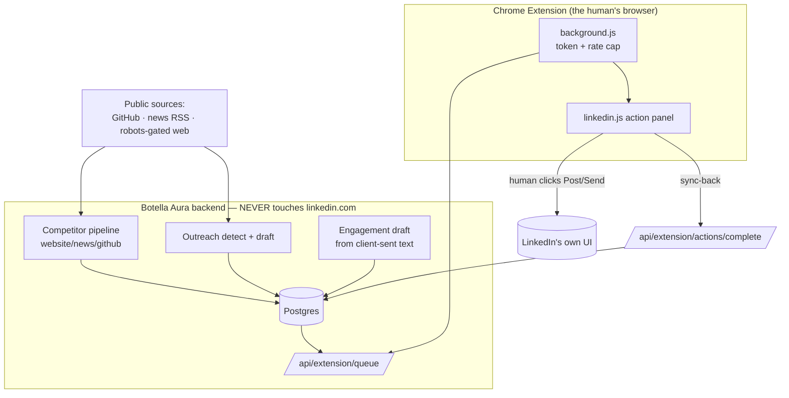
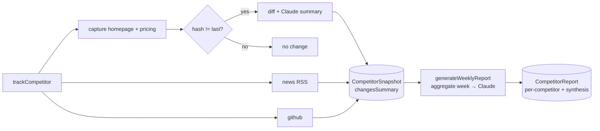
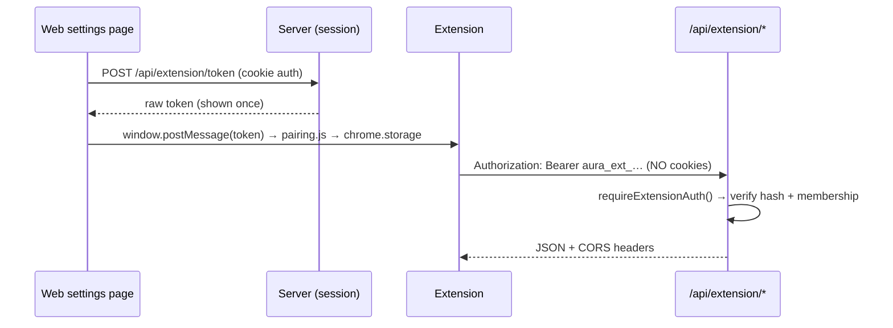
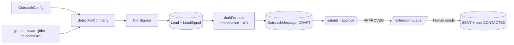
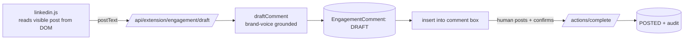

# Botella Aura — Sprint 4 (Competitor Radar · Chrome Extension · Outreach · Engagement) — Technical Documentation

> Complete technical reference for Sprint 4: four modules that complete the
> product's "killer features" — **Competitor Intelligence**, the **Chrome
> Extension** (the human action layer), **Outreach Intelligence**, and the
> **Engagement Copilot**. Grounded in the actual code.
>
> Builds on Sprint 1 ([`SPRINT-1-TECHNICAL.md`](./SPRINT-1-TECHNICAL.md)),
> Sprint 2 ([`SPRINT-2-TECHNICAL.md`](./SPRINT-2-TECHNICAL.md)), and
> Sprint 3 ([`SPRINT-3-TECHNICAL.md`](./SPRINT-3-TECHNICAL.md)).
> Companion docs: [`README.md`](../README.md), [`extension/README.md`](../extension/README.md).

---

## 1. What Sprint 4 delivers

1. **Competitor Intelligence** (`/dashboard/competitors`) — track competitors
   from public signal only (website change detection, news/RSS, GitHub API);
   weekly Claude-written report.
2. **Chrome Extension v1** (`/extension`) — the **action layer**: an approved-item
   queue the user sends themselves, one click at a time, inside their own browser.
3. **Outreach Intelligence** (`/dashboard/outreach`) — detect leads from public
   signal, AI-draft brand-voice-grounded messages, approve, hand off to the
   extension.
4. **Engagement Copilot** (`/dashboard/engagement`) — draft on-brand comments for
   posts **already visible in the user's own browser**, entirely extension-side.

### The non-negotiable that shapes the whole sprint

**Every LinkedIn action that touches another human — a connection request, a
message, a comment, a personal-profile post — is performed by a real logged-in
human clicking a real button in their own browser, via the extension.** The
backend NEVER logs into LinkedIn, NEVER stores LinkedIn session cookies, and
NEVER automates clicks or requests to linkedin.com from the server. Its job is:
gather legitimate public signal → draft excellent content → hand the human a
queue → the human reviews and clicks send, once, per item. This is the product's
trust moat, and it is enforced in the architecture (§2, §5, §7). Where a
capability would require the server to touch LinkedIn, it is **honestly stubbed
and flagged**, never faked (Competitor LinkedIn feed §4.2; Crunchbase §6.2).

---

## 2. Architecture at a glance

The **only** bridge to LinkedIn is a human clicking inside the extension. All
backend↔extension traffic is **bearer-authenticated, cookie-free**, over
`/api/extension/*` (§5.2). Reuses Sprint 2/3's Claude wrapper
([`server/ai/claude.ts`](../server/ai/claude.ts)) and `robots.ts` /
`lib/http.ts`. New dependency: **none** (`robots-parser`, `fast-xml-parser`,
`@anthropic-ai/sdk` already present). Three migrations; +26 tests (87 total).

---

## 3. Schema additions

Migrations `…_sprint4_competitor_intelligence`, `…_sprint4_extension_token`,
`…_sprint4_outreach_engagement` in [`prisma/migrations/`](../prisma/migrations/).
Full model: [`prisma/schema.prisma`](../prisma/schema.prisma).

| Model / field | Purpose |
|---|---|
| `CompetitorProfile` (extended) | `+ pricingUrl, linkedInUrl, githubOrg, trackingEnabled` + `snapshots` relation. |
| `CompetitorSnapshot` | Point-in-time capture: `homepageHash/Text`, `pricingHash/Text`, `changesSummary Json`. Indexed `[competitorId, capturedAt]`. |
| `CompetitorReport` | Weekly digest `payload Json`, `model`, `[companyId, weekStart]` unique (idempotent per ISO week). |
| `ExtensionToken` | Revocable, workspace-scoped bearer token — stores only `tokenHash` (sha256). `lastUsedAt`, `expiresAt`, `revokedAt`. |
| `Lead` / `LeadSignal` | Company-granularity lead + its public signals (`signalType`, `description`, `sourceUrl`). |
| `OutreachMessage` | AI draft with an approval lifecycle (`OutreachStatus`), `type` (`CONNECTION_NOTE`/`FOLLOWUP`), `aiMetadata`. |
| `OutreachConfig` | Per-company targeting (`industries[]`, `roleTitles[]`, `companyStages[]`, `enabledSources Json`). 1:1 with Company. |
| `EngagementTarget` | A public profile/page the user chose to monitor (`@@unique([companyId, profileUrl])`). |
| `EngagementComment` | A drafted comment: `targetPostUrl`, `postExcerpt`, `draftText`, `EngagementStatus`, `postedAt`. |
| Enums | `LeadStatus`, `SignalType`, `OutreachType`, `OutreachStatus`, `EngagementStatus` + 20 new audit actions. |

---

## 4. Module 1 — Competitor Intelligence

Directory: [`server/competitors/`](../server/competitors/). Fully server-side;
touches no LinkedIn.

### 4.1 Sources (public only)

- **Website** — [`sources/website.ts`](../server/competitors/sources/website.ts):
  reuses Sprint 3's [`politeFetchHtml`](../server/knowledge/robots.ts) (robots.txt
  compliance + 1.2 s throttle) and `htmlToText`, bounded to 20 k chars. No
  headless browser, no auth bypass.
- **News** — [`sources/news.ts`](../server/competitors/sources/news.ts): keyless
  Google News search RSS filtered by competitor name; 10-day freshness.
- **GitHub** — [`sources/github.ts`](../server/competitors/sources/github.ts):
  official REST API (repos + latest release) as a product-movement proxy; keyless
  (60/hr) or `GITHUB_TOKEN` for 5000/hr.
- **LinkedIn company feed** — [`sources/linkedin.ts`](../server/competitors/sources/linkedin.ts):
  **flagged stub**. No official scope exists for arbitrary company-page feeds, so
  it reports itself as "pending API access" and contributes nothing — surfaced in
  the snapshot's `skipped[]`. **No scraping.**

### 4.2 Change detection — [`diff.ts`](../server/competitors/diff.ts)

Pure, fixture-tested core: `normalizeText` (collapses cosmetic whitespace),
`hashText` (sha256 of normalized text — fast "did anything change?"), and
`diffTexts(prev, next)` (bounded line-level added/removed). Only when a **textual
change is detected** do we spend a Claude call (`summarizeChange`) to describe it
in one or two plain-English sentences; **deterministic fallback** (`deterministic
Summary`) when no key / on error. First capture never counts as a "change."

### 4.3 Tracking + report

- [`tracking.service.ts`](../server/competitors/tracking.service.ts):
  `trackCompetitor` writes one `CompetitorSnapshot` (hashes + `changesSummary`);
  `trackCompany` iterates tracking-enabled competitors, resilient (`allSettled`-
  style, one failure logged not fatal). Audited `COMPETITOR_SNAPSHOT_CAPTURED`.
- [`report.service.ts`](../server/competitors/report.service.ts):
  `generateWeeklyReport` collects the week's snapshots, asks Claude for a
  structured `{competitors[]{newLaunches, pricingChanges, notableActivity,
  strategicTakeaway}, synthesis}`, and **upserts** on `(companyId, weekStart)` —
  **idempotent per ISO week** (`startOfIsoWeekUTC`, unit-tested). Deterministic
  assembly when Claude is absent. AI entries are matched back to competitor ids
  **by name** (robust to reordering).

### 4.4 CRUD + routes

[`competitor.service.ts`](../server/competitors/competitor.service.ts) (add/edit/
remove, all audited). Routes under [`/api/competitors`](../app/api/competitors/):
`GET/POST`, `PATCH/DELETE [id]`, `POST [id]/track` (run one now), `POST reports`
("Generate now" for demos), and [`/api/cron/competitors`](../app/api/cron/competitors/route.ts)
(weekly, `Bearer CRON_SECRET`). Mutations gated `company:update`.

---

## 5. Module 2 — Chrome Extension v1 (the action layer)

The architectural centerpiece — Modules 3 & 4 depend on it. Backend:
[`server/extension/`](../server/extension/) + [`lib/extension-auth.ts`](../lib/extension-auth.ts).
Client: [`extension/`](../extension/) (MV3, vanilla JS, no bundler).

### 5.1 Token model — [`token.service.ts`](../server/extension/token.service.ts)

Mirrors the Sprint 1 password-reset pattern: `issueExtensionToken` returns a raw
`aura_ext_…` token **once**; only `sha256(raw)` is persisted. Tokens are
**revocable** (`revokedAt`), **time-boxed** (180-day `expiresAt`), and scoped to
one `(userId, companyId)`. `verifyExtensionToken` looks up by hash, rejects
revoked/expired/wrong-prefix, and bumps `lastUsedAt` best-effort. A compromised
extension token grants **only** `/api/extension/*`, never the web session.

### 5.2 Cross-origin auth — [`lib/extension-auth.ts`](../lib/extension-auth.ts)

Because auth is **bearer-only (no cookies)**, CORS safely allows extension
origins: `requireExtensionAuth(req)` validates the bearer + re-checks company
membership; `handleOptions`/`corsHeaders` allow any `chrome-extension://` origin
by default (unpacked dev gets a random id), pinnable in prod via
`EXTENSION_ALLOWED_ORIGIN`. `/api/*` is **not** in the middleware matcher — these
routes self-guard.

### 5.3 Queue + sync-back

- [`queue.service.ts`](../server/extension/queue.service.ts): `getQueue(companyId)`
  returns a uniform `QueueItem[]` (`itemType` ∈ `content_draft` |
  `outreach_message` | `engagement_comment`, plus the exact injectable `text` and
  a `target`). Module 2 populates it from **APPROVED** `ContentDraft`s via
  [`renderForManual`](../server/content/render.ts) (Sprint 3's manual-post
  renderer); Module 3 appends approved `OutreachMessage`s.
- [`action.service.ts`](../server/extension/action.service.ts): `completeAction`
  is the sync-back — after the human clicks send, it marks the item
  `PUBLISHED`/`SENT`/`POSTED`, writes the same audit a server-side publish would
  (`CONTENT_PUBLISHED`, `OUTREACH_SENT`, `ENGAGEMENT_COMMENT_POSTED`) **plus**
  `EXTENSION_ACTION_COMPLETED`. Idempotent; the backend performs no LinkedIn
  action — it only records that the human did.

### 5.4 Rate limiting (hard requirement)

Client caps in [`background.js`](../extension/background.js) (**8/hr, 25/day**,
tracked in `chrome.storage.local`) block a would-be bot before any API call;
`lib/extension-constants.ts` mirrors the daily cap **server-side** as
defense-in-depth (429 in [`actions/complete`](../app/api/extension/actions/complete/route.ts)).
The panel shows a "Healthy usage" indicator.

### 5.5 Extension files

| File | Role |
|---|---|
| [`manifest.json`](../extension/manifest.json) | MV3; `storage`; host perms for localhost + `*.linkedin.com`; content scripts. |
| [`background.js`](../extension/background.js) | Service worker — token, single API choke-point, rate cap, message hub. |
| [`popup.{html,js,css}`](../extension/popup.js) | Pair (paste token), status + usage, disconnect. |
| [`content/pairing.js`](../extension/content/pairing.js) | On the Aura origin — receives the token via `window.postMessage`, pins API base. |
| [`content/linkedin.js`](../extension/content/linkedin.js) | The action panel — insert into composer, engage flow, sync-back. |

**Injection model (safety):** "Insert" places approved text into LinkedIn's own
Quill composer (`div.ql-editor`); the **human clicks LinkedIn's native Post
button**, then confirms "Mark as posted." The extension never auto-clicks submit,
never loops, never runs on a timer. Selectors are best-effort with clipboard
fallbacks.

---

## 6. Module 3 — Outreach Intelligence

Directory: [`server/outreach/`](../server/outreach/). Reuses Sprint 3's brand
voice + knowledge retrieval; reuses the Sprint 3 approval-queue UI vocabulary.

### 6.1 Matching — [`matching.ts`](../server/outreach/matching.ts) (pure, tested)

`signalMatches(signal, criteria)` — a raw signal qualifies if any targeting term
appears in its company name/description (case-insensitive); **with no criteria
set, everything matches** so a new workspace still sees signal. `dedupeSignals`
keys on `signalType::companyName`. `filterSignals` = match + annotate + dedupe.

### 6.2 Sources — [`sources/`](../server/outreach/sources/)

- **GitHub search** ([`github.ts`](../server/outreach/sources/github.ts)) — orgs
  with recent public repos matching keywords → `GITHUB_ACTIVITY`.
- **News** ([`news.ts`](../server/outreach/sources/news.ts)) — funding/launch/
  leadership via Google News RSS; `companyFromHeadline` best-effort entity
  extraction (the user confirms).
- **Jobs** ([`jobs.ts`](../server/outreach/sources/jobs.ts)) — hiring via public
  news/RSS for "&lt;role&gt; hiring", **never** LinkedIn's jobs pages.
- **Crunchbase** ([`crunchbase.ts`](../server/outreach/sources/crunchbase.ts)) —
  funding, **stubbed behind `CRUNCHBASE_API_KEY`**; when absent, reported in
  `skipped[]` and contributes nothing (honest, like the LinkedIn stub). The
  official v4 request is wired for when a key exists.

### 6.3 Detect → draft → approve → hand off

- [`detect.service.ts`](../server/outreach/detect.service.ts) — runs enabled
  sources against the config, filters, **upserts a `Lead` per company** and
  attaches a `LeadSignal` (company-granularity; the person is confirmed by the
  user, never scraped). Audited `LEAD_CREATED` / `LEAD_SIGNAL_DETECTED`.
- [`drafting.service.ts`](../server/outreach/drafting.service.ts) — for a lead +
  its latest signal, reuses [`generateBrandVoiceProfile`](../server/content/brand-voice.service.ts)
  + [`retrieve`](../server/knowledge/retrieve.ts) and asks Claude
  (`completeStructured`) for `{connectionNote, followup}`; the note is truncated
  to LinkedIn's **300-char** limit. Deterministic template when Claude is absent.
- [`outreach.service.ts`](../server/outreach/outreach.service.ts) — the approval
  state machine (`submit → PENDING_APPROVAL`, `approve → APPROVED`, `reject`,
  `request_changes → DRAFT`), mirroring Sprint 3; editing returns a message to
  DRAFT (re-approval required). Approved messages surface in the extension queue
  (§5.3) and only a human click there sets `SENT`.

Routes under [`/api/outreach`](../app/api/outreach/) (`config`, `detect`,
`leads[/id][/draft]`, `messages/[id][/status]`) + daily
[`/api/cron/outreach`](../app/api/cron/outreach/route.ts).

---

## 7. Module 4 — Engagement Copilot

Directory: [`server/engagement/`](../server/engagement/).

### The critical constraint

**No server-side LinkedIn fetch exists in this module.** LinkedIn's API doesn't
expose arbitrary third-party post feeds, and scraping is forbidden — so
monitoring happens **in the extension**, on posts already rendered in the user's
own browser DOM.

- [`content/linkedin.js`](../extension/content/linkedin.js) `readVisiblePost()`
  picks the post nearest the viewport center and reads **only** its already-
  rendered text/author; "Draft a comment for this post" sends that text to the
  backend.
- [`comment.service.ts`](../server/engagement/comment.service.ts) `draftComment`
  turns the **client-supplied** text into an on-brand comment (brand voice;
  deterministic fallback), storing `postExcerpt` + `draftText` as a
  `DRAFT`. Audited `ENGAGEMENT_COMMENT_DRAFTED`.
- The human edits, inserts into LinkedIn's comment box, posts, and marks it —
  `completeAction('engagement_comment')` → `POSTED` (§5.3).
- [`target.service.ts`](../server/engagement/target.service.ts) — the user's
  chosen monitored profiles/pages. The web app is the **read-only system of
  record**: [`/dashboard/engagement`](../app/dashboard/engagement/page.tsx).

Endpoint: [`/api/extension/engagement/draft`](../app/api/extension/engagement/draft/route.ts)
(bearer). Targets: [`/api/engagement/targets`](../app/api/engagement/targets/).

---

## 8. API routes (new this sprint)

| Route | Method | Auth | Purpose |
|---|---|---|---|
| `/api/competitors` `[id]` `[id]/track` `reports` | GET/POST/PATCH/DELETE | session + `company:update` | Competitor CRUD, track-now, generate report |
| `/api/cron/competitors` · `/api/cron/outreach` | POST | `Bearer CRON_SECRET` | Scheduled tracking / detection |
| `/api/extension/token` `[id]/revoke` | GET/POST | **session** | Issue / list / revoke extension tokens |
| `/api/extension/status` · `queue` | GET (+OPTIONS) | **bearer** | Connection/usage · pending items |
| `/api/extension/actions/complete` | POST (+OPTIONS) | **bearer** | Sync-back (marks published/sent/posted) |
| `/api/extension/engagement/draft` | POST (+OPTIONS) | **bearer** | Draft a comment from client-sent post text |
| `/api/outreach/{config,detect,leads,messages}…` | GET/POST/PUT/PATCH/DELETE | session | Targeting, detection, lead/message lifecycle |
| `/api/engagement/targets` `[id]` | GET/POST/DELETE | session + `company:update` | Monitored-profile CRUD |

Session routes reuse `requireActiveCompany()` + `lib/api.ts`
(`jsonOk`/`handleRouteError`). Bearer routes use `requireExtensionAuth()` +
`extJson`/`handleExtensionError` (CORS-tagged) + an `OPTIONS` preflight handler.

---

## 9. Frontend

- **Competitors** — [`competitor-manager.tsx`](../components/dashboard/competitors/competitor-manager.tsx)
  (add/edit/remove, "Track now", latest-snapshot summary) +
  [`report-view.tsx`](../components/dashboard/competitors/report-view.tsx) /
  [`reports`](../app/dashboard/competitors/reports/page.tsx) (weekly digest with
  week switcher + "Generate now").
- **Extension pairing** — [`extension-manager.tsx`](../components/dashboard/extension/extension-manager.tsx)
  at [`/dashboard/settings/extension`](../app/dashboard/settings/extension/page.tsx):
  one-time token + "Send to extension" (`postMessage`), paired-device list +
  disconnect, install steps.
- **Outreach** — [`outreach-board.tsx`](../components/dashboard/outreach/outreach-board.tsx)
  reuses the Sprint 3 status-badge / approve-reject-edit vocabulary
  ([`lib/outreach-ui.ts`](../lib/outreach-ui.ts)); detect + manual-add; targeting
  at [`/dashboard/settings/outreach`](../app/dashboard/settings/outreach/page.tsx).
- **Engagement** — read-only history + [`target-manager.tsx`](../components/dashboard/engagement/target-manager.tsx)
  at [`/dashboard/settings/engagement`](../app/dashboard/settings/engagement/page.tsx).
- [`lib/nav.ts`](../lib/nav.ts) flips **Competitors, Outreach, Engagement** to
  `ready`; the Settings hub gains three sub-cards.

---

## 10. Testing

[`tests/`](../tests/) — **+26 tests (87 total)**:

- **`competitor-diff.test.ts`** (12) — `normalizeText`/`hashText` (cosmetic
  whitespace ≈ identical), `diffTexts` (first-capture = no change, added/removed
  detection, bounded sample), `deterministicSummary`, and `startOfIsoWeekUTC`
  (Monday-of-week, Sunday edge).
- **`extension-token.test.ts`** (6) — the security invariants with Prisma mocked:
  **raw token never stored** (only its sha256), issue→verify round-trip, and
  reject unknown / wrong-prefix / revoked / expired.
- **`outreach-matching.test.ts`** (8) — `criteriaTerms`, `signalMatches`
  (case-insensitive, empty-criteria-matches-all), `dedupeSignals`, `filterSignals`,
  and the config/lead Zod schemas (list dedupe, URL normalization).

**Live-verified** during the build (against real sources + a live server):
Competitor tracking pulled **real GitHub data** (repos + latest release), the
LinkedIn source was correctly **skipped**; the extension flow was verified over
HTTP — **CORS preflight**, bearer status/queue, **401 without auth**, sync-back →
draft `PUBLISHED` + audit; Outreach detection surfaced **real GitHub leads** →
draft (166 &lt; 300 chars) → approve → **appeared in the extension queue**;
Engagement draft (client-supplied post text) → sync-back → `POSTED` + audits.

---

## 11. Environment variables (Sprint 4 — all optional)

| Var | Notes |
|---|---|
| `GITHUB_TOKEN` | Raises GitHub rate limit 60/hr → 5000/hr (competitor + outreach sources). Works without it. |
| `CRUNCHBASE_API_KEY` | Enables the Crunchbase funding source; skipped + flagged when absent. |
| `EXTENSION_ALLOWED_ORIGIN` | Pin a **published** extension's origin in prod. Dev allows any `chrome-extension://`. |
| `CRON_SECRET` (existing) | Also protects `/api/cron/competitors` and `/api/cron/outreach`. |
| `ANTHROPIC_API_KEY` (existing) | Powers change summaries, reports, outreach + comment drafts; deterministic fallback otherwise. |

GitHub (keyless), Google News / job RSS, and robots-gated website fetches need
**no credentials**. No new npm dependencies.

---

## 12. Design decisions & tradeoffs

1. **The extension is the LinkedIn boundary.** The server never touches
   linkedin.com; the only bridge is a human click. Modules 3/4 hand the human
   ready text and record what they did — they don't act.
2. **Bearer, not cookies, for the extension.** A separate, hash-only, revocable,
   workspace-scoped token means a compromised extension can't escalate to the web
   session; it also makes cross-origin CORS safe (no credentials ride along).
3. **Client-side rate cap is a hard requirement**, mirrored server-side. Safety
   isn't advisory — it's enforced before and after the API call.
4. **Honesty over capability theater.** LinkedIn company-feed reading (M1) and
   Crunchbase (M3) are stubbed and flagged, never faked — same principle as
   Sprint 3's publishing.
5. **DOM-read, not server-fetch, for engagement.** M4 reads only what LinkedIn
   already served the human's own screen; there is no server-side LinkedIn read
   anywhere in the module.
6. **Reuse over rebuild.** Claude wrapper, robots/http clients, brand voice +
   retrieval, the approval-queue UI vocabulary, and the audit service are all
   reused — each module is a thin, consistent layer.
7. **Idempotent + resilient.** Weekly reports upsert per ISO week; snapshots/leads
   dedupe; sync-back is idempotent; per-item failures are logged, never fatal.

---

## 13. Key files quick reference

| Area | File |
|---|---|
| Competitor sources | `server/competitors/sources/{website,news,github,linkedin}.ts` |
| Competitor diff / tracking / report | `server/competitors/{diff,tracking.service,report.service}.ts` |
| Extension token / auth / CORS | `server/extension/token.service.ts`, `lib/extension-auth.ts` |
| Extension queue / sync-back | `server/extension/{queue,action}.service.ts` |
| The extension itself | `extension/{manifest.json,background.js,popup.*,content/*}` |
| Outreach matching / sources | `server/outreach/matching.ts`, `server/outreach/sources/*` |
| Outreach detect / draft / state | `server/outreach/{detect,drafting,outreach}.service.ts` |
| Engagement | `server/engagement/{target,comment}.service.ts` |
| API routes | `app/api/{competitors,extension,outreach,engagement,cron}/…` |
| Frontend | `components/dashboard/{competitors,extension,outreach,engagement}/*` |
| UI helpers | `lib/{outreach-ui,extension-constants}.ts` |

---

_Sprint 4 status: complete and verified — typecheck + build clean (52 routes);
87 tests pass; all four modules verified live against real public sources and a
running server, including the extension's bearer/CORS/rate-limit/sync-back path.
The safety architecture — one human, one click, one action, backend never touches
LinkedIn — holds end to end._
