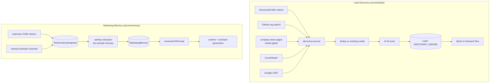

# Botella Aura — Sprint 5 (Lead Discovery Engine + Marketing Memory / Learning Loop) — Technical Documentation

> Complete technical reference for Sprint 5: two modules that make the product
> compound in value — **Lead Discovery** (proactive, criteria-based prospecting)
> and **Marketing Memory** (a learning loop that remembers what works and feeds
> it back into every future generation). Grounded in the actual code.
>
> Builds on Sprints 1–4 ([`SPRINT-1`](./SPRINT-1-TECHNICAL.md) …
> [`SPRINT-4`](./SPRINT-4-TECHNICAL.md)).
> Companion docs: [`README.md`](../README.md), [`extension/README.md`](../extension/README.md).

---

## 1. What Sprint 5 delivers

1. **Lead Discovery Engine** (`/dashboard/leads`, `/dashboard/leads/discover`) —
   the user defines *who* to reach; the AI actively searches legitimate public
   sources to build a deduped, AI-scored lead list, rather than waiting for a
   signal (Sprint 4) to fire.
2. **Marketing Memory / Learning Loop** (`/dashboard/memory`) — the system
   captures real performance data, extracts data-grounded insights weekly, and
   **injects them into the Sprint 3 content generator and Sprint 4 outreach
   generator** — so drafts get smarter every week. The retention moat.

### The non-negotiable that shapes the whole sprint

**Never fabricate.** No discovery result, performance metric, or memory insight
is ever invented. Where a source is unavailable it is honestly skipped/flagged
(Crunchbase, Google CSE — §4.2; LinkedIn analytics — §6.1); below a real data
threshold the memory module says **"not enough data yet"** instead of guessing
(§6.3). Every insight is traceable to the data that supports it (§6.3). And the
Sprint 1–4 rule still holds: **no server-side LinkedIn scraping** — discovery
never touches LinkedIn, and Marketing Memory reads post metrics only from the
extension's DOM view of the user's *own* screen (§6.2).

---

## 2. Architecture at a glance



`*` = stubbed behind an env key, gracefully skipped when absent. Reuses the
Sprint 2–4 primitives throughout: `server/ai/claude.ts` (`completeStructured`),
`server/knowledge/robots.ts` + `extract.ts`, `lib/http.ts`, brand voice +
retrieval, and the audit service. **No new npm dependency** (charts are inline
SVG). Two migrations; +23 tests (110 total).

---

## 3. Schema additions

Migrations `…_sprint5_lead_discovery` and `…_sprint5_marketing_memory`. Full
model: [`prisma/schema.prisma`](../prisma/schema.prisma).

| Model / field | Purpose |
|---|---|
| `DiscoveryProfile` | Saved search criteria (`criteria Json`), `isActive`, `autoRun` (weekly). |
| `DiscoveryRun` | Run history: `status`, `leadsFound/Created`, `summary Json` (per-source + skipped). |
| `Lead` (extended) | `+ source LeadSource (SIGNAL\|DISCOVERY_ENGINE\|MANUAL)`, `discoveryProfileId`, `fitScore`, `fitRationale`. Existing leads default to `SIGNAL`. |
| `PerformanceSnapshot` | Real metrics for a published item: `source PerformanceSource`, `metrics Json`; nullable FKs to `ContentDraft`/`OutreachMessage`/`EngagementComment`. |
| `OutreachMessage` (extended) | `+ connectionAccepted, replyReceived` — the manual "did it work" signal. |
| `MarketingMemory` | A learned insight: `insightType`, `insight`, `confidence`, `sampleSize`, `supportingDataSummary Json`, `isActive`. |
| Enums | `LeadSource`, `DiscoveryRunStatus`, `InsightType`, `MemoryConfidence`, `PerformanceSource` + 10 audit actions. |

---

## 4. Module 1 — Lead Discovery Engine

Directory: [`server/leads/`](../server/leads/).

### 4.1 Sources — [`discovery/sources/`](../server/leads/discovery/sources/)

- **GitHub** ([`github.ts`](../server/leads/discovery/sources/github.ts)) — official
  Search API for **organizations** matching the criteria keywords; reads each
  org's public website so the company-site source can find people. Keyless.
- **Company site** ([`company-site.ts`](../server/leads/discovery/sources/company-site.ts))
  — robots-gated fetch of `/team`, `/about`, `/leadership`… (reuses
  `politeFetchHtml` + `htmlToText`); Claude extracts **named** founders/execs.
  Never behind login, never LinkedIn. Returns nothing (not fabricated names) if
  Claude isn't configured.
- **Crunchbase** ([`crunchbase.ts`](../server/leads/discovery/sources/crunchbase.ts))
  — official v4 org search, **stubbed behind `CRUNCHBASE_API_KEY`**.
- **Google CSE** ([`google-cse.ts`](../server/leads/discovery/sources/google-cse.ts))
  — the **official** Custom Search JSON API (not scraping Google), **stubbed
  behind `GOOGLE_CSE_API_KEY` + `GOOGLE_CSE_CX`**.

### 4.2 Dedup / merge — [`discovery/dedup.ts`](../server/leads/discovery/dedup.ts) (pure, tested)

`normalize` (strips legal suffixes/punctuation) → `jaccard` token overlap →
`sameCompany` (≥0.6) + `namesMatch` (exact / subset-for-middle-initials / ≥0.7).
`isSameLead` treats two company-level leads at the same company as one, a named
person and a company-level lead as **distinct**, and different people as
distinct. `dedupeWithin` collapses a batch; `findExistingMatch` prevents a
discovered lead from duplicating an existing Sprint 4 lead (**NON-NEGOTIABLE #4**).

### 4.3 Fit scoring — [`discovery/scoring.ts`](../server/leads/discovery/scoring.ts)

`scoreLead` → Claude `completeStructured(fitScoreSchema)` producing a 0–100
`fitScore` + one-line `fitRationale`, grounded in the criteria **and** the acting
company's ICP. `deterministicScore` (term-overlap) is the fallback — never a
confident number with no basis.

### 4.4 Orchestrator — [`discovery/discovery.service.ts`](../server/leads/discovery/discovery.service.ts)

`runDiscovery(profileId)`: gather companies (GitHub + Crunchbase) → people
(company sites) + CSE leads → **`dedupeWithin` then `findExistingMatch`** vs
existing leads → create only new `DISCOVERY_ENGINE` leads → AI-score each →
record a `DiscoveryRun` (`summary` = per-source counts + `skipped[]`) and stamp
`profile.lastRunAt`. Re-running merges into existing leads — **idempotent-
friendly**. "Draft outreach" from the unified table calls the existing Sprint 4
`/api/outreach/leads/[id]/draft` — **no duplicate pipeline** (#5).

### 4.5 Routes + UI

Routes under [`/api/leads/discovery/profiles`](../app/api/leads/discovery/profiles/)
(`GET/POST`, `[id]` `PATCH/DELETE`, `[id]/run` `POST`) + weekly
[`/api/cron/discovery`](../app/api/cron/discovery/route.ts). UI:
[`/dashboard/leads/discover`](../app/dashboard/leads/discover/page.tsx) (criteria
builder + profiles + run history),
[`/dashboard/leads`](../app/dashboard/leads/page.tsx) (unified, filterable table
of signal + discovery leads), and `[id]` detail with fit rationale + signals +
outreach history.

---

## 5. Marketing Memory data model & collection

Directory: [`server/memory/`](../server/memory/).

### 5.1 Metrics — [`metrics.ts`](../server/memory/metrics.ts) (pure, tested)

`engagementScore` = `likes + comments·3 + reposts·4 + clicks·2` (a single
ranking scalar). `confidenceFromSample` → `LOW/MEDIUM/HIGH` at 15/30 thresholds.
`hasEnoughData` gates extraction at `MIN_SAMPLE_FOR_INSIGHTS = 10`.

### 5.2 Collection — [`performance.service.ts`](../server/memory/performance.service.ts)

- `recordContentMetrics(...)` — matches a published `ContentDraft` by
  `publishedUrl` and stores a `PerformanceSnapshot`. Called by the extension.
- `setOutreachOutcome(...)` — the manual connection-accepted / reply-received
  toggle (audited `OUTREACH_OUTCOME_UPDATED`).
- `getContentPerformance` / `bestWorst` / `engagementTrend` — the dashboard +
  extraction data source (latest snapshot per post, engagement-scored, with an
  approx `wordCount` for length analysis).

> **Extension DOM metrics (constraint):** the metric numbers come from the
> extension reading the like/comment counts already rendered on the user's OWN
> post page ([`content/linkedin.js`](../extension/content/linkedin.js)
> `readPostMetrics` → `AURA_SYNC_METRICS` → [`/api/extension/metrics`](../app/api/extension/metrics/route.ts)).
> **No server-side LinkedIn fetch.** LinkedIn API analytics are unavailable at
> our OIDC scope — shown honestly as "unavailable", never faked.

---

## 6. Marketing Memory — the learning loop

### 6.1 Sources of truth (honest)

- **LinkedIn API analytics** — unavailable at current scope → **not collected**;
  the UI shows unavailable rather than a fabricated number.
- **Extension DOM metrics** — real, for personal-profile posts (§5.2).
- **Manual outreach outcomes** — the human toggle.

### 6.2 Extraction — [`extraction.service.ts`](../server/memory/extraction.service.ts)

```mermaid
flowchart TD
  A[generateMemories] --> B{sample >= 10?}
  B -->|no| C[store honest<br/>"not enough data" note]
  B -->|yes| D[analyze real data]
  D --> E{Claude configured?}
  E -->|yes| F[completeStructured<br/>data-grounded insights]
  E -->|no| G[analyzeDeterministic<br/>type/length/timing diffs]
  F & G --> H[(MarketingMemory<br/>confidence from sample size<br/>+ supportingDataSummary)]
```

- **Low-sample honesty** — below 10 measured posts, it deactivates prior memories
  and stores a single honest note (`supportingDataSummary.status = 'insufficient'`).
  No fabricated insight (**NON-NEGOTIABLE #2**).
- **`analyzeDeterministic`** (pure, tested) — emits an insight ONLY on a clear
  data difference: format (best vs worst type avg engagement, >25% gap), length
  (short <150 words vs long, >20% gap), timing (best weekday). Never a generic
  guess.
- Every insight records `confidence` (sample-derived), `sampleSize`, and
  `supportingDataSummary.basis` — **traceable** (#3).

### 6.3 Injection — [`memory.service.ts`](../server/memory/memory.service.ts)

`memoriesToPrompt(getActiveMemories(companyId), {types})` renders active insights
into an instruction block and is added to the system prompt in **both**
generators:
[`server/content/generator.ts`](../server/content/generator.ts) (format/length/
timing/topic/hashtag) and
[`server/outreach/drafting.service.ts`](../server/outreach/drafting.service.ts)
(outreach-approach/timing). It returns `''` when there are no real insights, so
**fresh accounts generate exactly as before** — the "gets smarter" effect only
turns on once real data exists (**#5**, hook into existing generators, no
parallel path). The honest "insufficient" note is excluded from injection.

### 6.4 Dashboard — [`/dashboard/memory`](../app/dashboard/memory/page.tsx)

Insight cards grouped by category (each showing the insight, confidence, and the
data behind it), an **inline-SVG** engagement trend
([`trend-chart.tsx`](../components/dashboard/memory/trend-chart.tsx) — no charting
dependency), and best/worst posts by engagement. An "Analyze now" button runs
extraction on demand; a weekly [`/api/cron/memory`](../app/api/cron/memory/route.ts)
does it automatically.

---

## 7. API routes (new this sprint)

| Route | Method | Auth | Purpose |
|---|---|---|---|
| `/api/leads/discovery/profiles` `[id]` `[id]/run` | GET/POST/PATCH/DELETE | session + `content:approve` | Discovery profiles + run-now |
| `/api/cron/discovery` · `/api/cron/memory` | POST | `Bearer CRON_SECRET` | Weekly discovery / memory extraction |
| `/api/extension/metrics` | POST (+OPTIONS) | **bearer** | Extension DOM metrics sync-back |
| `/api/outreach/messages/[id]/outcome` | POST | session | Manual outreach outcome toggle |
| `/api/memory/generate` | POST | session + `content:approve` | Run pattern extraction now |

"Draft outreach" on a discovered lead reuses the existing
`/api/outreach/leads/[id]/draft`.

---

## 8. Testing

[`tests/`](../tests/) — **+23 tests (110 total)**:

- **`lead-dedup.test.ts`** (13) — normalize/jaccard, `sameCompany`/`namesMatch`
  (incl. middle initials), the full `isSameLead` matrix (company-level vs person,
  same/different person), batch + existing-lead merge, and the fit-score schema +
  deterministic scoring.
- **`marketing-memory.test.ts`** (10) — engagement weighting, confidence tiers,
  the sufficiency gate; `memoriesToPrompt` (empty when none, **skips the
  insufficient note**, formats + filters by type); and `analyzeDeterministic`
  (**surfaces an insight on a clear diff, emits NONE on flat data** — never guesses).

**Live-verified** end-to-end: real GitHub discovery → 8 leads scored, **re-run
created 0 (dedup holds)**, Crunchbase/CSE skipped; Marketing Memory → 0 posts
yields the honest "not enough data" note, 12 posts yields a data-grounded
`CONTENT_FORMAT` insight (110 vs 11) whose block `memoriesToPrompt` feeds the
generators; metrics matched a published draft by URL.

---

## 9. Environment variables (Sprint 5 — all optional)

| Var | Notes |
|---|---|
| `GOOGLE_CSE_API_KEY` + `GOOGLE_CSE_CX` | Official Custom Search JSON API for discovery web lookups. Skipped + flagged when unset. |
| `GITHUB_TOKEN` (existing) | Higher GitHub rate limit for discovery. Sources run keyless without it. |
| `CRUNCHBASE_API_KEY` (existing) | Crunchbase discovery; skipped when absent. |
| `CRON_SECRET` (existing) | Also protects `/api/cron/discovery` + `/api/cron/memory`. |
| `ANTHROPIC_API_KEY` (existing) | Fit scoring, people extraction, insight extraction; deterministic fallback otherwise. |

No LinkedIn analytics scope is assumed (it isn't granted) — metrics come from the
extension DOM read. No new npm dependency (charts are inline SVG).

---

## 10. Design decisions & tradeoffs

1. **Honesty is the feature.** This is the module a technical buyer scrutinizes,
   so every path fails to an honest empty/"unavailable"/"not enough data" state,
   never a fabricated number or insight.
2. **Dedup at the merge boundary.** Discovered leads reconcile against existing
   ones by normalized name+company, so signal + discovery never produce a
   confusing duplicate.
3. **Reuse, don't fork.** Discovery hands into the Sprint 4 outreach pipeline;
   Memory hooks into the existing Sprint 3/4 generators — one generation path,
   now memory-aware.
4. **Injection is additive + gated.** `memoriesToPrompt` returns empty until real
   insights exist, so a new company's output is unchanged — the compounding value
   turns on only with real data.
5. **Confidence is mechanical, not vibes.** It's derived purely from sample size,
   and each insight carries its supporting-data basis.
6. **Inline SVG over a charting lib.** One trend line + ranked lists don't justify
   a dependency; keeps the codebase lean (Sprint 1 principle).
7. **Extension-side metrics.** Personal-post analytics have no API, so they're
   read from the user's own DOM — the same safe pattern as the Engagement Copilot.

---

## 11. Key files quick reference

| Area | File |
|---|---|
| Discovery sources | `server/leads/discovery/sources/{github,company-site,crunchbase,google-cse}.ts` |
| Dedup / scoring / orchestrator | `server/leads/discovery/{dedup,scoring,discovery.service}.ts` |
| Discovery profiles + detail | `server/leads/{profile,detail}.service.ts` |
| Memory metrics / performance | `server/memory/{metrics,performance.service}.ts` |
| Memory extraction / retrieval | `server/memory/{extraction,memory}.service.ts` |
| Generator injection | `server/content/generator.ts`, `server/outreach/drafting.service.ts` |
| API routes | `app/api/{leads/discovery,memory,extension/metrics,outreach/messages/[id]/outcome,cron/{discovery,memory}}/…` |
| Frontend | `app/dashboard/{leads,memory}/*`, `components/dashboard/{leads,memory}/*` |
| Extension additions | `extension/background.js`, `extension/content/linkedin.js` |

---

_Sprint 5 status: complete and verified — typecheck + build clean; 110 tests
pass; both modules verified live against real public sources and real fixture
performance data. Dedup prevents duplicate leads; Marketing Memory is honest
about data limits and demonstrably feeds the generators. Nothing is fabricated._
