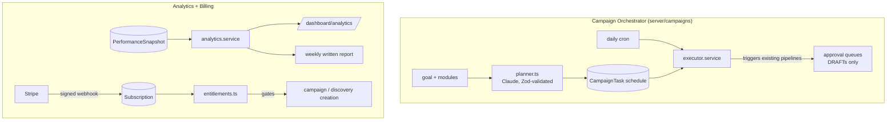
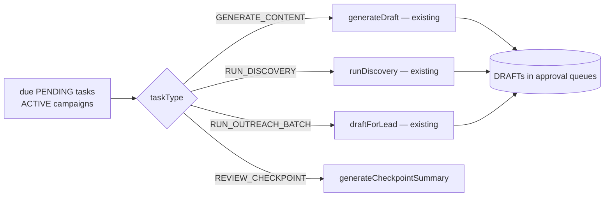

# Botella Aura — Sprint 6 (Campaign Orchestrator + Analytics + Billing + Launch) — Technical Documentation

> Complete technical reference for Sprint 6, the final MVP sprint: it ties every
> prior module into one orchestrated product (**Campaign Orchestrator**), adds a
> results **Analytics** layer, adds **Stripe billing** + entitlements, and hardens
> the app for **production**. Grounded in the actual code.
>
> Builds on Sprints 1–5 ([`SPRINT-1`](./SPRINT-1-TECHNICAL.md) …
> [`SPRINT-5`](./SPRINT-5-TECHNICAL.md)).
> Companion docs: [`README.md`](../README.md) (deploy + secrets), [`extension/README.md`](../extension/README.md).

---

## 1. What Sprint 6 delivers

1. **Campaign Orchestrator** — one goal → an AI-planned, reviewable 30-day
   schedule that CONDUCTS the existing Sprint 3–5 pipelines.
2. **Analytics Dashboard** — the client-presentable RESULTS view + a shareable
   weekly written report.
3. **Billing (Stripe)** — subscriptions, signature-verified webhooks, plan
   entitlements, and a graceful trial.
4. **Production hardening** — multi-tenant isolation tests, rate limiting, error
   monitoring, migration-chain safety, a marketing landing page, and the
   extension store checklist.

### The non-negotiable that shapes the whole sprint

**The orchestrator conducts; it never bypasses a gate.** A full 30-day campaign
creates *tasks* that trigger the existing generators — output lands in the normal
approval queues as DRAFTs, and **nothing publishes or sends without per-item human
approval** (§4.3, verified in §8). And carried from Sprint 5: **no fabricated
data** — analytics and reports reflect real captured numbers or show honest empty
states (§5). Security is a release blocker: **multi-tenant isolation** is proven
by test (§7), and the **Stripe webhook signature is always verified** (§6).

---

## 2. Architecture at a glance

New dependency: **`stripe`** (official SDK). Charts stay inline SVG/CSS (no
charting lib). Reuses every prior primitive: the Claude wrapper, brand voice +
memory injection, the content/outreach/discovery services, the audit service,
and `lib/api.ts`. One migration; +30 tests (130 total).

---

## 3. Schema additions

Migration `…_sprint6_campaigns_billing_analytics`. Full model:
[`prisma/schema.prisma`](../prisma/schema.prisma).

| Model / field | Purpose |
|---|---|
| `Campaign` (extended) | `+ startDate, endDate, durationDays, modulesIncluded Json, targetAudience, themes[], plan Json`; `CampaignStatus + PAUSED`. |
| `CampaignTask` | Scheduled unit: `taskType`, `status`, `contentType?`, `topic?`, `rationale?`, `relatedContentDraftId?`, `relatedDiscoveryRunId?`, `checkpointSummary?`. |
| `Subscription` | One per company: `plan`, `status`, `stripeCustomerId?`, `stripeSubscriptionId?`, `trialEndsAt?`, `currentPeriodEnd?`. |
| `AnalyticsReport` | Stored weekly written report (idempotent per ISO week). |
| Enums | `CampaignTaskType`, `CampaignTaskStatus`, `Plan`, `SubscriptionStatus` + 16 audit actions. |

---

## 4. Module 1 — Campaign Orchestrator

Directory: [`server/campaigns/`](../server/campaigns/).

### 4.1 Planner — [`planner.ts`](../server/campaigns/planner.ts)

`generateCampaignPlan` makes ONE Claude call grounded in brand voice
(`getBrandVoiceProfile`) + active marketing memory (`memoriesToPrompt`) + the
goal, producing a plan validated by
[`campaignPlanSchema`](../lib/validations/campaign.ts) (**strict Zod contract**,
`{ overview, days: [{ day, contentType, topic, outreach, discovery, rationale }] }`).
`gatePlan` strips any action for a module the user didn't enable.
`deterministicPlan` is the fallback — a sensible weekly cadence — so a campaign can
be planned without Claude.

### 4.2 Task generation — [`campaign.service.ts`](../server/campaigns/campaign.service.ts)

`createCampaign` persists the Campaign (status ACTIVE, `plan`), then materializes
`CampaignTask` rows from the plan: a `GENERATE_CONTENT` task per content day, plus
`RUN_OUTREACH_BATCH`/`RUN_DISCOVERY` where flagged, plus a `REVIEW_CHECKPOINT`
every 7 days — all `PENDING`. Gated by `requireEntitlement(companyId,'campaigns')`.

### 4.3 Executor (the conductor) — [`executor.service.ts`](../server/campaigns/executor.service.ts)

`executeDueCampaignTasks` (the daily cron,
[`/api/cron/campaigns`](../app/api/cron/campaigns/route.ts)) finds due `PENDING`
tasks for `ACTIVE` campaigns and **triggers the existing pipelines** — it builds
NO generation logic and NEVER publishes/sends. Campaign work is attributed to the
company OWNER (a real user → valid creator + audit). Weekly
[`checkpoint.service.ts`](../server/campaigns/checkpoint.service.ts) writes a
data-grounded "what landed / what's next" summary. Per-task failures are isolated
(`FAILED` + audit), never fatal.

### 4.4 UI

[`/dashboard/campaigns`](../app/dashboard/campaigns/page.tsx) (list),
[`/new`](../app/dashboard/campaigns/new/page.tsx) (guided form → planner), and
[`/[id]`](../app/dashboard/campaigns/%5Bid%5D/page.tsx) (progress bar + timeline
with drill-through to each queued item + pause/resume).

---

## 5. Module 2 — Analytics

Directory: [`server/analytics/`](../server/analytics/).

- [`analytics.service.ts`](../server/analytics/analytics.service.ts)
  `getAnalytics(companyId, days)` aggregates REAL data over 7/30/90-day ranges:
  top-line counts, engagement trend, content volume, outreach funnel (sent →
  connected → replied, from Sprint 5's manual outcomes), and channel breakdown by
  content type. `hasData:false` when a range is empty → the UI shows an honest
  "not enough data" state, never a misleading zero chart.
- [`report.service.ts`](../server/analytics/report.service.ts) writes a short,
  forward-ready weekly summary grounded ONLY in the numbers (Claude + deterministic
  fallback), idempotent per ISO week in `AnalyticsReport`.
- [`/dashboard/analytics`](../app/dashboard/analytics/page.tsx): stat cards, the
  reused inline-SVG trend chart, CSS bar funnel + channel breakdown
  ([`bar-list.tsx`](../components/dashboard/analytics/bar-list.tsx)), and a copyable
  report card. Distinct from Marketing Memory (learnings) — this is RESULTS.

---

## 6. Module 3 — Billing (Stripe)

Directory: [`server/billing/`](../server/billing/) + [`lib/stripe.ts`](../lib/stripe.ts).

- **Client + plan mapping** ([`lib/stripe.ts`](../lib/stripe.ts)): lazy singleton;
  `priceIdForPlan`/`planFromPriceId` map Plans ↔ env price IDs — **prices live in
  Stripe, never hardcoded** (NON-NEGOTIABLE #5).
- **Webhook** ([`/api/webhooks/stripe`](../app/api/webhooks/stripe/route.ts)):
  reads the raw body, **verifies the signature with `STRIPE_WEBHOOK_SECRET`**, and
  only then dispatches to
  [`handleStripeEvent`](../server/billing/subscription.service.ts) — an
  invalid/tampered request is rejected 400 and never touches the DB
  (NON-NEGOTIABLE #4). Handles checkout.completed, subscription.updated/deleted,
  invoice.payment_failed.
- **Checkout + Portal** ([`checkout.service.ts`](../server/billing/checkout.service.ts)):
  hosted Stripe Checkout + Customer Portal only (no custom card forms); checkout
  carries `companyId`+`plan` metadata for webhook attribution.
- **Entitlements** ([`entitlements.ts`](../server/billing/entitlements.ts)): the
  single source of plan → limits (campaigns, discovery/month, connected accounts).
  `getEffectivePlan` defaults a new company to an active trial and marks an expired
  trial/canceled sub inactive; `requireEntitlement` throws `EntitlementError` (402)
  at creation boundaries — reads are never gated, so an expired trial is
  read-only, never a data-losing lockout. Wired into campaign creation +
  discovery runs.

---

## 7. Module 4 — Production hardening

- **Multi-tenant isolation** ([`tests/tenant-isolation.test.ts`](../tests/tenant-isolation.test.ts)):
  drives the real scoped getters (`getCampaign`, `getLeadDetail`, `getDraft`,
  `getSubscription`) through a faithful filtering mock seeded with two companies,
  proving company B can never read company A's data (NON-NEGOTIABLE #3). The full
  Sprint 1–6 migration chain was verified to apply cleanly on a fresh database.
- **Rate limiting** ([`lib/rate-limit.ts`](../lib/rate-limit.ts)): in-memory
  sliding window on `signup` / `forgot-password` / `reset-password` (documented
  Redis upgrade behind the same interface).
- **Monitoring** ([`lib/monitoring.ts`](../lib/monitoring.ts)): `captureException`
  always structured-logs and best-effort ships to Sentry when `SENTRY_DSN` is set;
  wired into the central `handleRouteError`. Swap in `@sentry/nextjs` later behind
  the same seam.
- **Landing page** ([`app/page.tsx`](../app/page.tsx)): hero, killer features, a
  prominent "we never risk your LinkedIn account" safety section, pricing preview
  (from `PLAN_LIMITS`), and signup CTA.
- **Deploy**: all `/api/cron/*` jobs are platform-agnostic (POST + `Bearer
  CRON_SECRET`) — wire to any scheduler. Full secrets checklist in the README.

---

## 8. Testing

[`tests/`](../tests/) — **+30 tests (130 total)**:

- **`campaign-plan.test.ts`** (6) — the plan Zod schema (day range, content-type
  enum, min/max), `createCampaignSchema` defaults, and deterministic-plan module
  gating (content-only schedules no outreach, etc.).
- **`billing.test.ts`** (10) — the webhook HANDLER across all event types (mocked,
  Prisma-mocked) and entitlement gating (no-sub trial, expired trial → inactive,
  per-plan campaign + discovery limits).
- **`tenant-isolation.test.ts`** (4) — cross-tenant reads blocked for campaigns,
  leads, content, billing.

**Live-verified** end-to-end: a 14-day campaign created 12 tasks; the executor
triggered real discovery + outreach-draft + checkpoint pipelines, produced only
DRAFTs, and **published/sent NOTHING** (0/0). Analytics: honest empty state → real
top-line (2 posts / 120 engagement / funnel) with fixture data. Migration chain
applied clean on a fresh DB.

---

## 9. Environment variables (Sprint 6 — all optional)

| Var | Notes |
|---|---|
| `STRIPE_SECRET_KEY`, `STRIPE_WEBHOOK_SECRET` | Enable billing + verify webhooks. |
| `STRIPE_PRICE_STARTER/_GROWTH/_AGENCY` | Purchasable plan price IDs (from Stripe). |
| `SENTRY_DSN` | Error monitoring (else structured logs only). |
| `CRON_SECRET` (existing) | Also protects `/api/cron/campaigns` + `/api/cron/analytics`. |

See [`README.md`](../README.md) for the full production secrets checklist + cron
wiring.

---

## 10. Design decisions & tradeoffs

1. **Conductor, not generator.** The orchestrator only schedules + triggers
   existing pipelines, so there is exactly one generation path and one approval
   gate — a 30-day campaign can't produce an unapproved publish.
2. **Prices in Stripe, entitlements in code.** Changing a price is a Stripe
   dashboard edit, not a deploy; limits are one config table.
3. **Signature-first webhooks.** Verification happens before any parsing/DB work;
   the handler logic is extracted so it's unit-testable independent of signatures.
4. **Graceful trial expiry.** Access degrades to read-only, never a lockout —
   customers never lose data behind a paywall.
5. **Honest analytics.** Empty ranges say so; every number traces to captured
   data. Same discipline as Marketing Memory.
6. **Lean charts.** Inline SVG/CSS for a couple of clean visuals — no BI-dashboard
   dependency.
7. **Isolation as a test, not a hope.** Multi-tenant scoping is proven by a test
   that drives the real getters; the migration chain is proven on a fresh DB.

---

## 11. Key files quick reference

| Area | File |
|---|---|
| Planner / tasks / executor / checkpoint | `server/campaigns/{planner,campaign.service,executor.service,checkpoint.service}.ts` |
| Analytics + report | `server/analytics/{analytics,report}.service.ts` |
| Stripe client + billing | `lib/stripe.ts`, `server/billing/{subscription,checkout,entitlements}.ts` |
| Webhook | `app/api/webhooks/stripe/route.ts` |
| Hardening | `lib/{rate-limit,monitoring}.ts`, `tests/tenant-isolation.test.ts` |
| Landing | `app/page.tsx` |
| Frontend | `app/dashboard/{campaigns,analytics,settings/billing}/*`, `components/dashboard/{campaigns,analytics,billing}/*` |
| API routes | `app/api/{campaigns,analytics,billing,cron/{campaigns,analytics}}/…` |

---

_Sprint 6 status: complete and verified — typecheck + build clean (68 routes);
130 tests pass; the Campaign Orchestrator conducts every module without bypassing
a single approval gate; billing webhooks are signature-verified; multi-tenant
isolation and the full migration chain are proven. This is the MVP._
