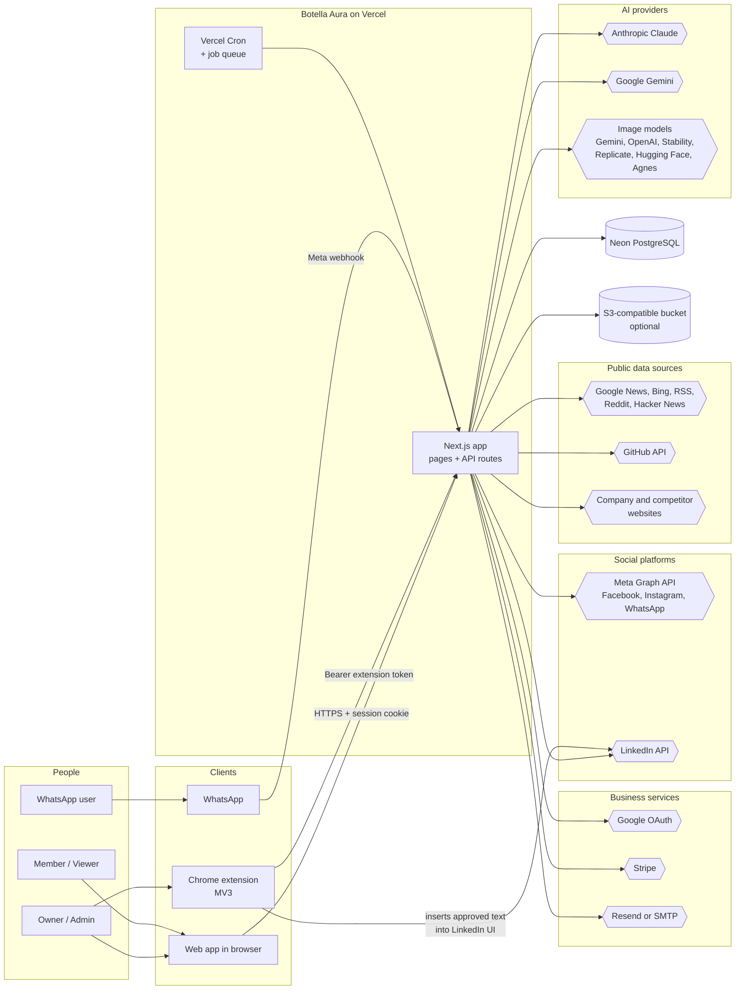
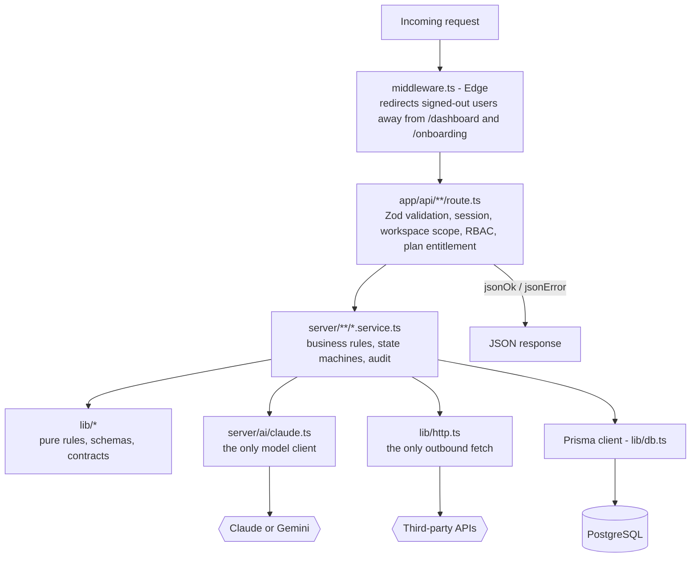
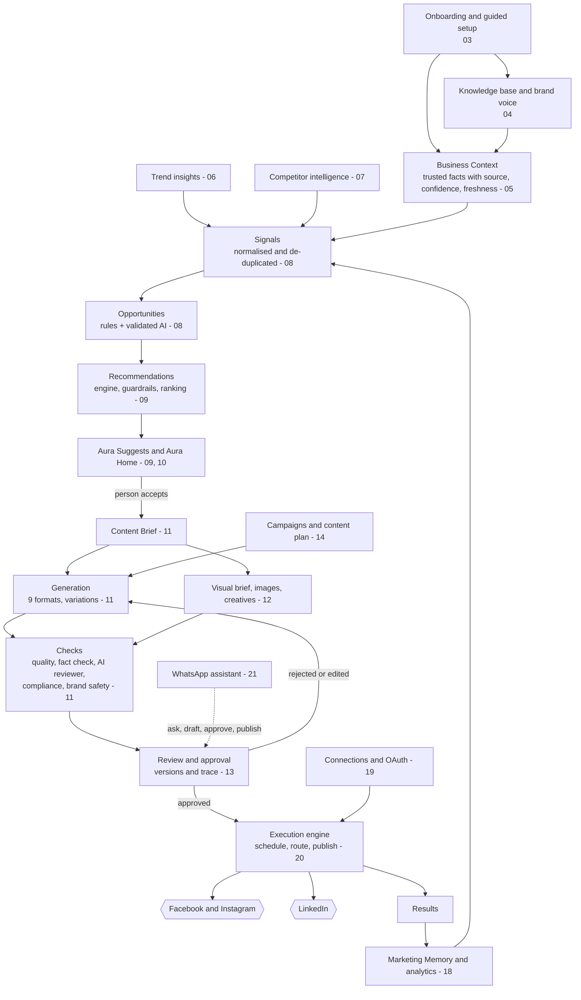
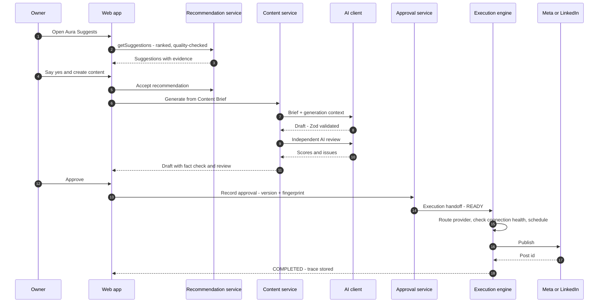
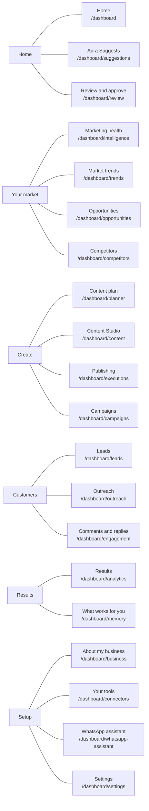
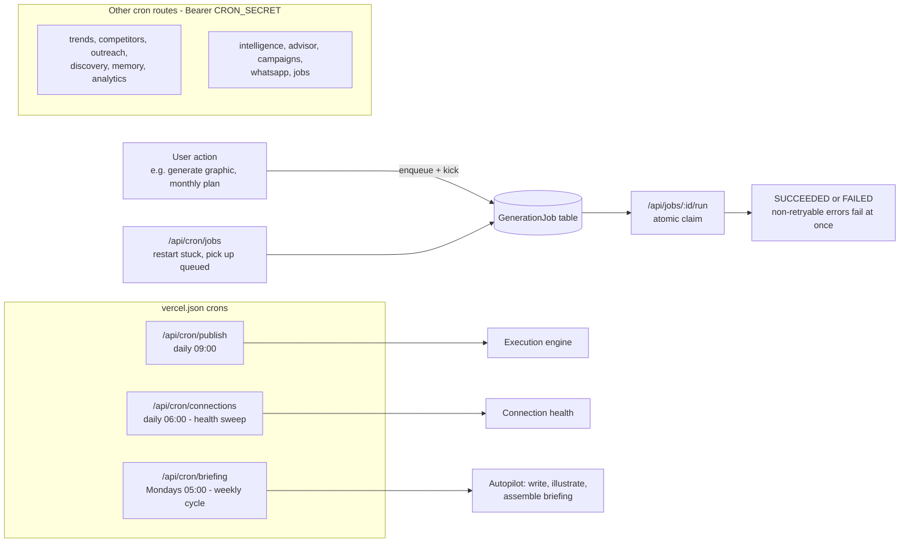
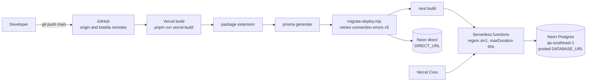
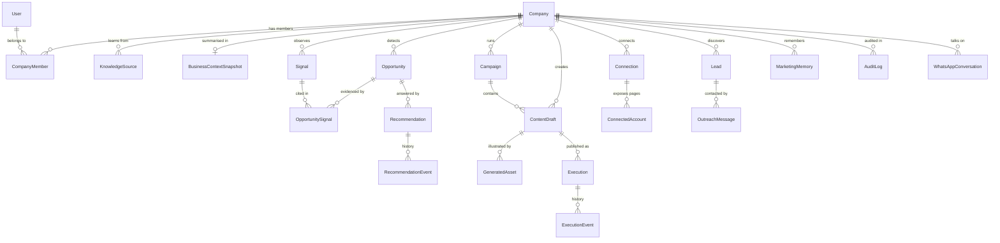

# Botella Aura — Overall Architecture & Application Workflow

Botella Aura is an AI marketing co-pilot. It learns a business, watches its market, decides what is worth doing,
drafts the work, and hands it to a person to approve before anything is published or sent. This document shows
how the whole application fits together. Each feature has its own folder under
[`../02-features/`](../02-features/) with details, architecture and change history.

| | |
| --- | --- |
| **Product** | Botella Aura — AI Marketing Co-Pilot (`botella-aura` v0.1.0) |
| **Type** | Multi-tenant SaaS web app + Chrome extension + WhatsApp assistant |
| **Stack** | Next.js 14 (App Router) · React 18 · TypeScript (strict) · Prisma 5 · PostgreSQL · NextAuth v4 · Zod · Tailwind |
| **Size** | 61 Prisma models · 49 migrations · 181 API route files (250 operations) · 47 dashboard pages · 147 test suites · 66 verification scripts |
| **Hosting** | Vercel (functions in `sin1`) + Neon PostgreSQL (`ap-southeast-1`); Netlify and Railway configs also present |
| **Development** | 23 Jul 2026 → present · 204 commits — see [`../03-changelog/CHANGELOG.md`](../03-changelog/CHANGELOG.md) |

---

## 1. System context

Who and what Aura talks to. Everything outside the app box is reached through one HTTP client
(`lib/http.ts`) or one AI client (`server/ai/claude.ts`).

People use the web app, the Chrome extension (which acts inside the user's own LinkedIn session) and WhatsApp.
The server never logs in to LinkedIn or scrapes it. Every external call is optional: a missing key turns a feature
into a labelled fallback instead of an error.

---

## 2. Layered architecture (defence in depth)

Every request passes the same four layers. Route handlers stay thin; all business logic and every write lives in a
service.

| Layer | Responsibility | Key files |
| --- | --- | --- |
| Edge middleware | Session gate for `/dashboard/*` and `/onboarding` | `middleware.ts` |
| Route handler | Parse → authorise → delegate → format. `requireActiveCompany()` resolves the user and the workspace from their own memberships; `can(role, permission)` checks RBAC | `app/api/**/route.ts`, `lib/auth-helpers.ts`, `lib/rbac.ts`, `lib/api.ts` |
| Service | All business logic and writes; action + `AuditLog` row in one transaction; compare-and-swap for concurrent edits | `server/**` (39 areas) |
| Shared rules | Pure, unit-tested logic and Zod contracts shared by client and server | `lib/**` (104 modules), `lib/validations/*` |
| Data | Prisma 5 over PostgreSQL; every query scoped by `companyId` | `prisma/schema.prisma`, `lib/db.ts` |
| Outbound | Timeouts, retries, user agent, robots.txt, SSRF-safe redirects | `lib/http.ts`, `lib/safe-url.ts` |
| AI | Claude primary, Gemini fallback, model tiers, structured (Zod-validated) output | `server/ai/claude.ts` |

---

## 3. Application workflow — from business to published post

This is the core loop built in Sprints 7–10. Each box is a feature folder.

1. **Learn the business.** Onboarding, the knowledge base and brand voice feed the **Business Context**: one
   trusted model of the business where every fact records its source, confidence and freshness.
2. **Watch the market.** Trends, competitor changes, results and memory become **Signals**.
3. **Decide.** Deterministic rules plus validated AI turn signals into **Opportunities** with evidence; the
   **Recommendation engine** turns an opportunity into what, why, action and expected outcome, applying
   guardrails and ranking.
4. **Create.** Accepting a suggestion builds a **Content Brief**; Content Studio writes the piece and the media
   pipeline makes the visual. Every piece is checked for quality, facts, compliance and brand safety.
5. **Approve.** A person reviews and approves in one queue. An edit after approval reopens it.
6. **Execute.** The execution engine schedules and publishes through healthy connections, one job per network.
7. **Learn.** Results flow into Marketing Memory and back into the next round of signals.

### End-to-end sequence

---

## 4. Navigation map (what the user sees)

The sidebar has six groups; a group's pages appear only while the user is inside it (`lib/nav.ts`).

---

## 5. Background processing

Long AI work runs as resumable jobs so a request returns at once; Vercel Cron sweeps for stuck work.

All cron routes accept `Authorization: Bearer $CRON_SECRET` and are idempotent per workspace and period, so a
double fire never duplicates work. **Only the three routes in `vercel.json` are scheduled.** The others (trends,
competitors, outreach, discovery, memory, analytics, intelligence, advisor, campaigns, whatsapp, jobs) run only
when an external scheduler or a person calls them. Add them to `vercel.json` (or another scheduler) to automate
them. WhatsApp replies are drained by a Postgres work queue via `waitUntil`
and a cron sweep.

---

## 6. Deployment

Details: [`../02-features/24-platform-jobs-and-deployment/`](../02-features/24-platform-jobs-and-deployment/01-FEATURE-DETAILS.md),
[`../../DEPLOYMENT-CHECKLIST.md`](../../DEPLOYMENT-CHECKLIST.md), [`../../VERCEL-DEPLOYMENT.md`](../../VERCEL-DEPLOYMENT.md).

---

## 7. Data model overview

The core entities and how they connect. Every business table carries `companyId` and is deleted with its
workspace. The full schema is `prisma/schema.prisma`.

Approval records, versions and the trace chain are stored on the draft in `aiMetadata` (JSON), and the
compliance policy in `Company.preferences`, so those features needed no migration.

---

## 8. Cross-cutting principles (enforced in code)

| Principle | Enforcement |
| --- | --- |
| A person approves before anything goes out | Unified approval model; `PUBLISHED` reachable only from `APPROVED`; any change after approval reopens it (`changed_after_approval`) |
| Never invent facts or numbers | Business facts carry provenance; fact check, quality rules and AI reviewer block unsupported figures; empty states say what is missing |
| Workspace isolation | Every query scoped by `companyId`; foreign ids answer 404; static and HTTP isolation tests |
| Everything audited | Typed `AuditLog` rows for logins, edits, AI runs, approvals, publishes, sends |
| Fail visibly | Missing keys give labelled fallbacks or `skipped` sources, never silent success |
| Public sources only | robots.txt honoured, per-origin throttling, no LinkedIn scraping |
| Idempotent background work | Unique per period; advisory locks; compare-and-swap transitions |

---

## 9. Feature index

| # | Feature | Folder |
| --- | --- | --- |
| 01 | Authentication & Accounts | [01-authentication-and-accounts](../02-features/01-authentication-and-accounts/01-FEATURE-DETAILS.md) |
| 02 | Workspaces, Team & Roles (RBAC) | [02-workspaces-team-and-roles](../02-features/02-workspaces-team-and-roles/01-FEATURE-DETAILS.md) |
| 03 | Onboarding & Guided Setup | [03-onboarding-and-guided-setup](../02-features/03-onboarding-and-guided-setup/01-FEATURE-DETAILS.md) |
| 04 | Knowledge Base & Brand Voice | [04-knowledge-base-and-brand-voice](../02-features/04-knowledge-base-and-brand-voice/01-FEATURE-DETAILS.md) |
| 05 | Business Context & About My Business | [05-business-context](../02-features/05-business-context/01-FEATURE-DETAILS.md) |
| 06 | Trend Insights | [06-trend-insights](../02-features/06-trend-insights/01-FEATURE-DETAILS.md) |
| 07 | Competitor Intelligence | [07-competitor-intelligence](../02-features/07-competitor-intelligence/01-FEATURE-DETAILS.md) |
| 08 | Signals & Opportunity Detection | [08-signals-and-opportunities](../02-features/08-signals-and-opportunities/01-FEATURE-DETAILS.md) |
| 09 | Recommendations & Aura Suggests | [09-recommendations-and-aura-suggests](../02-features/09-recommendations-and-aura-suggests/01-FEATURE-DETAILS.md) |
| 10 | Aura Home, What Matters Now & Weekly Briefing | [10-aura-home-and-briefing](../02-features/10-aura-home-and-briefing/01-FEATURE-DETAILS.md) |
| 11 | Content Studio | [11-content-studio](../02-features/11-content-studio/01-FEATURE-DETAILS.md) |
| 12 | Media, Graphics & Marketing Creatives | [12-media-graphics-and-creatives](../02-features/12-media-graphics-and-creatives/01-FEATURE-DETAILS.md) |
| 13 | Review, Approval, Versions & Traceability | [13-review-approval-versions-and-trace](../02-features/13-review-approval-versions-and-trace/01-FEATURE-DETAILS.md) |
| 14 | Campaigns & Content Planner | [14-campaigns-and-content-planner](../02-features/14-campaigns-and-content-planner/01-FEATURE-DETAILS.md) |
| 15 | Lead Discovery & Outreach Intelligence | [15-leads-and-outreach](../02-features/15-leads-and-outreach/01-FEATURE-DETAILS.md) |
| 16 | Engagement Copilot | [16-engagement-copilot](../02-features/16-engagement-copilot/01-FEATURE-DETAILS.md) |
| 17 | Chrome Extension | [17-chrome-extension](../02-features/17-chrome-extension/01-FEATURE-DETAILS.md) |
| 18 | Marketing Memory & Analytics | [18-marketing-memory-and-analytics](../02-features/18-marketing-memory-and-analytics/01-FEATURE-DETAILS.md) |
| 19 | Connections, Connectors & OAuth | [19-connections-and-connectors](../02-features/19-connections-and-connectors/01-FEATURE-DETAILS.md) |
| 20 | Publishing, Execution Engine & Scheduling | [20-publishing-execution-and-scheduling](../02-features/20-publishing-execution-and-scheduling/01-FEATURE-DETAILS.md) |
| 21 | WhatsApp AI Assistant | [21-whatsapp-assistant](../02-features/21-whatsapp-assistant/01-FEATURE-DETAILS.md) |
| 22 | Billing, Plans & Entitlements | [22-billing-and-plans](../02-features/22-billing-and-plans/01-FEATURE-DETAILS.md) |
| 23 | AI Layer | [23-ai-layer](../02-features/23-ai-layer/01-FEATURE-DETAILS.md) |
| 24 | Platform: Jobs, Cron, Security & Deployment | [24-platform-jobs-and-deployment](../02-features/24-platform-jobs-and-deployment/01-FEATURE-DETAILS.md) |
| 25 | Navigation, Dashboard Shell & Design System | [25-navigation-and-design-system](../02-features/25-navigation-and-design-system/01-FEATURE-DETAILS.md) |
