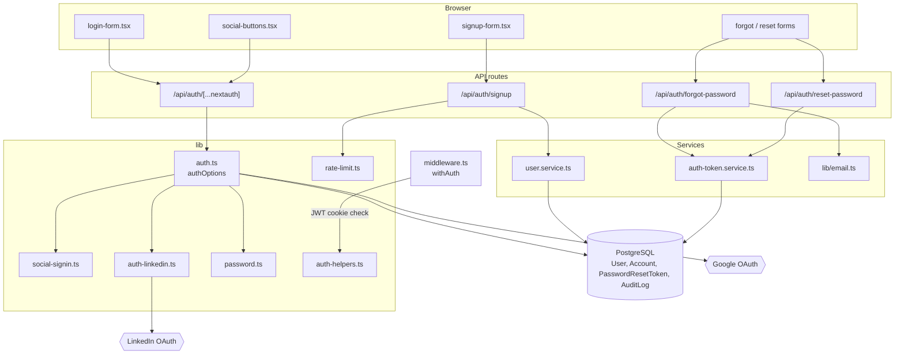
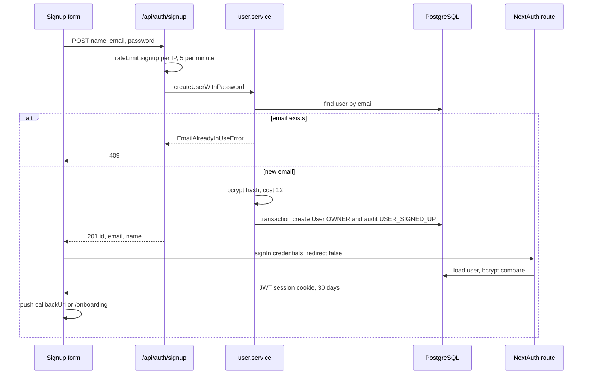
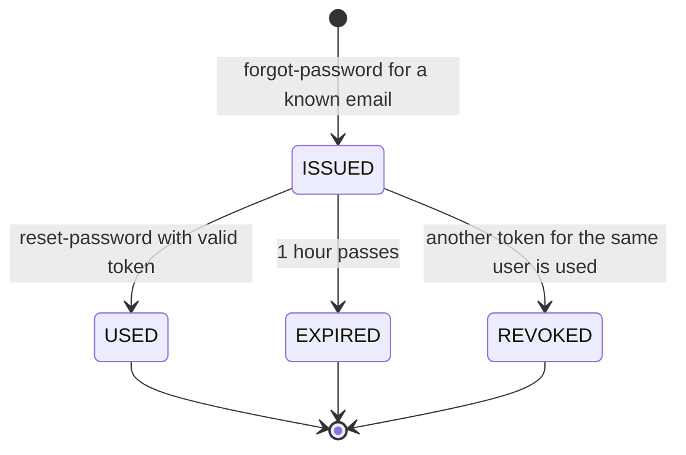
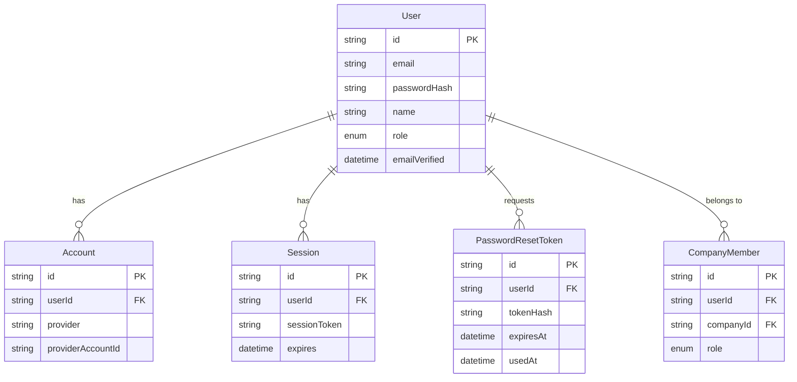

# Authentication & Accounts — Architecture

Authentication is NextAuth v4 with a Prisma adapter and JWT sessions, plus three small custom routes for sign-up and password reset. Edge middleware does the cheap redirect; server helpers in `lib/auth-helpers.ts` re-check the session wherever data is loaded.

## Component architecture

The forms on the left post either to NextAuth (sign-in, OAuth) or to the three custom routes (sign-up, reset). `social-signin.ts` decides both which providers `authOptions` builds and which buttons appear, so the two cannot disagree. All persistent state is in PostgreSQL; Google and LinkedIn are only called during the OAuth dance.

## Main flow

Sign-up is a two-step client flow: the custom route creates the account, then the form signs in through NextAuth's Credentials provider so the same session code path is used for every login. An invitee arriving with `?callbackUrl=/invite/...` is returned to the invite instead of onboarding.

## Lifecycle / state machine

This is the life of a `PasswordResetToken`. There is no status column: `ISSUED` means `usedAt` is null and `expiresAt` is in the future, `USED` and `REVOKED` both set `usedAt`, and `EXPIRED` is computed from `expiresAt`. Any token that is not `ISSUED` is rejected with the same "invalid or has expired" message.

## Data model

`Account` holds one row per OAuth provider a user has signed in with, which is how a Google and a password login end up on the same `User`. `Session` and `VerificationToken` exist for the adapter but are not used at runtime with JWT sessions. `CompanyMember` is shown for orientation; it is owned by the workspaces feature.

## Design decisions

- **JWT sessions** because the Credentials provider requires them; it also keeps session reads off the database.
- **One predicate for providers and buttons** (`lib/social-signin.ts`) after a real failure where a button appeared without its provider and produced an unexplained NextAuth error.
- **Custom LinkedIn provider** typed `oauth` against `/v2/userinfo`, because the bundled provider calls retired v2 profile endpoints and OIDC id_token verification against LinkedIn has been unreliable.
- **Email account linking allowed, but only for verified emails**, so "log in with Google" reaches the workspace created with a password without letting an unverified address take it over.
- **Import-free password policy module** so client forms do not bundle `bcryptjs` and its Node polyfills.
- **Hashed, single-use, 1-hour reset tokens** with neutral responses, so a database leak or the endpoint itself cannot be used to take over or enumerate accounts.
- **No `SessionProvider`**: the session is read on the server, avoiding a `/api/auth/session` request on every page load.
