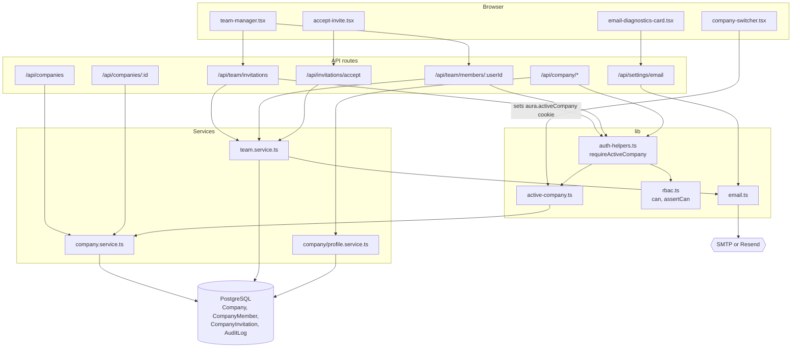
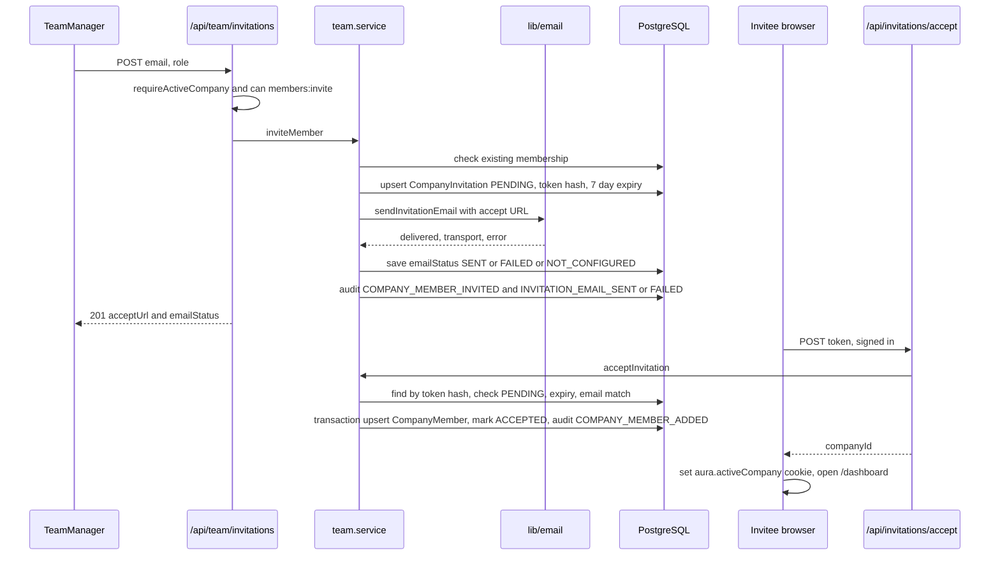
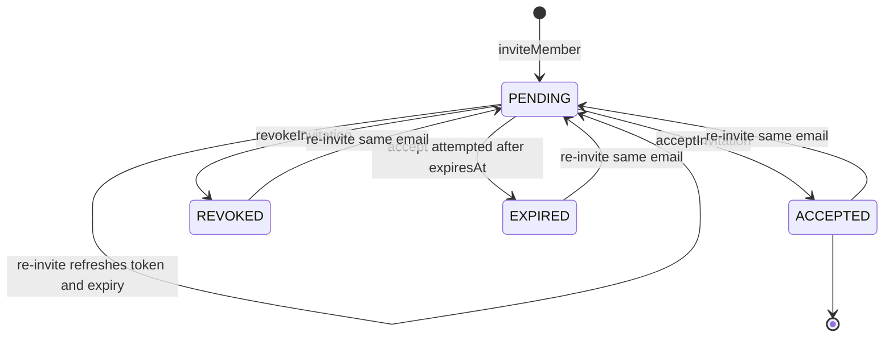
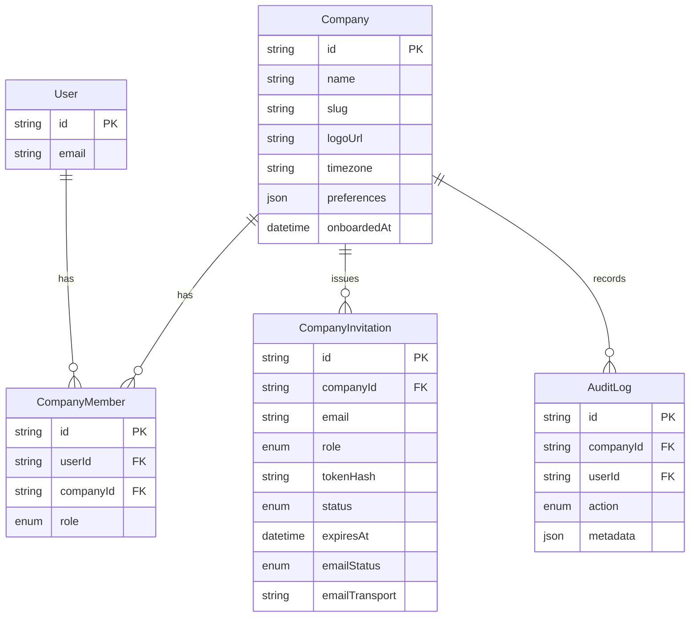

# Workspaces, Team & Roles (RBAC) — Architecture

Every Aura request is resolved to one workspace (`Company`) through the caller's own `CompanyMember` rows, and every action is checked against the role matrix in `lib/rbac.ts`. Team management and invitations live in `server/services/team.service.ts`; outbound email goes through the truthful transport in `lib/email.ts`.

## Component architecture

UI components call API routes; each route first resolves the user and active company through `requireActiveCompany` (or `requireCompanyRole` for an id in the path) and checks a permission with `can()`. Services do the database work and write audit rows; only the team service talks to the email transport.

## Main flow

The invitation row is created even when email fails, and the response always carries `acceptUrl`, so the admin can share the link by hand. Acceptance is the only step that creates a membership, and it requires the signed-in user's email to equal the invited one.

## Lifecycle / state machine

`InvitationStatus` moves only through `team.service.ts`. Because there is one row per (company, email), re-inviting any address upserts the same row back to `PENDING` with a new token, which also invalidates the previous link. Separately, `emailStatus` records the delivery outcome of the latest send.

## Data model

`CompanyMember` is the join between users and workspaces and carries the role that RBAC reads. `CompanyInvitation` is unique on `(companyId, email)` and on `tokenHash`. Every team and workspace change writes an `AuditLog` row.

## Design decisions

- **One role matrix** in `lib/rbac.ts`, so access rules are reviewed in one place and routes only ask `can(role, permission)`.
- **Active company from the caller's memberships**, never trusted from input; most settings routes have no company id in the path at all.
- **Request-memoised lookups** (`cache` on `resolveActiveCompany` and membership) because the layout and page both resolve the same workspace on each navigation; `getCompaniesForUser` selects five columns instead of whole rows.
- **Always keep an owner**, and only owners can create or change owners.
- **Truthful email results** after a real bug where invitations showed "Mail sent" while only the console transport ran; the accept link is always returned for manual sharing.
- **Duplicate-name guard with explicit override** (`confirmDuplicate`) so a double submit does not silently create two identical workspaces.
- **Hashed invite tokens** mirroring password-reset tokens, so a database leak does not expose working links.
