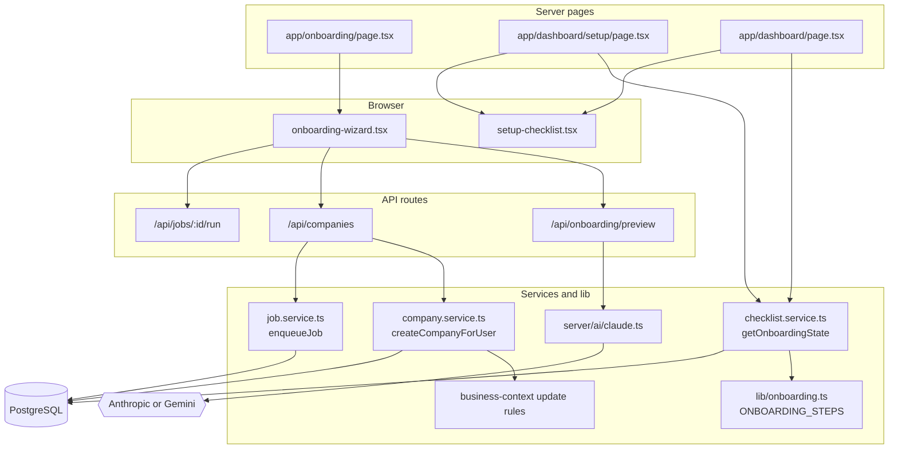
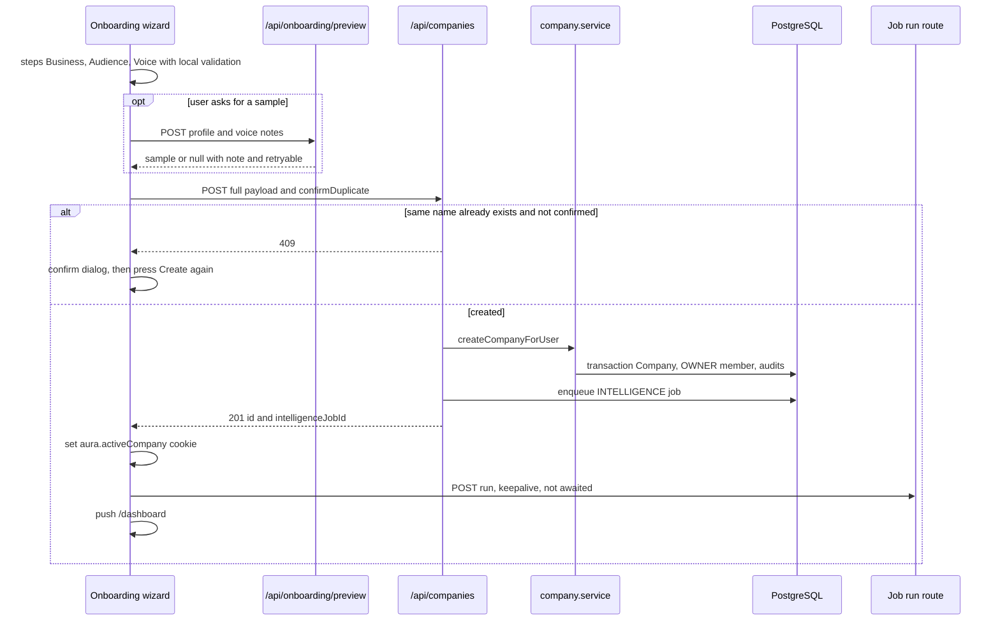
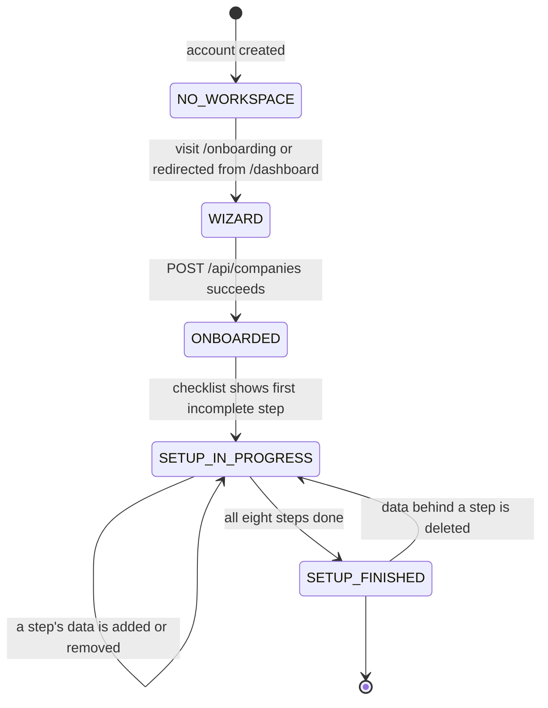

# Onboarding & Guided Setup — Architecture

Onboarding is a client-side wizard that posts once to `POST /api/companies` and optionally asks `POST /api/onboarding/preview` for a sample post. Guided setup is a pure read model: `getOnboardingState` derives eight step states from existing tables every time the dashboard or `/dashboard/setup` renders.

## Component architecture

The left half is write-once onboarding: the wizard calls the preview route any number of times, then creates the workspace and kicks its first job. The right half is the read-only checklist: two pages call `getOnboardingState`, which combines the static step list in `lib/onboarding.ts` with counts from the database.

## Main flow

The preview never blocks progress: it always answers 200, with `sample: null` and a note when the AI is unavailable. The intelligence job is fired without waiting so the redirect is immediate; the generation queue's safety net picks it up if the kick is lost.

## Lifecycle / state machine

These states are not stored anywhere except `Company.onboardedAt`. "Setup finished" is recomputed on every render, so deleting the last knowledge source or disconnecting the only channel reopens the matching step and brings the checklist back.

## Design decisions

- **Completion is derived, never stored.** A step is done when its data exists, so the checklist stays honest across devices and after deletions.
- **Exactly one current step.** Only the first incomplete step has a button, so the user always has one obvious next action.
- **Only the business step is required.** The rest are labelled as improvements, with a `why` stated as the outcome.
- **The wizard requires a description and an audience**, because a workspace that finished onboarding with only a name produced generic or invented drafts.
- **Market mode asked in the wizard**, because it is the largest fork in how content is written and every workspace previously fell back to B2B.
- **Onboarding data goes through the Business Context rules**, so it cannot store a value the settings pages would refuse.
- **Preview told to invent nothing**, so the first thing Aura writes for a new user is not a fabricated claim.
- **First analysis queued at creation**, so the dashboard is not blank on arrival.
