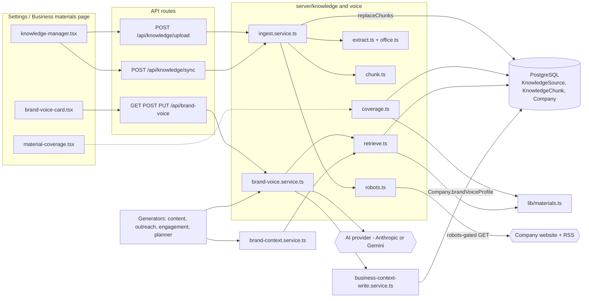
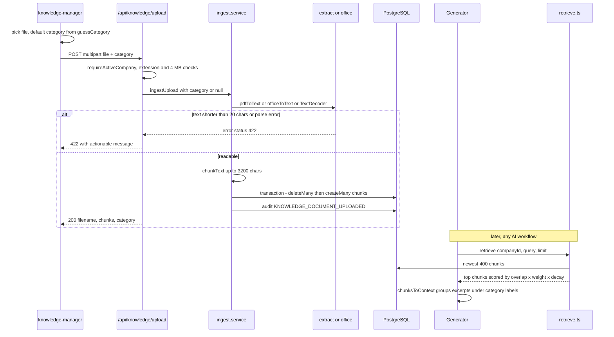
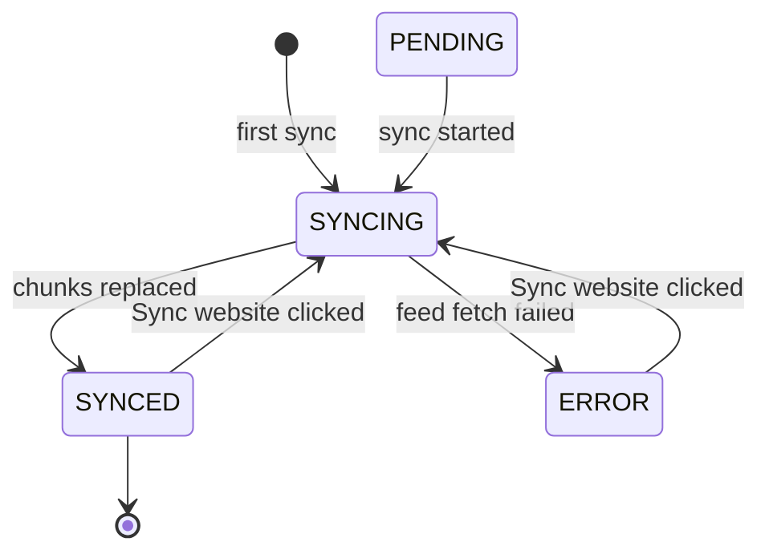
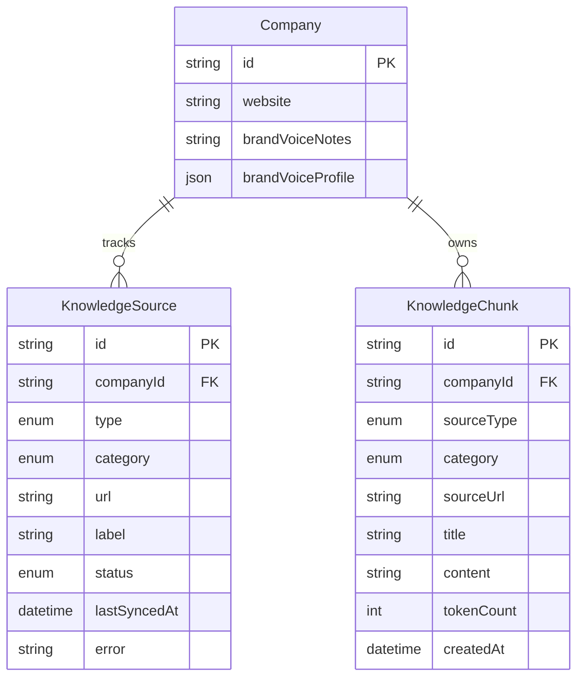

# Knowledge Base & Brand Voice — Architecture

The knowledge base is a small ingestion and retrieval pipeline. Website pages, blog feeds and uploaded documents become `KnowledgeChunk` rows, and AI workflows retrieve them with keyword scoring weighted by the kind of material. The Brand Voice Profile is a JSON document on `Company`. AI generates it from those chunks, people edit it, and every write goes through the Business Context write service.

## Component architecture

Solid arrows are runtime calls. The dotted arrow from the coverage card means `page.tsx` calls `getMaterialCoverage` on the server and passes the result in as props. All three ingestion paths end in `replaceChunks`, and reads go only through `retrieve()`. The voice service never writes `Company` directly: it hands its patch to the Business Context write service, which enforces the rules on what AI may write.

## Main flow

Uploading a document, then using it in a generation:

The top half runs once per upload. Extraction is chosen by file extension, and a file that yields no readable text is rejected with a 422 rather than stored. The bottom half runs whenever a generator needs grounding. The category picked at upload time sets both the score weight and the heading the model reads above each excerpt.

## Lifecycle / state machine

`KnowledgeSource.status` for website and blog sources (uploads have no source row):

`PENDING` is the schema default, but `upsertSource` always writes `SYNCING` straight away, so in practice a new source starts in `SYNCING`. Only the blog path sets `ERROR`. When a website yields no readable pages it still ends up `SYNCED`, with `error = "No readable pages found"`.

## Data model

`KnowledgeSource` and `KnowledgeChunk` have no foreign key to each other. They are matched logically on `(companyId, type/sourceType, url/sourceUrl)`, and for uploads `sourceUrl` holds the filename. Both tables cascade-delete with `Company`. The voice profile is a validated JSON column on `Company`, not a table of its own.

## Design decisions

- **Re-sync replaces chunks instead of appending.** Replacing all chunks for one source key in a single transaction means a re-sync or re-upload can never duplicate content.
- **Labels by kind as well as source.** `MaterialCategory` records what a document *is*, separately from where it came from. Brand guidelines need to be obeyed and competitor battlecards must never be echoed, so excerpts are grouped under a prompt label for their category.
- **Reference material does not decay.** Positioning, ICP, guidelines, pitch and company info are marked timeless and skip the 30-day half-life. Without this, old but binding rules would lose out to last week's post.
- **Category is guessed but always confirmed.** `guessCategory` only pre-fills the picker. A wrong silent guess, such as treating a deck as brand rules, would do more harm than asking.
- **Keyword retrieval, no embeddings.** It is cheap, deterministic and needs no extra service. The `retrieve()` interface is kept stable so vector search can replace it later.
- **Office files read without a dependency.** DOCX and PPTX are read with a minimal ZIP reader built on `node:zlib`. The extractor is chosen by extension because browsers mislabel Office MIME types.
- **Polite, read-only crawling.** Robots.txt is respected, requests are throttled by 1.2 s, and page JavaScript is never executed. Meta, OG and JSON-LD tags are read so JavaScript-rendered sites still yield brand copy.
- **AI drafts, a person confirms.** Voice writes go through `updateBusinessContext`. AI may only touch `voice.profile`, and a human save marks it confirmed.
- **One brand preamble.** `brand-context.service.ts` composes identity, audience, voice, writing rules and knowledge in a fixed order. Every workflow therefore gets the whole picture, not whichever fragment its author remembered.
