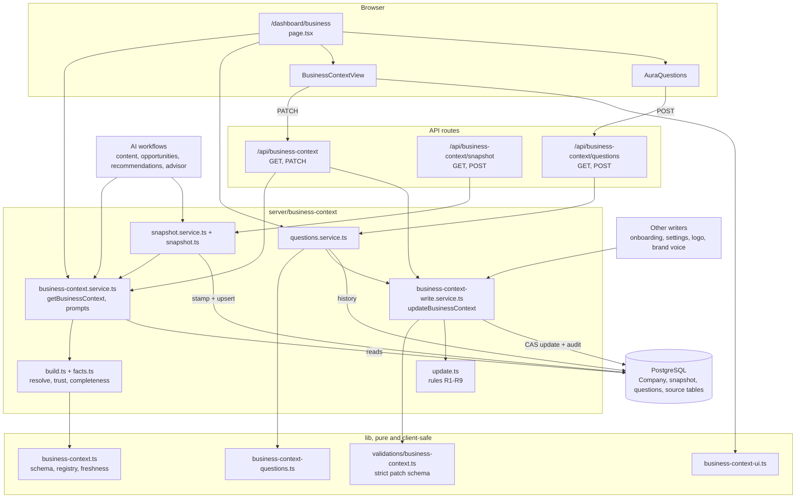
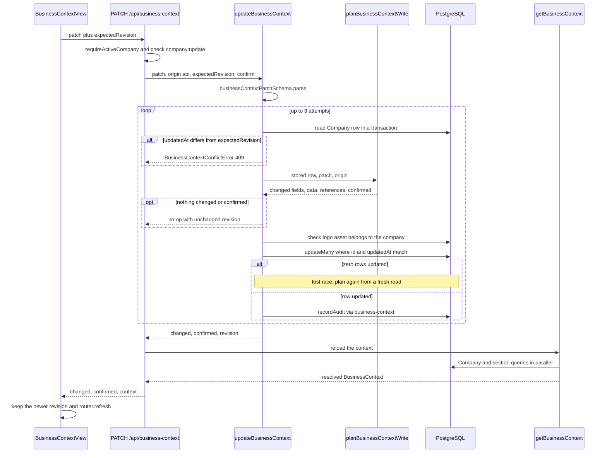
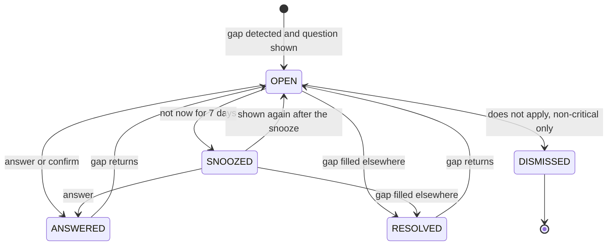
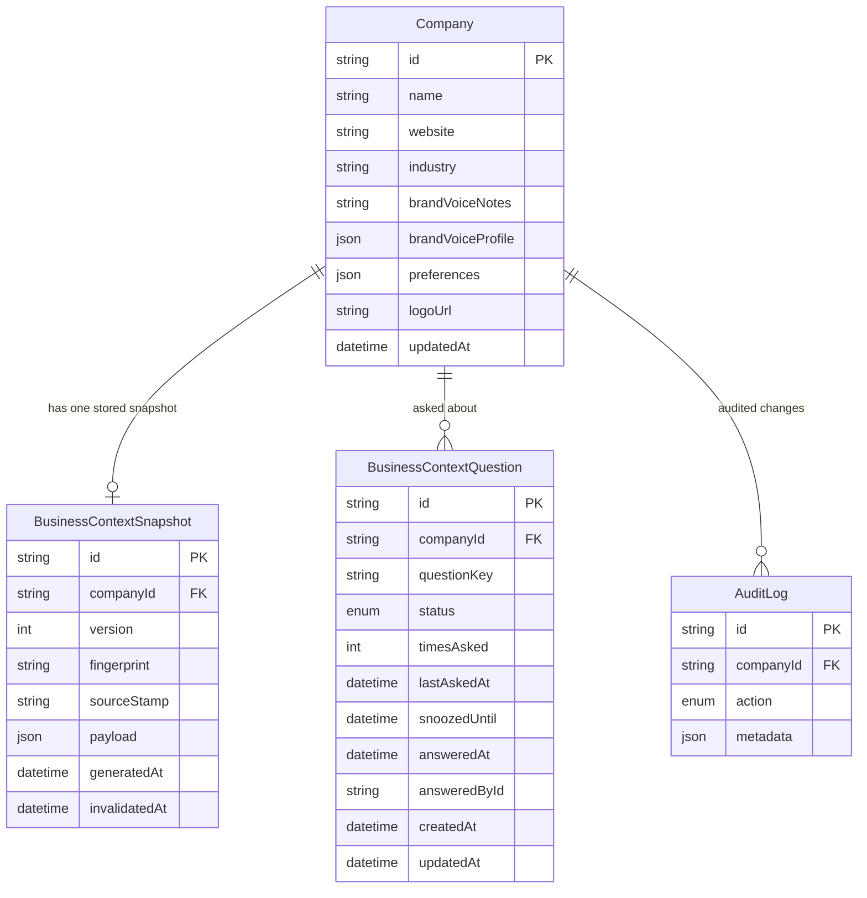

# Business Context & About My Business — Architecture

The Business Context has one read path and one write path. The read path builds a resolved context from the `Company` row and up to 13 other tables owned by other features. The write path accepts changes only to the business fields stored on `Company`. Two derived artefacts sit on top of the context: a stored, fingerprinted snapshot for AI workflows, and a list of questions about missing or doubtful facts. Each has its own table.

## Component architecture

Read the diagram from top to bottom. The server page calls the read service and the questions service directly. The two client components write only through the API routes.

Every write converges on `updateBusinessContext`, whether it comes from the page, a question answer, or another feature's writer (onboarding, the settings routes, logo upload, brand voice). Every read converges on `getBusinessContext`.

The `lib/` modules have no database access. Client components and tests import the same registry and rules that the server uses.

## Main flow

Editing a field on About my business:

The PATCH route checks permissions, then hands the raw patch to the write service. The write service validates the patch shape again, whatever the caller already checked.

Inside the transaction, three checks can stop the write:
- A stale revision fails immediately with 409.
- A rule refusal from `planBusinessContextWrite` returns 422, with every refused field reported at once.
- A lost compare-and-swap race causes the write to be re-planned. After 3 attempts it becomes a 409.

The route then rebuilds the context, so the client receives the new `meta.revision` with its response.

## Lifecycle / state machine

`BusinessContextQuestion.status` (`ContextQuestionStatus`):

Questions are not stored as the source of truth. They are re-derived from the context on every request, and the table only remembers what happened to each question key.

`sync()` moves OPEN and SNOOZED rows to RESOLVED when their gap is gone. It moves ANSWERED and RESOLVED rows back to OPEN, with `timesAsked` reset, when the gap returns, for example when a goal goes stale again.

`markAsked` re-sets OPEN on an upsert when a question is shown again. DISMISSED is final, and critical questions can never reach it. Resting after 3 unanswered asks is a time filter in `isAskable`, not a separate status.

## Data model

How the tables are used:
- **`Company`** holds every writable business fact. Some are columns. The rest are in the `preferences` JSON, under the keys `business`, `marketingProfile`, `brand`, `contentFormats` and `factMeta`. `updatedAt` doubles as the context revision.
- **`BusinessContextSnapshot`** has a unique `companyId`, so there is exactly one stored full snapshot per workspace. Views are cut from it on read.
- **`BusinessContextQuestion`** is unique on `(companyId, questionKey)`, where `questionKey` is `<kind>:<field>`.
- **`AuditLog`** gets one row per real change, with `metadata.via = 'business-context'`.

Both owned tables cascade-delete with their company. The other source tables the read path uses (memory, competitors, trend config, plans, campaigns, connections, knowledge, drafts, analytics) belong to other features and are not drawn here.

## Design decisions

- **One resolved structure, one registry.** `CONTEXT_FIELDS` records each field's requirement, source precedence, resolution strategy, consumers and fix-it link in one place. Before this, every workflow chose its own fragment of the business, and lead scoring described the company to the model with its tone notes.
- **Stated facts beat derived ones, and nothing is dropped silently.** Settings beat a single month's plan, and plan values only fill gaps (`inferred`). Each overridden value is kept in `meta.issues` so a person can settle it.
- **Trust is per fact, not per table.** The same column can hold a user-typed value or an AI seed. `preferences.factMeta` records the origin of each written path, and AI-derived values are never trusted until a person confirms them. Prompts and snapshots label or separate assumptions instead of stating them as facts.
- **A single validated write path.** Every screen keeps its own request schema and error wording. Adapters with alias maps turn its input into one strict patch, so a value cannot enter the context by a side door.
  - Quality rules judge only changed values, because forms re-send every field.
  - AI may write only `voice.profile`.
- **Optimistic concurrency plus compare-and-swap.** `expectedRevision` (`Company.updatedAt`) stops one user from overwriting another's edit. The retried compare-and-swap on `updatedAt` stops concurrent writers to the shared `preferences` bag, such as voice generation and goal edits, from erasing each other.
- **A stored snapshot refreshed by a source stamp.** One cheap aggregate per source table catches edits in every module without hooks in those modules. A 6-hour TTL covers freshness that changes with the date alone. The fingerprint hashes content, not build time, so AI output can be traced to the exact business state it was produced from.
- **Pure core, thin I/O.** `build.ts`, `facts.ts`, `update.ts`, `snapshot.ts` and the `lib/` modules have no database access. The rules can be unit-tested and shared with client components, and they cannot differ between callers.
- **Ask instead of assume.** Gaps become questions with anti-nagging rules (12-hour ask cooldown, 7-day snooze, rest after 3 asks). Prompts carry a NOT YET KNOWN block, so models say what they do not know rather than inventing it.
