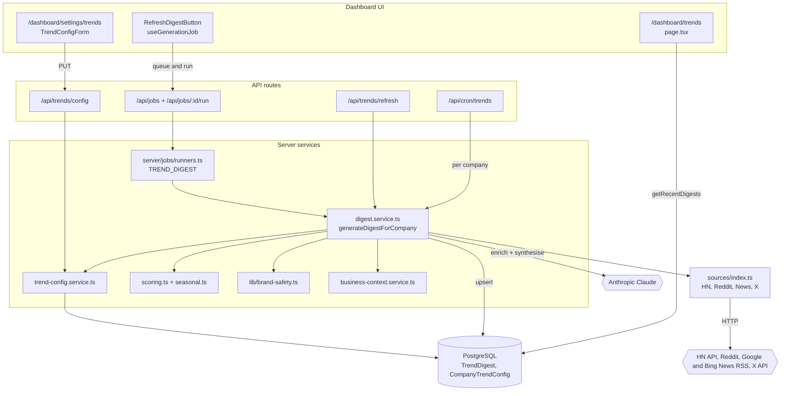
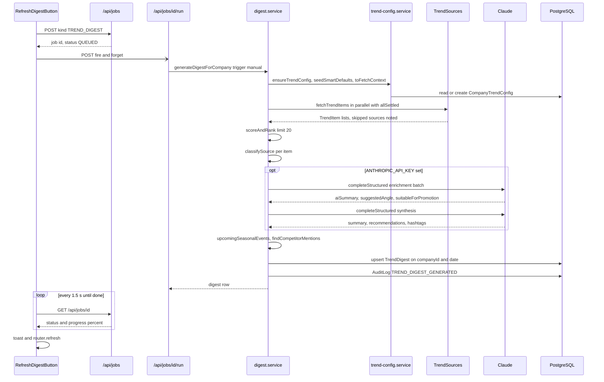
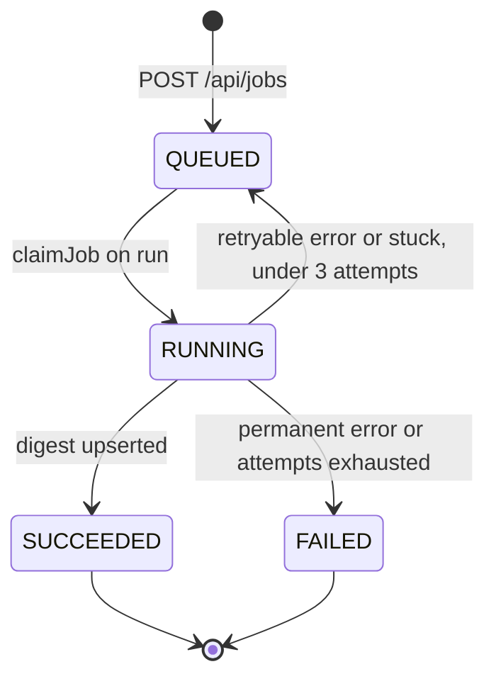
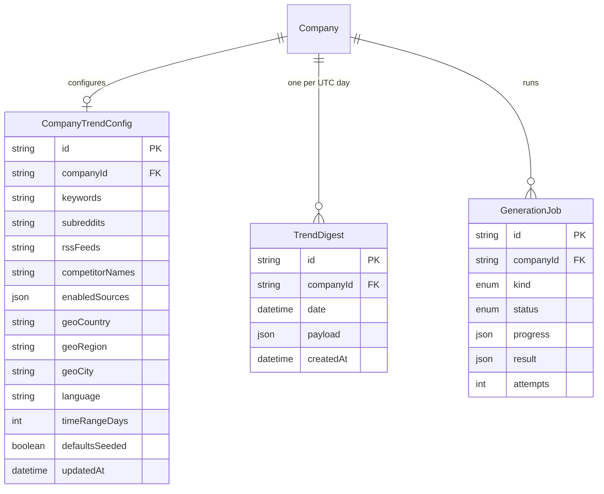

# Trend Insights — Architecture

Trend Insights is a fetch → score → enrich → store pipeline. It has one orchestrator, `generateDigestForCompany` in `server/trends/digest.service.ts`, and three entry points: the background-job path used by the dashboard, the scheduled cron, and a legacy synchronous refresh route. Sources sit behind a single `TrendSource` interface. Scoring and seasonal lookup are pure functions. The result is one JSON `TrendDigest` row per company per UTC day.

## Component architecture

Read the diagram top to bottom.

- **Entry points:** three routes reach the same orchestrator. The jobs path (used by the Refresh button), the legacy refresh route and the cron loop all call `generateDigestForCompany`.
- **Config:** the orchestrator reads the company's config through `trend-config.service.ts`. That service also seeds smart defaults.
- **Fetching:** sources are fetched through the registry in `sources/index.ts`.
- **Processing:** items are ranked by the pure scoring module and safety-classified before Claude ever sees them.
- **Output:** the page never calls the API. It is a server component that reads the stored digests directly.

## Main flow

How to read it:

- **Creating the job:** the browser queues a job and fires the run request without awaiting it.
- **Polling:** the browser then polls the job for progress. The orchestrator reports progress at 8, 20, 55, 80 and 95 %.
- **The `opt` block:** both Claude calls are optional. Without an API key, or when a call fails, deterministic fallbacks fill the same fields.
- **Other entry points:** the cron and the legacy refresh route call `generateDigestForCompany` directly with the same steps, just without the polling loop.

## Lifecycle / state machine

A digest has no status of its own. The manual run is tracked by the shared `GenerationJob` row (`kind = TREND_DIGEST`):

`claimJob` only succeeds for the caller that moves the row out of `QUEUED`, so a duplicate run request is a no-op. A `TREND_DIGEST` job with no activity for 10 minutes counts as stuck (the default `STUCK_AFTER_MS`). The job service may then retry it, up to `MAX_ATTEMPTS = 3`. The digest itself is idempotent per day, so a retry overwrites today's row instead of adding one.

## Data model

How to read it:

- **Owned models:** the feature owns `CompanyTrendConfig` (1:1 with `Company`) and `TrendDigest`. Both cascade-delete with the company.
- **Array columns:** the list fields of `CompanyTrendConfig` are native Postgres `text[]` columns. They are shown as `string` because of Mermaid's type limits.
- **Idempotency:** `TrendDigest` has a unique `(companyId, date)`, which is what makes generation idempotent. All digest content (items, synthesis, seasonal moments, competitor mentions, source counts) lives in the `payload` JSON.
- **Shared model:** `GenerationJob` is shared infrastructure. Only rows with `kind = TREND_DIGEST` belong to this feature.

## Design decisions

- **One `TrendSource` interface.** Every connector returns normalised `TrendItem[]` and declares `isConfigured()`. Scoring, enrichment and the UI are source-agnostic, and adding a source means one file plus one registry entry in `sources/index.ts`.
- **Never fabricate.** A source that is unconfigured is skipped and listed in `skippedSources`, and the page shows a banner for it. A source that fails contributes zero items. No placeholder data is generated for either case.
- **Idempotent per company/day.** The upsert on `(companyId, date)` makes a cron double-fire, a manual refresh, or a job retry safe. Each run replaces today's digest instead of duplicating it.
- **Pure, injectable scoring.** `scoreItem` and `upcomingSeasonalEvents` do no I/O and take `now` as a parameter, so they are deterministic in unit tests. The weights and half-life are named constants (`SCORING`).
- **Brand safety before the model.** `classifySource` runs on every item before enrichment. The model's verdict can only make an item *stricter*, and an unsuitable item never keeps a model-written angle. The fallback path follows the same rules. This was added after a news story about deaths produced a promotional post angle.
- **Schema-validated AI output.** Enrichment and synthesis use `completeStructured` with Zod schemas, so a reply with the wrong shape is detected instead of silently becoming "no enrichment".
- **Graceful AI fallback.** Without `ANTHROPIC_API_KEY`, or on an AI error, deterministic summaries, angles, recommendations and hashtags still produce a full digest, labelled `model: "fallback"`.
- **Background job for manual refresh.** A digest fans out to many feeds and makes two model calls, which can outlive a serverless function budget. Running it as a `GenerationJob` with progress reporting replaced an opaque spinner and timeouts.
- **Localised, industry-matched news.** Google News queries and topic headlines use the workspace's country and language. Industry press is chosen by regex on industry and keywords, and a business that matches nothing gets no industry feed rather than technology press.
- **Tolerant reads.** `normalizeDigestPayload` and the `UNKNOWN_SOURCE` fallback in `TrendCard` let a digest written by an older build render with fewer sections instead of crashing the page.
- **Sequential cron.** Companies are processed one at a time so tenants do not compete for shared third-party rate limits. Each digest is committed as it completes, so a timeout mid-run loses no finished work.
