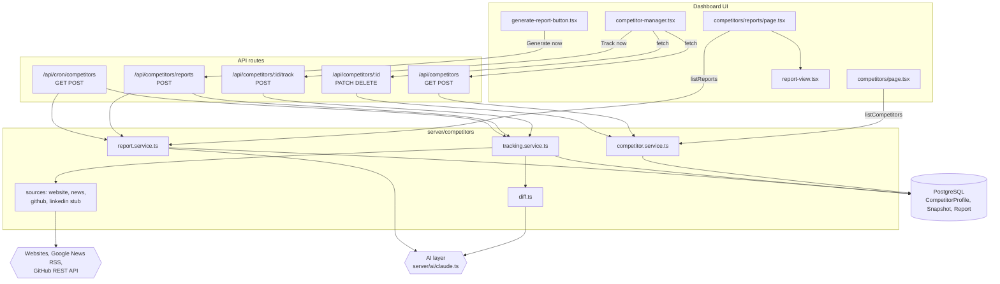
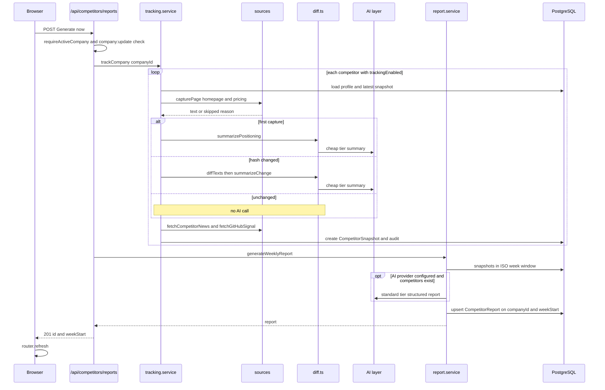
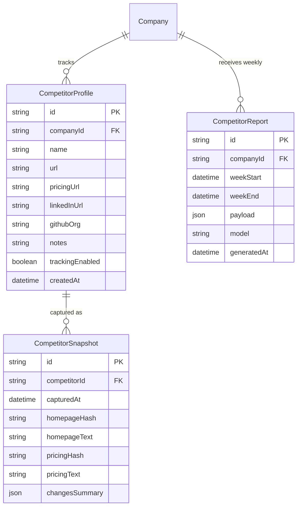

# Competitor Intelligence — Architecture

Competitor Intelligence works in two stages, both on the server. A tracking pass captures each competitor's public signal into a `CompetitorSnapshot`. A report pass merges a week of snapshots into one `CompetitorReport` per company and ISO week. Next.js server pages and client components sit on top of a small set of `/api/competitors` routes. A cron route runs the same two services on a schedule.

## Component architecture

How to read it:

- **Pages.** The two server pages read from the services directly.
- **Writes.** The three client components write only through the API routes.
- **Two services, three callers.** `tracking.service.ts` and `report.service.ts` are the only pieces that reach external systems. "Track now", "Generate now" and the cron job all call them.
- **AI and its fallback.** AI calls go through `diff.ts` (per-page summaries) and `report.service.ts` (the weekly report). Both have deterministic fallbacks when no provider is configured.

## Main flow

This is the "Generate now" path. The weekly cron runs the same two service calls for every company, without a session.

How to read it:

- **The loop.** One snapshot is written per tracking-enabled competitor. The `alt` block shows the only three cases for a page capture.
- **When the AI is called.** An AI summary is requested only for a first capture (to record positioning) or when the hash changed (to describe the diff).
- **The report step.** It always writes a row. If the AI is skipped or fails, the payload is deterministic.
- **Re-running.** Running it again in the same week overwrites that week's report.

## Data model

How to read it:

- **Cascades.** All three tables cascade on delete. Removing a competitor deletes its snapshots, and deleting a company deletes everything.
- **No link from reports to snapshots.** `CompetitorReport` has no foreign key to snapshots. It is a derived digest, unique on `(companyId, weekStart)`, and its `payload` refers to competitors by `competitorId` inside the JSON.
- **JSON shapes.** The `changesSummary` and `payload` JSON follow the `ChangesSummary` and `CompetitorReportPayload` types in `server/competitors/types.ts`.

## Design decisions

- **Public sources only, and LinkedIn as an honest stub.** No official API scope exists for an arbitrary company-page feed, and scraping is off-limits. So `sources/linkedin.ts` always reports itself unavailable, and the reason appears in `skipped` instead of being silently omitted.
- **Hash first, AI second.** A SHA-256 of normalized text answers "did anything change?" for free. AI summaries are only bought for real changes or a first capture. The normalize, hash and diff core is pure and unit-tested.
- **A baseline on the first capture.** A new competitor used to produce an empty first report that looked broken. `summarizePositioning` now records what the page currently claims, so the first report has content.
- **Coverage and skipped reasons are stored with the data.** Each report section carries `coverage`, and each snapshot carries `skipped`, so "nothing changed" can be told apart from "nothing was read".
- **Degrade, never fail.** Every source catches its own errors and returns empty or `null`. Every AI call has a deterministic fallback. `trackCompany` and the cron loop log a failed competitor or company and move on.
- **Idempotent per ISO week.** Upserting on `(companyId, weekStart)` with `weekStart` set to Monday 00:00 UTC makes "Generate now" and the cron job safe to repeat.
- **Normalize stored JSON at the boundary.** `readChangesSummary` guarantees the arrays the type promises. Older snapshots lacking `news` and `skipped` once crashed the page.
- **Reuse the knowledge pipeline's polite fetcher.** `politeFetchHtml` and `htmlToText` from `server/knowledge/` give robots.txt compliance and throttling without a second implementation.
- **Manage permissions follow `company:update`.** Competitor setup is a workspace-configuration act, so it is limited to OWNER and ADMIN, while any member can read.
