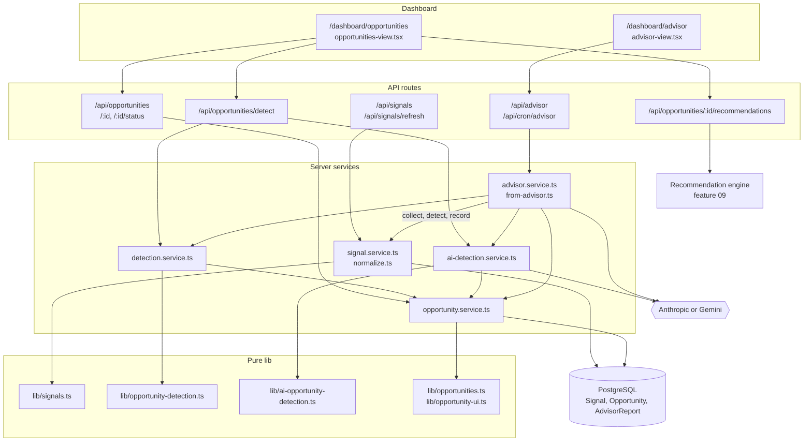
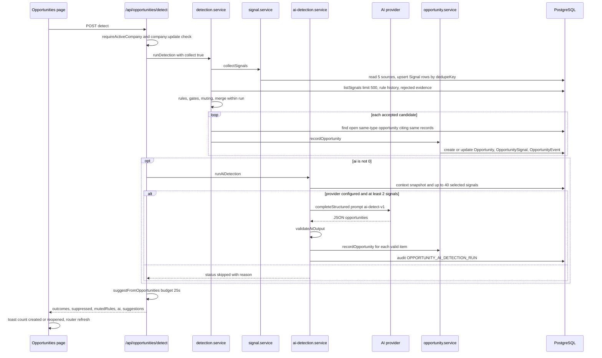
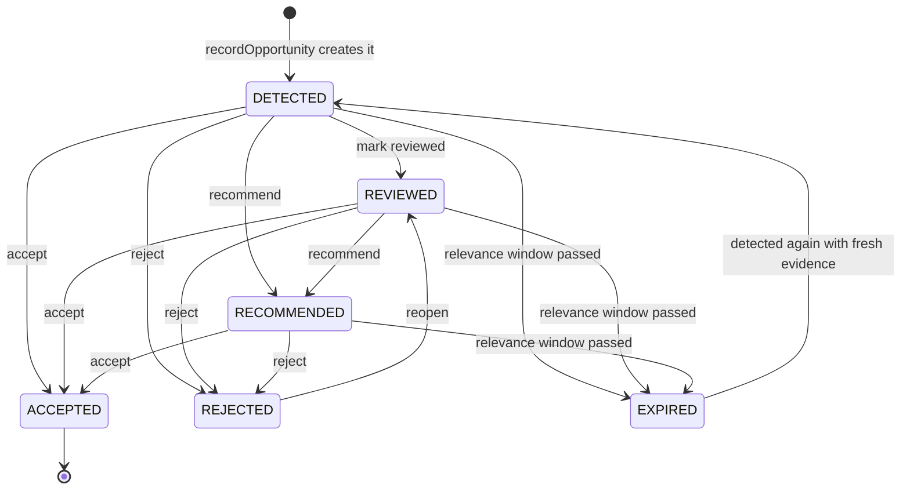
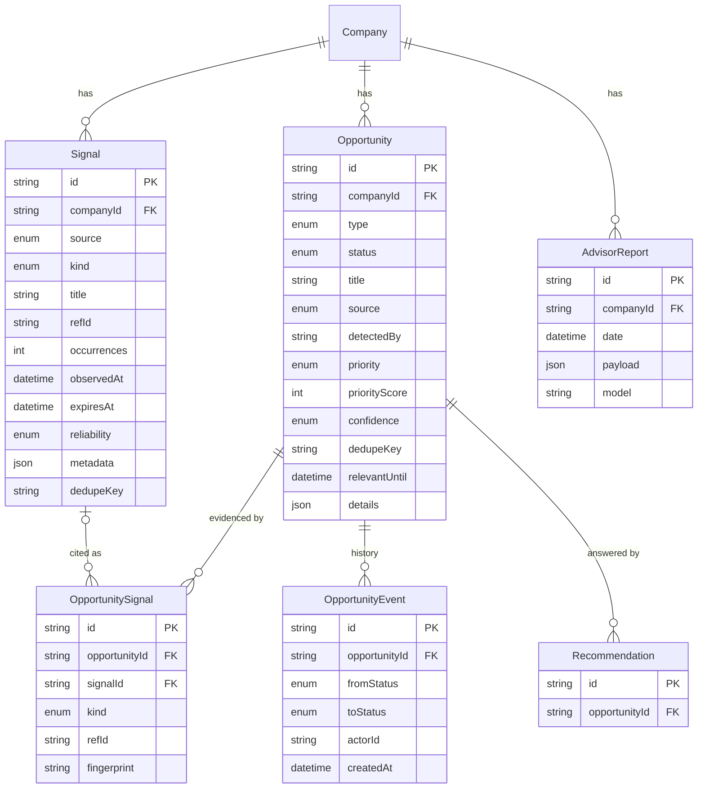

# Signals & Opportunity Detection — Architecture

Signals and opportunities are a pipeline: source modules (trends, competitors, analytics, memory, Business Context) are normalised into a `Signal` store, three detectors turn signals into candidate opportunities, and one write path (`recordOpportunity`) stores them with evidence, derived confidence and priority. Pure rules live in `lib/` and are unit-tested; database work lives in `server/`; API routes only authenticate, check permissions, validate and call services.

## Component architecture

Read top to bottom: the two dashboard pages call API routes, routes call services, services use pure lib modules for rules and write to PostgreSQL. All three detectors (rules, AI detection, advisor) converge on `opportunity.service.ts`, which is the only code that writes `Opportunity` rows. The advisor service is also an orchestrator: one advisor run collects signals and runs both other detectors before recording its own opportunities. Recommending an opportunity hands off to the recommendation engine in [../09-recommendations-and-aura-suggests](../09-recommendations-and-aura-suggests/).

## Main flow

The primary request is "Look for new opportunities" on the Opportunities page.

The rule run always completes first and is never affected by the AI step: AI detection returns a status (`ok`, `partial`, `rejected`, `failed`, `skipped`) instead of throwing, and the auto-suggestion step is wrapped in a catch. Both detectors check for an existing open opportunity of the same type citing the same records before recording, so the same opening found by different detectors becomes one row. The page then reloads server data, which expires stale opportunities before listing.

## Lifecycle / state machine

`DETECTED`, `REVIEWED` and `RECOMMENDED` are the open (`ACTIVE_STATUSES`) states; only these can expire, and only `expireOpportunities` moves anything to `EXPIRED` (people are never offered it). `ACCEPTED` is final, and re-detecting an accepted or rejected opportunity is skipped so a person's decision stands. `EXPIRED -> DETECTED` is not a manual transition: it happens only inside `recordOpportunity` when a detector sees the same `dedupeKey` again. Moves to `ACCEPTED`, `REJECTED` and `EXPIRED` are mirrored onto the opportunity's recommendations that are still `GENERATED` or `PRESENTED`.

## Data model

`Signal` and `Opportunity` are each unique per `(companyId, dedupeKey)`, which is what makes collection and re-detection idempotent. `OpportunitySignal` is the evidence: it always carries `kind` + `refId` back to the original record and, when it came through the signal store, `signalId` (set to null if the signal is ever deleted, so evidence survives). `OpportunityEvent` holds every status change, and `AdvisorReport` is one JSON payload per company per UTC day. `Recommendation` is owned by feature 09 and shown here only for the link.

## Design decisions

- **One normalised signal store.** Every source is converted to the same shape with a source, record id, observation date, expiry, reliability and reason, so detection rules do not need to know each module's storage format. Normalisers are pure and defensive: malformed rows produce fewer signals, never exceptions.
- **Deterministic first, AI only where interpretation is needed.** Five plain-logic rules cover what can be checked mechanically. AI detection is limited to `CONTENT_GAP`, `COMPETITIVE_GAP` and `AUDIENCE_SEGMENT`, and rule categories proposed by the model are rejected.
- **The model interprets, never asserts.** AI output must cite signals by reference, name the business facts it relies on, declare no assumptions, and contain no number absent from its sources; every check is deterministic and failures are audited rather than silently dropped.
- **Confidence comes from evidence, not claims.** Stored confidence is the lowest of the detector's claim, what the evidence count and kinds allow, and a MEDIUM cap when the opportunity relies on unconfirmed or stale business facts. A LOW-confidence opportunity can never be HIGH or URGENT priority.
- **One write path, idempotent by key.** `recordOpportunity` is the only way detectors save results; same key means more evidence on one row, not a duplicate. Cross-detector duplicates are caught by matching open opportunities of the same type that cite the same records.
- **Human decisions are sticky.** Re-detection never overrides `ACCEPTED` or `REJECTED`; evidence from rejected opportunities is not reused; a rule that keeps being rejected is muted for 30 days.
- **Compare-and-swap transitions.** Status changes update only if the status is still what was read, so concurrent decisions produce a 409 instead of a lost update.
- **Lazy expiry.** Opportunities are expired before every list and each advisor run instead of by a dedicated job, so a view never shows an open opportunity whose window has passed.
- **Best-effort orchestration.** In an advisor run, signal collection, both detectors and opportunity storage are each wrapped so a failure is logged and never stops the advisor report from being returned.
