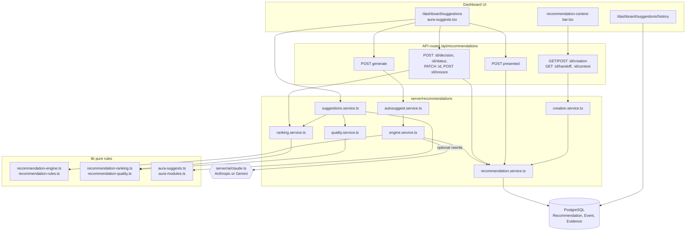
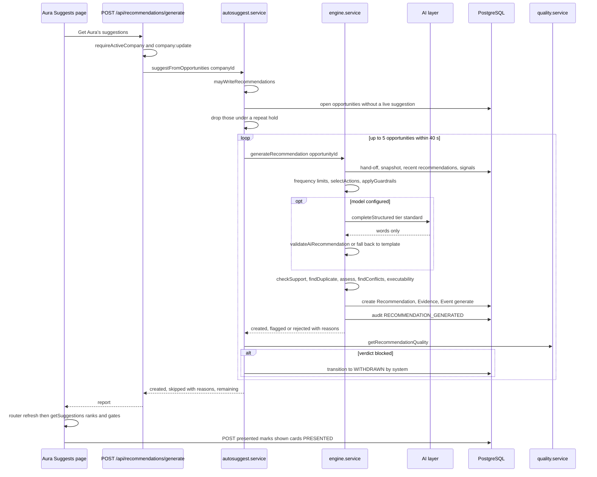
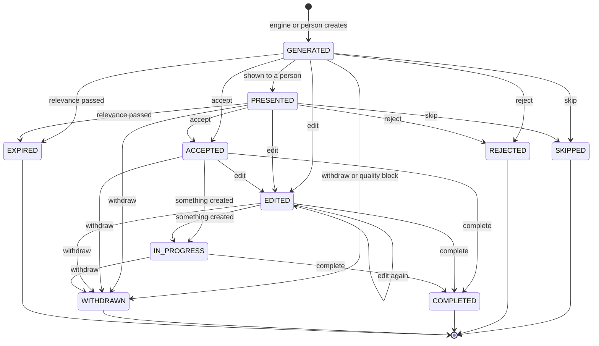
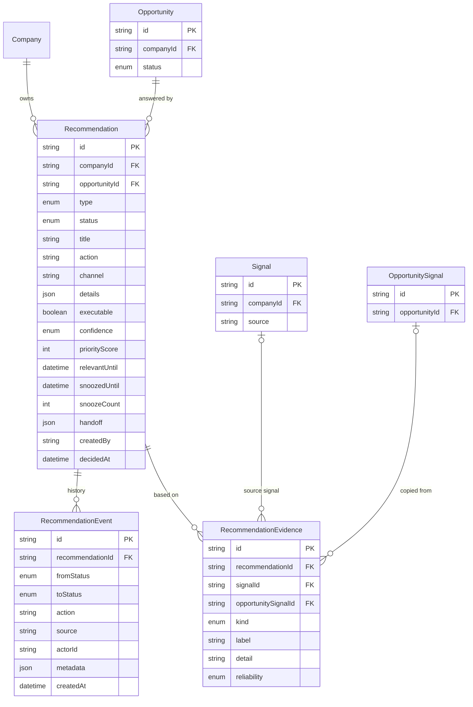

# Recommendations & Aura Suggests — Architecture

Recommendations follow the pattern used across Aura: pure, client-safe rules in `lib/` (lifecycle, engine, guardrails, ranking, quality, presentation) and thin database services in `server/recommendations/` that apply them. API routes only authenticate, check the role, validate with Zod and delegate. The model is optional and only allowed to reword an action the deterministic engine already chose.

## Component architecture

Read top to bottom: pages and the context bar call API routes (or, for server-rendered pages, the services directly), routes call services, services apply the pure rules in `lib/` and read or write the three recommendation tables. The only external dependency is the AI layer, used by the engine for an optional, validated rewrite. `suggestions.service.ts` is the single read path that combines ranking, quality gating and the plain-language view used by both Aura Suggests and Aura Home.

## Main flow

The primary flow is a person (or a detection run) asking Aura for suggestions. Each opportunity goes through the engine's deterministic steps; the model is consulted only to improve wording and is discarded if it cites anything unsupported. Right after writing, the quality gate can withdraw a suggestion before anyone sees it. When the page re-renders, ranking and quality are computed again on read, and the cards actually displayed are reported back as presented.

## Lifecycle / state machine

This is `RECOMMENDATION_TRANSITIONS` from `lib/recommendations.ts`. Only `GENERATED` and `PRESENTED` can expire; the five terminal states are final, so a new recommendation is made instead. Accepting or editing also moves the opportunity to `ACCEPTED`, rejecting moves it to `REJECTED`; "Not now" (snooze) does not change the status, it only hides the recommendation from the ranked list and writes a `defer` event.

## Data model

A recommendation always belongs to one workspace and one opportunity. Its history (`RecommendationEvent`) is append-only and cascades with it. Evidence is copied from the opportunity rather than shared, keeping soft links (`SetNull`) back to the opportunity's evidence row and the normalised `Signal`, so a recommendation keeps what it was based on even after signals are pruned.

## Design decisions

- **Rules first, model second.** The engine picks the action deterministically from a catalogue per opportunity type; a model may only reword it, and `validateAiRecommendation` throws its output away if it cites unknown evidence or facts, declares assumptions, or invents figures. Without any model configured, the feature still works from templates.
- **Guardrails as data.** Limits, duplicate windows, minimum evidence, confidence rules and channel integrations are constants in `lib/recommendation-rules.ts`, unit-tested on their own and documented with the same numbers.
- **Never surer than the evidence.** Confidence and relevance are bounded by the opportunity's (`boundByOpportunity`, `assess`); low confidence is advisory and not executable until a person accepts it.
- **Ranking computed on read.** The surfaced order depends on today's goals, deadlines and past decisions, so it is never stored; every point comes with its reason so the order can be explained.
- **Quality gate right before presentation.** Things change after creation (evidence expires, an opportunity is rejected, the profile is edited), so the eight checks run in `getSuggestions` and again just after auto-suggest writes, and blocked suggestions are held back with a reason rather than shown.
- **One decision, both sides.** Recommendation and opportunity statuses are kept in step in the same transaction (`transitionRecommendation` -> `transitionOpportunity`).
- **Optimistic concurrency and idempotency.** Compare-and-swap updates and `expectedStatus` stop double clicks and stale screens from creating conflicting history; repeats return `changed: false`.
- **Honest emptiness.** When Aura lacks the basics (what the business does, where it publishes), it writes nothing and the page shows the readiness checklist instead of generic advice.
- **One answer to "Create".** `creationPlan` and the versioned Context Handoff are shared by Aura Suggests, Content Studio, Campaigns, Outreach and the API, so modules never disagree about what can be created or what context it carries; every destination carries `?rec=<id>`.
- **Workspace scoping enforced by a test.** A static test scans every database call on the recommendation tables to make sure it is scoped to one workspace.
