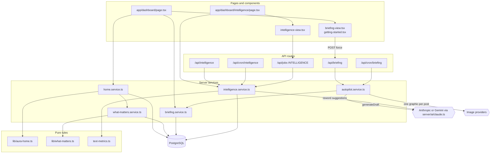
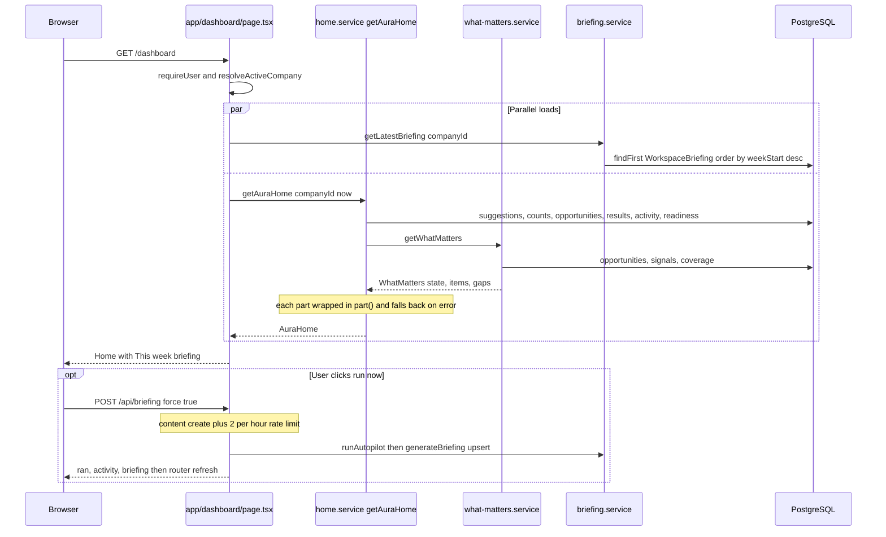
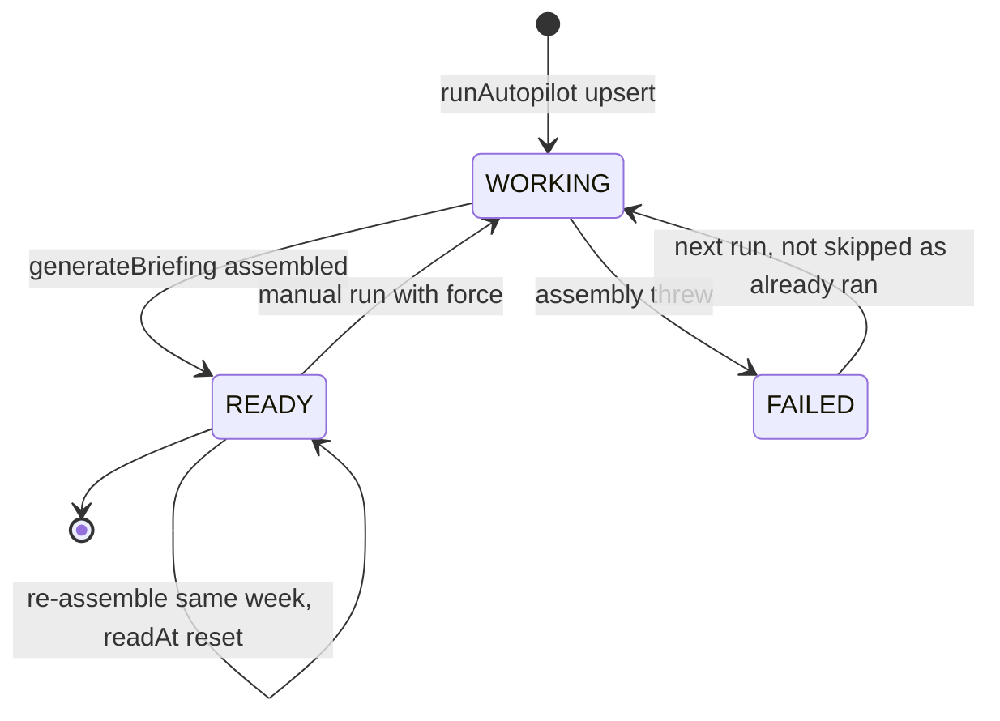
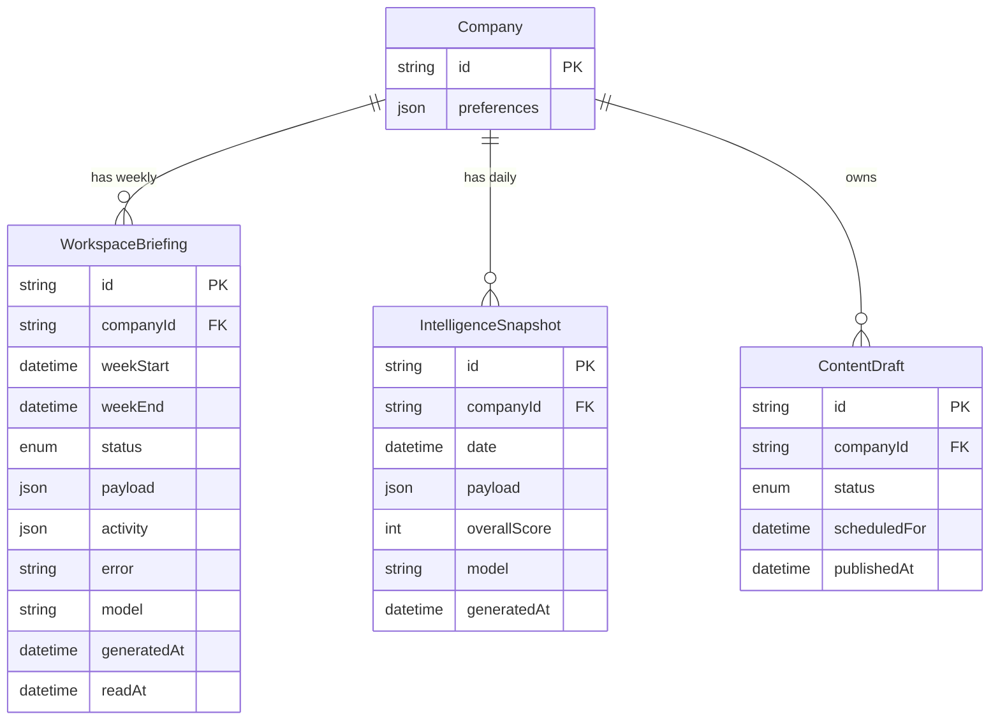

# Aura Home, What Matters Now & Weekly Briefing — Architecture

Aura Home is a Server Component. On every request it reads from several services in parallel and passes the results through pure rule modules (`lib/aura-home.ts`, `lib/what-matters.ts`). Two scheduled pipelines write the snapshots that Home also reads. The weekly Autopilot cycle stores a `WorkspaceBriefing`. The daily intelligence run stores an `IntelligenceSnapshot`.

## Component architecture

How to read it: the Home page goes straight to the services; it has no API route of its own. Only three paths can reach a model or image provider: Autopilot (writing posts and graphics), the intelligence run (rewording suggestions), and the manual and cron triggers that start them. The briefing service only reads and writes the database. Both cron routes and the manual POST routes call the same service functions, so a run started by hand and a scheduled run behave the same way.

## Main flow

How to read it: the briefing and the live Home data load at the same time. Inside `getAuraHome`, each of the seven sources is isolated by `part()`, so a failing source (analytics, for example) only blanks its own section. The optional block is the manual "catch me up" run. It writes through the same Autopilot path as the Monday cron, and the page then re-renders with `router.refresh()`.

## Lifecycle / state machine

How to read it: one `WorkspaceBriefing` row exists per company per ISO week. A run sets the row to `WORKING` and then to `READY`. If assembly throws, the row becomes `FAILED` with an `error`. A non-forced run skips writing posts when the week already has a row that is not FAILED: it only re-assembles the briefing, which keeps the row `READY`. A FAILED week is retried in full. When Autopilot is disabled, `generateBriefing` writes the row directly as `READY`, without the WORKING step.

## Data model

How to read it: the feature owns two snapshot tables. `WorkspaceBriefing` is unique on `(companyId, weekStart)` and `IntelligenceSnapshot` is unique on `(companyId, date)`. Both are upserted, so re-running replaces the snapshot instead of adding a new one. Autopilot settings live in `Company.preferences.autopilot`. Autopilot creates and updates `ContentDraft` rows. Everything else Home shows is read live from other features' tables (opportunities, signals, recommendations, leads, analytics).

## Design decisions

- **Recommendation-led Home, computed live.** The old Home was a weekly snapshot whose "Needs you" counts could be up to 7 days old. The sections above "This week" are now computed on every request, and the briefing is kept below them as Aura's weekly report.
- **One failing source never breaks Home.** `part()` returns a fallback and logs a warning, so analytics, suggestions or another source can fail without taking the page down. `verify:home` simulates such an outage.
- **No fabrication.** What matters now has explicit `insufficient` and `quiet` states and a list of gaps. The briefing records `coverage.skipped` reasons instead of filling sections with placeholders. Results show "—" instead of a misleading zero.
- **The briefing assembles; it does not generate.** `assembleBriefing` makes no model calls, so it is instant and costs nothing, and a briefing can be rebuilt at any time. The payload is a snapshot of that week.
- **Autopilot is built to avoid unwanted spending.**
  - It runs unless a workspace turns it off.
  - It is idempotent per week.
  - It takes graphics only from the plan allowance that is left, and posts are still written when graphics are not.
  - It asks for exactly one image variation.
  - Any unknown `publishMode` falls back to `review`.
  - Auto-approval requires `auto` mode, a connected channel and the weekly cap of 5.
- **Cron and manual runs share one code path.** `POST /api/briefing` and `/api/cron/briefing` both call `runAutopilot`, so they cannot drift apart. Cron routes export `GET = POST` for Vercel Cron.
- **Scores are deterministic; the model only gives advice.** Intelligence scores come from `text-metrics.ts` and ratios over real rows. The model may reword and reorder suggestions, but impact and priority are recomputed by the code. Unmeasured areas are excluded from the overall score instead of being counted as zero, and a setup-only score is labelled as setup progress.
- **Pure rule modules.** `lib/aura-home.ts` and `lib/what-matters.ts` have no database access and are unit-tested directly. The services only load data and map it to the rule inputs.
