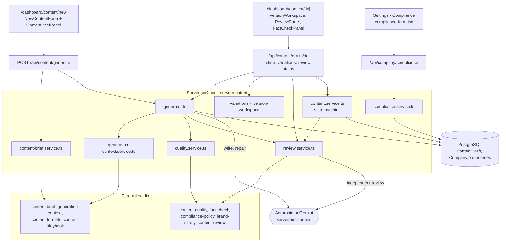
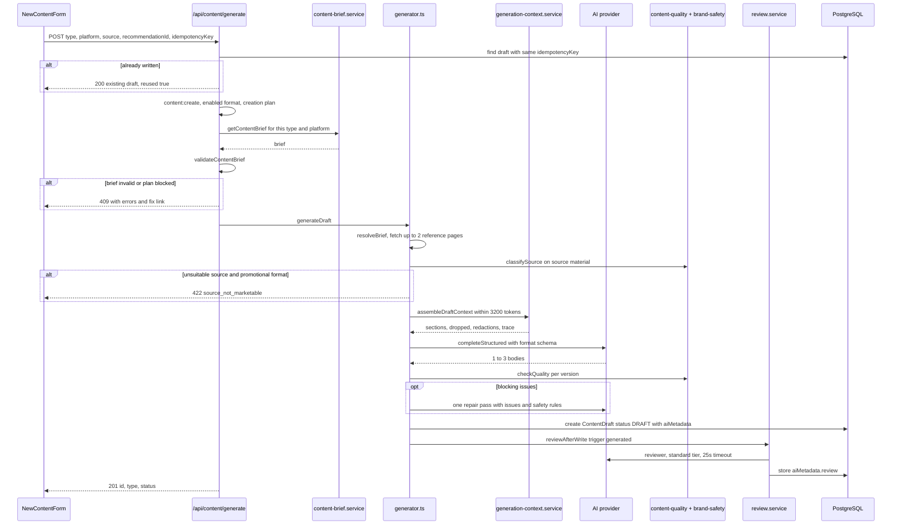
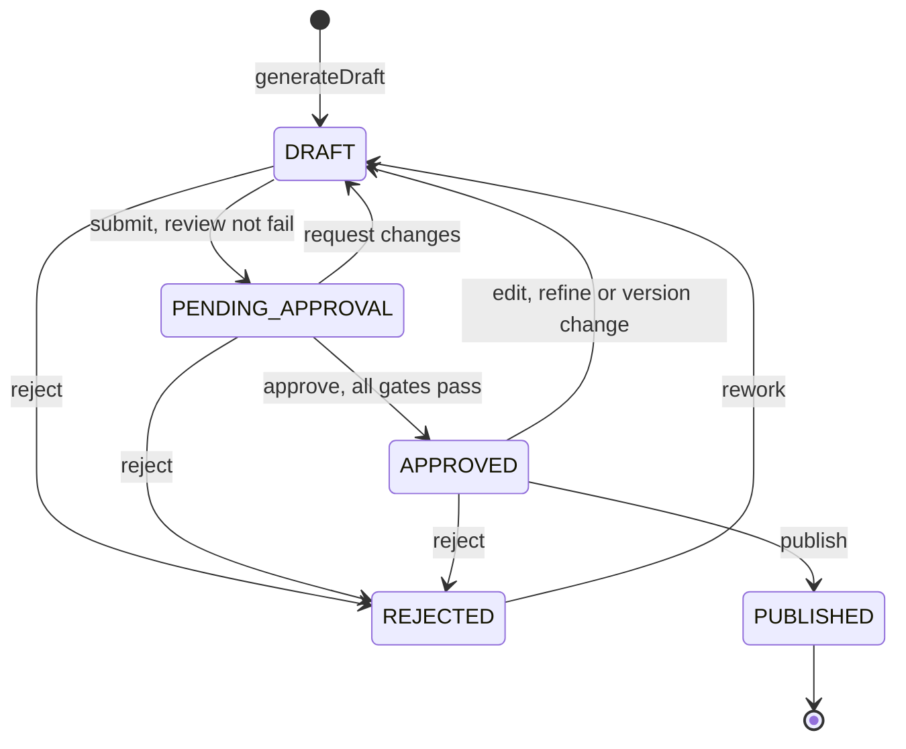
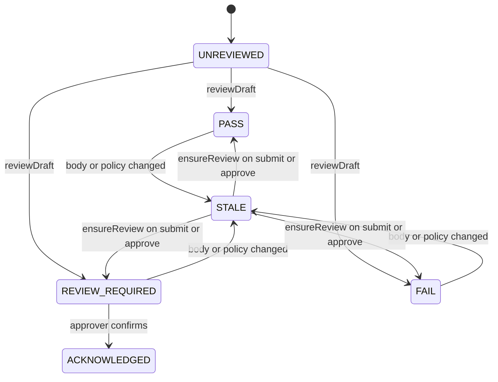
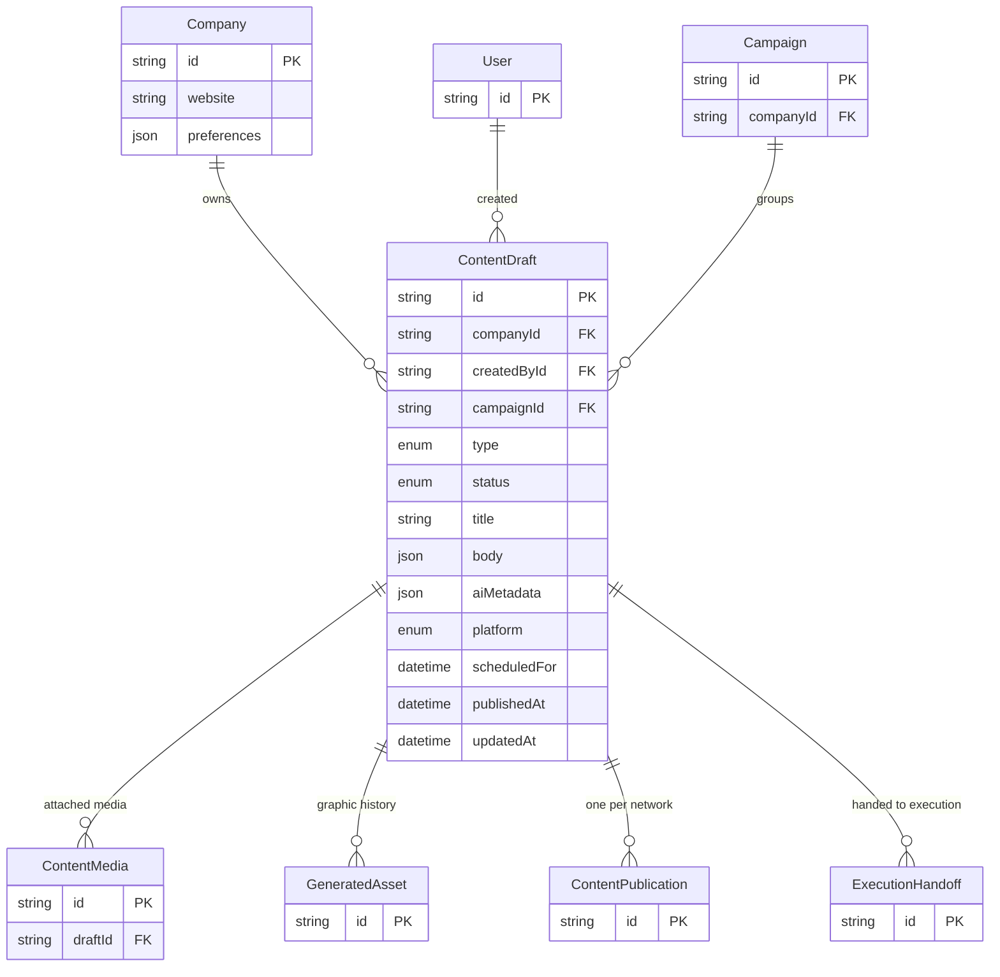

# Content Studio (Generation, Brief, Formats, Quality) — Architecture

Content Studio turns a request into a checked draft: a brief, trend, campaign or accepted recommendation. The work is split between pure, client-safe rule modules in `lib/` (brief, context, formats, quality, fact check, compliance, brand safety, review) and server services in `server/content/` that load data, call the model and persist `ContentDraft`. Every decision the model cannot be trusted with is made deterministically: whether a source can be marketed, whether a fact changed, whether a rule failed. The model writes, and the code decides what can reach approval.

## Component architecture

Read the diagram top to bottom: pages call API routes, routes call services in `server/content/`, and services apply the pure rules in `lib/` before touching the model or the database. Two separate model calls exist: the writer (and its repair pass) in `generator.ts`, and the reviewer in `review.service.ts`, which never sees the writer's prompt. `content.service.ts` is the only place that changes `status`. It calls the reviewer again whenever the stored review is out of date.

## Main flow

The sequence covers the primary path, writing a draft from an accepted recommendation. The `alt` blocks are the early exits, each with its HTTP status: an idempotent replay returns the existing draft, an invalid brief or blocked plan returns 409, and a grave source with a promotional format returns 422. The repair pass is optional and runs at most once. The review runs after the draft is saved, so a reviewer failure never loses the draft.

## Lifecycle / state machine

These are the `TRANSITIONS` in `server/content/content.service.ts`. `PUBLISHED` is reachable only from `APPROVED` and is terminal. Before `PENDING_APPROVAL` and `APPROVED`, `ensureReview()` re-reviews a stale review. On approval, the gates are checked in this order: blocking quality issues, then fact-check contradictions and must-fix claims, then unconfirmed claims (`factsReviewed`), then a failed review, then `review_required` (`reviewAcknowledged`). Any content change on an approved draft sends it back to `DRAFT`. The approval layer that wraps this machine is described in [13](../13-review-approval-versions-and-trace/02-ARCHITECTURE.md).

A second, smaller state machine governs the AI Reviewer's verdict on the current body.

A review is current only while its `bodyHash` matches the body and its `policyHash` matches the rules in force (`isReviewCurrent`). Manual edits, version switches, undo and compliance-policy changes all make it stale. `FAIL` blocks both submit and approve. `REVIEW_REQUIRED` blocks only approval, until the approver acknowledges it; that is recorded as `acknowledgedBy`.

## Data model

Content Studio owns one table, `ContentDraft`; the rest of the feature's state lives in JSON. `body` holds the per-format structure and its post `details`. `aiMetadata` holds the brief, context trace, source safety verdict and source material, quality report, versions, undo history and review. `Company.preferences.compliancePolicy` holds the workspace's rules. Media, generated assets, publications and execution hand-offs hang off the draft; they are owned by features 12 and 20 and shown here only for orientation.

## Design decisions

- **Each format is defined once.** `FORMAT_SPECS` drives the writer's instructions, the brief's required fields, the quality limits and the zod output schema. Adding Campaign copy and Promo meant adding one spec, not editing four places.
- **The brief is validated server-side, for exactly what is being made.** The brief is rebuilt for the chosen format and network in the generate route, so a client cannot submit a brief whose requirements do not match the output.
- **Context is budgeted and recorded as a trace, not as text.** A fixed 3,200-token budget with per-section caps keeps prompts bounded. Storing only the trace (ids, revision, sections, drops, redactions) in `aiMetadata.context` avoids copying sensitive material into the draft while still answering "why did it say that".
- **Brand safety is deterministic and runs before the writer.** Its notes explain why: a model asked whether something is sensitive agrees with its framing. The same verdict is stored on the draft, so rewrites, variations and the reviewer all read the source the same way. Promotional formats are refused outright on grave sources.
- **The reviewer is independent and cannot write copy.** It has a separate system prompt, a schema with no copy field, a cheaper standard tier and a 25-second timeout. When it fails, the piece goes to a person instead of passing.
- **The model never fails a piece on legal or factual grounds alone.** For the critical dimensions (accuracy, compliance, brand safety), a low model score only sends the piece to review; only rules, the fact check and the policy can fail it. A rule breach always fails, whatever the model scored.
- **Variations are added, never replacing.** The facts guardrail and the topic-drift guard check the result in code. CTA and headline variations change a single field in code, so nothing else can move. Up to 8 versions are kept, and the active one is never dropped.
- **Post details are never AI-written.** The writer's schema excludes `details`, so contact information comes only from the business profile or a person. Typed values block approval until a person confirms them.
- **Writes are idempotent and use optimistic concurrency.** An idempotency key per open form avoids paying for duplicate drafts after a retry. The `updatedAt` / `baseUpdatedAt` guards turn concurrent edits into 409s instead of silent overwrites.
- **The publish guarantee lives in the service.** `PUBLISHED` is reachable only from `APPROVED`, enforced in `TRANSITIONS`, so no UI or caller can publish an unapproved draft.
