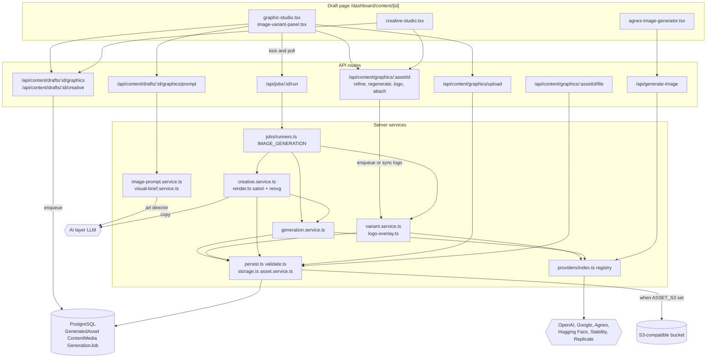
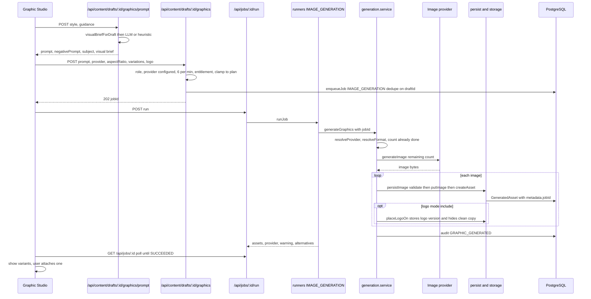
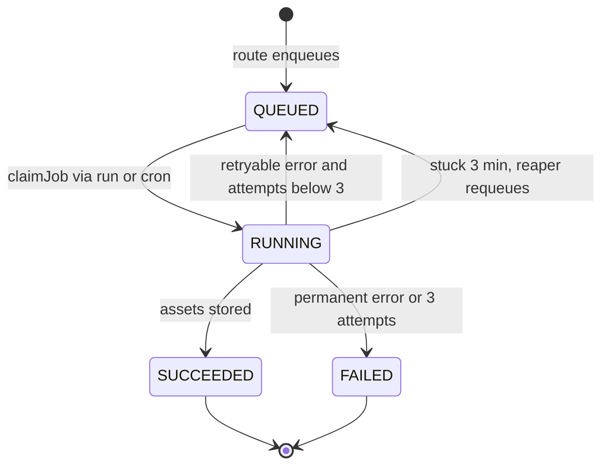
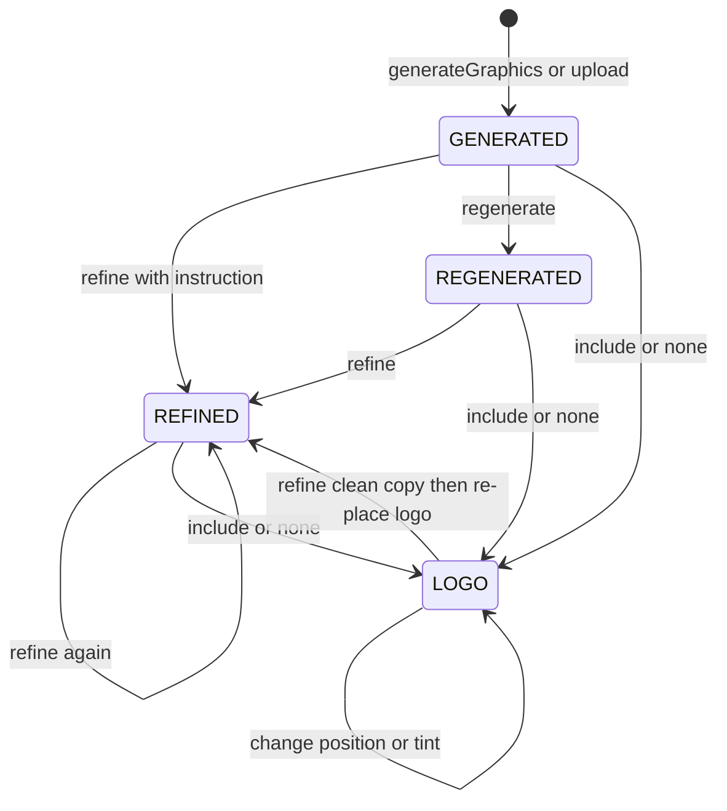
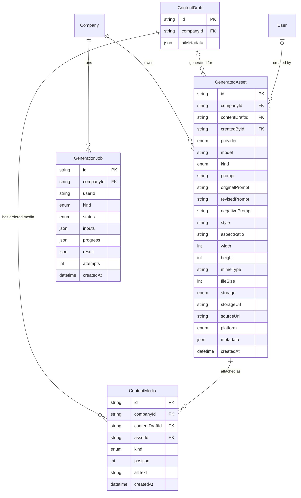

# Media, Graphics & Marketing Creatives — Architecture

The browser never talks to an image vendor. It calls Aura routes, and those routes run a few cheap checks and then queue a `GenerationJob`. The job runner drives the media services, which go through a provider registry to the vendors and store the resulting bytes in Postgres or an S3-compatible bucket. Every image, logo version and creative ends up as an ordinary `GeneratedAsset`, and a post attaches assets through `ContentMedia`.

## Component architecture

The top band is the three UI components on the draft page. The middle band is the Next.js route handlers. The lower band is `server/media/` together with the job runner. Generation, creatives with a new photo, refine, regenerate and make-space requests only enqueue a job. The browser then calls `/api/jobs/:id/run`, and the runner dispatches to `generateGraphics`, `generateCreative` or the variant service. All of these paths converge on the same storage path: `persistImage`, then `validateImageBytes`, then `putImage`, then `createAsset`. `/api/generate-image` is the one path that calls the provider registry and returns the bytes directly, without storing anything.

## Main flow

Read the diagram top to bottom. The prompt call is cheap and runs synchronously. Generation is paid, so it is queued. Every check that should fail fast (role, provider configured, burst limit, plan allowance) runs before the job row is created. Inside the runner, `generateGraphics` subtracts any images an earlier attempt of the same job already stored, so a retry pays only for the shortfall. Each image is stored on its own; one rejected image does not lose the rest, and the shortfall comes back as `warning`.

## Lifecycle / state machine

### Generation job

`GenerationJobStatus` is owned by the jobs platform, but image runs use their own stuck threshold of 3 minutes. Errors that declare `retryable = false`, such as `NoImageProviderError`, go straight to FAILED. A retried run resumes from the assets stamped with its `jobId`, so returning to QUEUED never charges for the same images twice.

### Image variant versions

Each state is a value of `metadata.variant.action` on a **new** `GeneratedAsset`. Every transition creates the next version under the same `rootId`; nothing is edited in place, so choosing an earlier version is how a user reverts. A LOGO version keeps a pointer (`cleanId`) to the hidden logo-free image, and refinements always edit that clean copy. The image model never sees the logo.

## Data model

`GeneratedAsset` stores every visual: generated images, uploads (`provider = UPLOAD`), videos (`kind = VIDEO`), logo versions and composed creatives (`metadata.kind = creative`). With database storage the bytes are kept in the `data` column, which is left out of the diagram. Deleting a draft sets `contentDraftId` to null rather than deleting the asset, so a graphic reused on another post survives. `ContentMedia` is the ordered join that turns assets into a post's media set, including carousels, and the unique key on draft and asset makes attaching the same asset twice a no-op. `GenerationJob.inputs` carries the variant or creative payload, and `ContentDraft.aiMetadata.brief.visual` is where the stored visual brief comes from.

## Design decisions

- **Provider abstraction plus registry** (`server/media/types.ts`, `providers/index.ts`). Adding a vendor means one file and one registry line. Routes and components never name a vendor. Registry order (OpenAI, Google, Agnes, Hugging Face, Stability, Replicate) decides the default. An explicit choice that is not configured is refused, never silently swapped, so a workspace is never billed for a model it did not pick.
- **Generation runs as a job, not inline.** Several variations on a slow provider exceed a serverless function's time budget. Checks that should fail fast run in the route before the job exists. Jobs are deduplicated per draft, and a conflicting request returns 409 instead of quietly attaching to the run already in progress.
- **Resumable by `metadata.jobId` / `creativeJobId`.** A run killed by the platform is retried and pays only for the images it had not finished.
- **Durable storage by default in Postgres.** Provider URLs expire within hours and the deployment targets have no writable disk. `ASSET_S3_*` switches to a bucket with no code change, and each row records which store holds its bytes, so assets made before the switch keep working. SigV4 is hand-written rather than pulling in the AWS SDK. A failed bucket upload falls back to the database because the image has already been paid for. Video has no database fallback.
- **Trust bytes, not headers.** Magic-byte sniffing and header-read dimensions run before storage, so a provider's HTML error page never becomes an asset row.
- **Signed URLs instead of a public route.** Instagram fetches media by URL, so the file route accepts a short-lived HMAC grant (15 min) or a session. Without either it answers 404, so it never confirms that an asset id exists.
- **The model never draws the logo or the words.** Prompts reserve clean space for the logo. The exact uploaded logo is composited with sharp (with tinting that keeps the alpha channel). Creative text is set by satori and resvg in bundled OFL fonts, measured against real font metrics. This avoids garbled lettering and redrawn marks.
- **Versions, never overwrites.** Lineage lives in `metadata` (`variant`, `logo`, `cleanId`, `hidden`), so no schema change was needed, every earlier version stays usable, and refinements work on the logo-free copy.
- **Fact-guarded creative copy.** Text the user typed is locked. Figures and details the model writes are checked against the user's own request, the post and the business facts, and anything unsupported is dropped and reported. When no photo can be made, the creative falls back to the brand background and is labelled honestly instead of failing.
- **Visual brief as the art director's input.** The prompt is written from what the piece is *for* (the recommendation's key message, product, audience, palette, mood, the channel's shape) rather than guessed from the post's first line. Missing inputs are listed with a link to fix them, never invented.
- **Usage counts generations, not compositions.** Creatives and logo versions reuse an image that has already been counted, so they do not reduce the monthly allowance. Entitlement checks and the studio meter share one count, `assetsThisMonth`.
- **Media changes reopen approval.** Attaching or detaching goes through `recordContentChange`, because an approval covers the images as well as the text.
