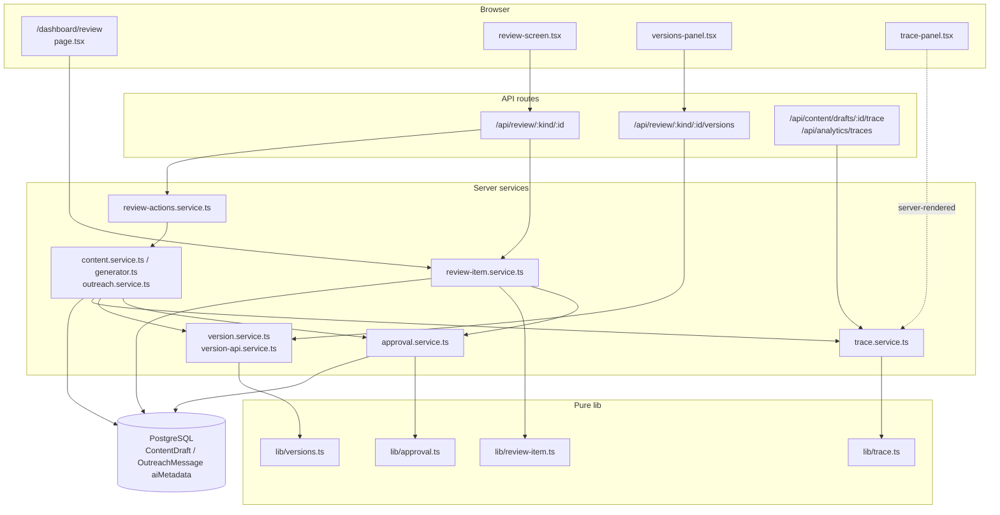
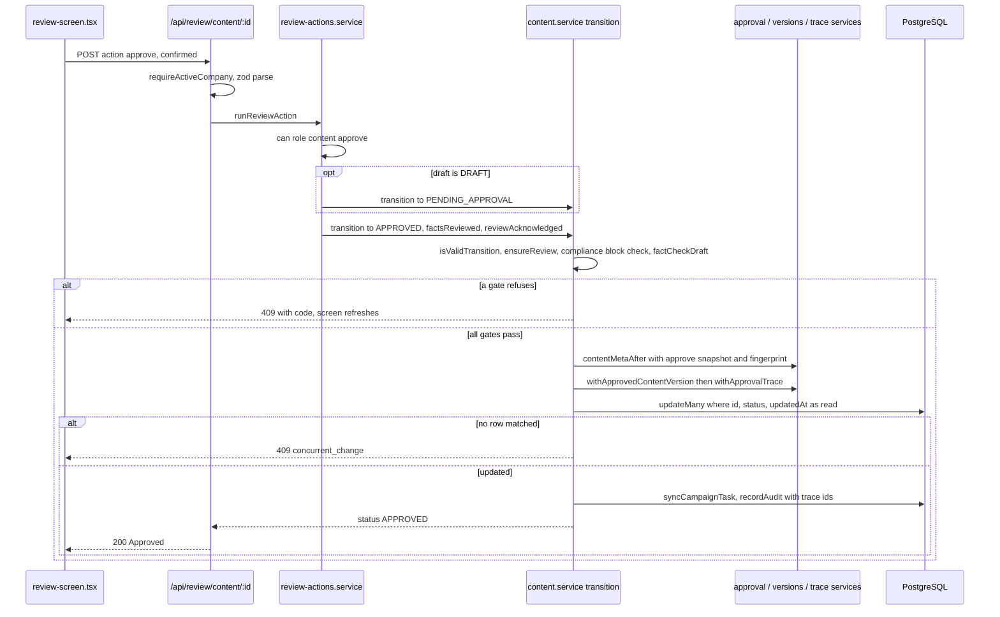
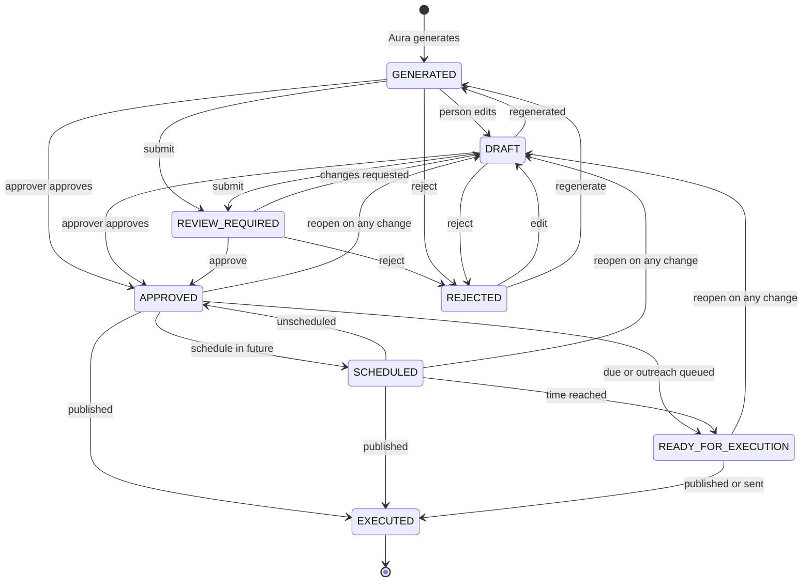
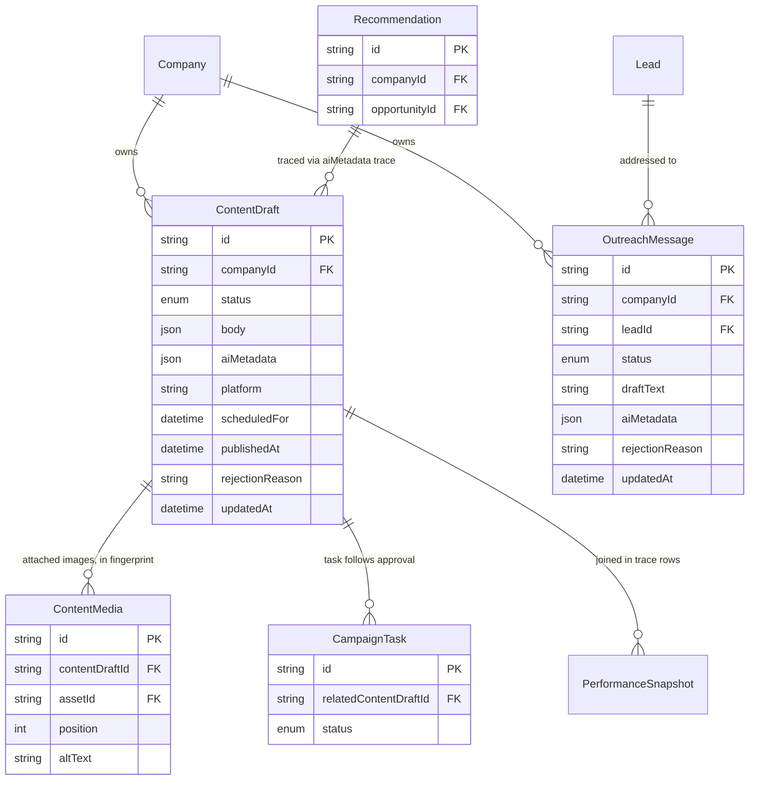

# Review, Approval, Versions & Traceability — Architecture

Pure models in `lib/` define how review items look, the approval states and fingerprints, the version log and the trace ids. Server services in `server/` apply those models to `ContentDraft` and `OutreachMessage` rows, storing everything inside each row's `aiMetadata` JSON. One review screen and one review API sit on top. Every review action delegates to the owning module's service, so Content Studio's and Outreach's gates apply whichever screen a person uses.

## Component architecture

Read the diagram from top to bottom. The queue and item pages are server components, so they call the services directly. The client screen and versions panel use the API routes. The action service never writes rows itself. It calls the module services (`transition`, `updateDraftBody`, `refineDraft`, `scheduleDraft`, `transitionMessage`, `updateMessageText`, `regenerateMessage`), which in turn use the approval, version and trace services to compute the next `aiMetadata`. The four `lib/` files have no database dependency and are shared with the client.

## Main flow

Approving a Content Studio draft from the review screen:

The approver's single click may run two transitions: submit, then approve. Each transition re-runs the AI review, the compliance check and the fact check, so the screen cannot skip them. The approval record, the approved version marker and the approval trace are all computed into one `aiMetadata` value and written in a single conditional update, which is why a concurrent edit or a second approver gets a 409 instead of a half-applied approval.

## Lifecycle / state machine

The unified approval state (`lib/approval.ts`). It is derived from `ContentDraft.status` and `scheduledFor`, or from `OutreachMessage.status`.

`GENERATED` and `DRAFT` are both stored as `DRAFT`. They differ only by whether the last non-submit event was a person's change. Every exit from the approved family (`APPROVED`, `SCHEDULED`, `READY_FOR_EXECUTION`) back to `DRAFT` is a recorded reopen, caused by an edit, regeneration, variation, undo, restore, image swap or network change. No path changes approved content while it stays approved. `EXECUTED` (`PUBLISHED` or `SENT`) is terminal. Rejection is also allowed from the approved family; it is omitted here to keep the diagram readable.

## Data model

The feature owns no tables. These are the rows it reads and writes, with its JSON sub-documents shown as attributes.

`aiMetadata` carries three sub-documents. `approval` holds the version, fingerprint, the approved and rejected records, and up to 60 events. `versions` holds the current version, the approved version and up to 50 versions. `trace` (content only) holds the traceId and the business-context revision, signal, opportunity, recommendation, brief, reviewed, approved and media ids. The link from `Recommendation` to `ContentDraft` is not a foreign key. It is a snapshot id kept in `aiMetadata.trace`, so the chain survives a deleted recommendation, and `resolveTrace` reports the gap.

## Design decisions

- **Derive the unified state; don't store it.** Each module keeps its own status column and meaning. The unified state is computed from status plus schedule, so no migration was needed, and the execution engine can take over from `ready_for_execution` without renames.
- **Everything in `aiMetadata` JSON.** The approval record, the version log and the trace sit next to the content they describe, need no schema change, and outlive the upstream records they point at. Caps (60 events, 50 versions, snapshots on the newest 15 events) keep the rows bounded.
- **An approval covers a fingerprint, not a status.** Content is fingerprinted over text, network and ordered images (with alt text). Every execution path calls `assertContentIntact`, or `outreachIntact` for outreach, so even a change that bypassed the services (such as a direct DB write) is refused with `changed_after_approval`.
- **Change reopens; it never edits in place.** Edits, regenerations, variations, undos, restores, image swaps and network changes all move the version on, keep the previous content and send approved work back to draft. The audit shows the reopen.
- **Restore appends.** Making an old version current creates a new `restored` version with `basedOn`, so history is never rewritten. The original, current and approved versions are never trimmed.
- **One screen, module rules.** `runReviewAction` only checks roles and delegates. The AI review, compliance, fact check and state machine live in the module services, so the gates are identical in Content Studio, on the Outreach board, in the unified review and on WhatsApp.
- **Optimistic concurrency everywhere.** Saves carry `baseUpdatedAt` (409 `stale`). Transitions write with `where { status, updatedAt }` (409 `concurrent_change`). Unsaved edits live in `localStorage` per item, with the version they were made on, so a conflict never loses work.
- **Lazy records for legacy items.** Items made before each model get a record, log or trace the first time they are read. Items that were already approved are recorded as approved as they stand, by an unknown approver, rather than being silently unapproved.
- **Autopilot is never a person.** Machine approvals are stored with `via: 'autopilot'` and `by: null`, and shown as "Autopilot".
