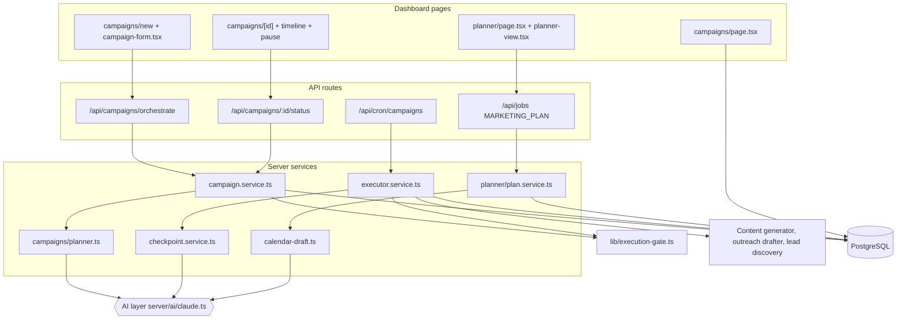
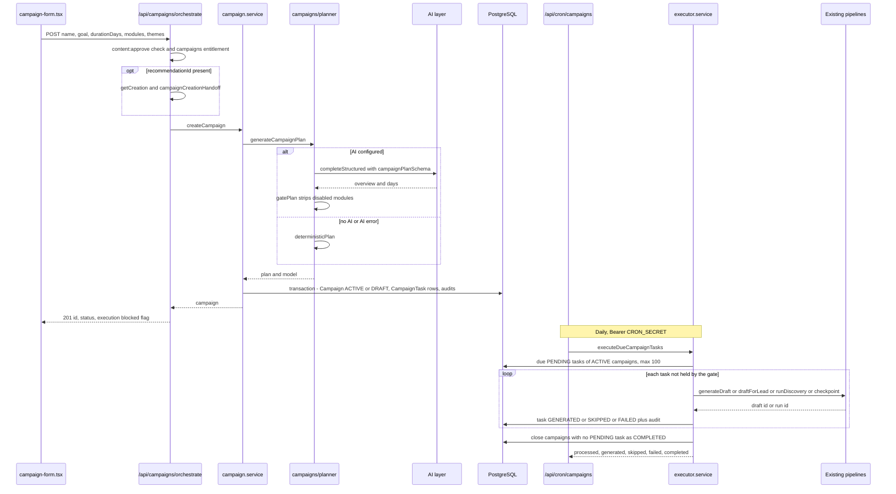
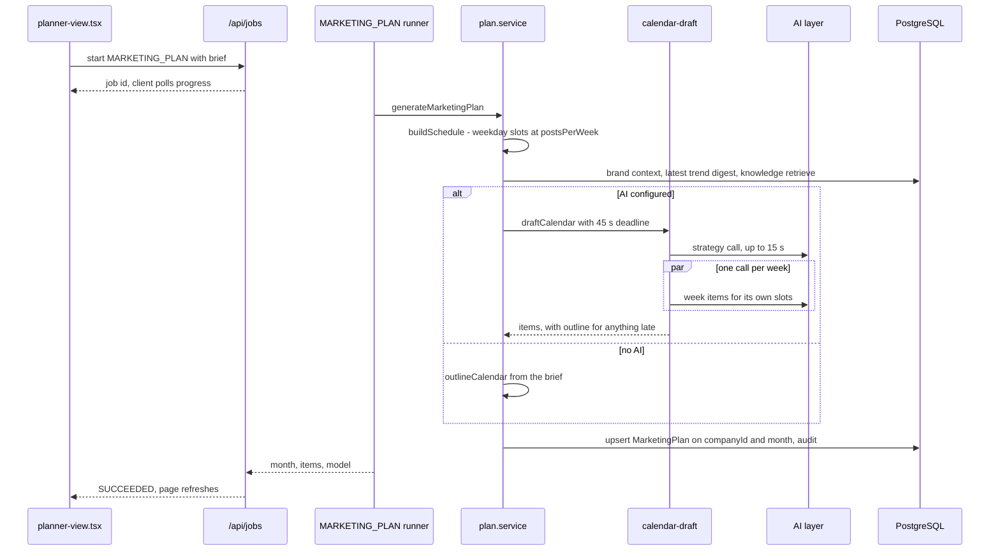
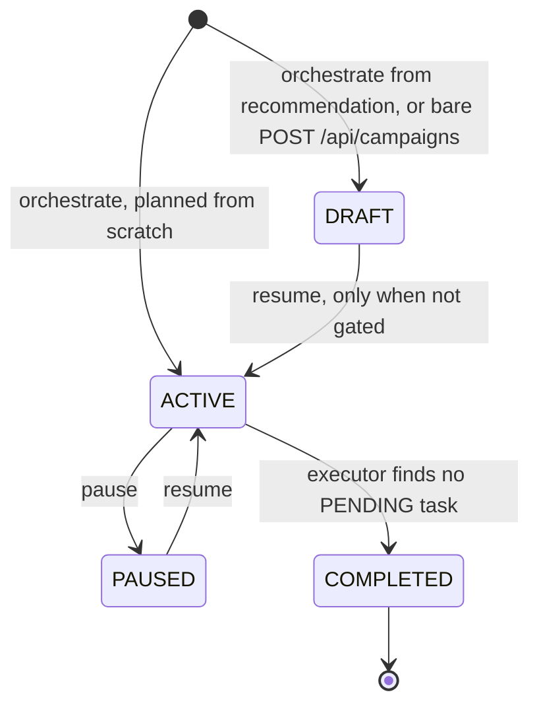
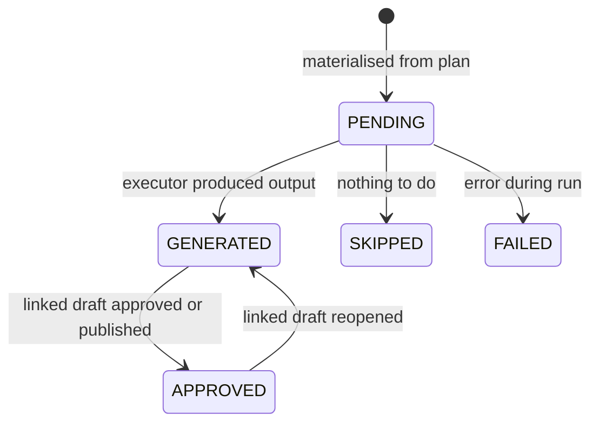
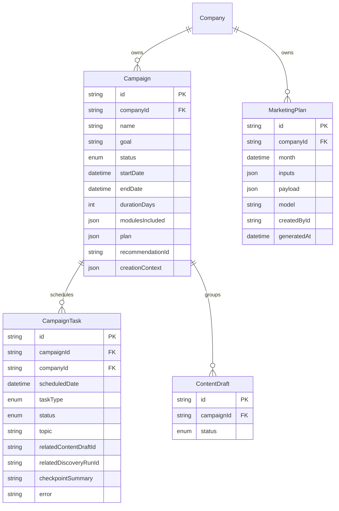

# Campaigns & Content Planner — Architecture

Campaigns and the Content Planner are two thin planning layers over the rest of Aura. The Campaign Orchestrator turns a goal into a stored plan and a `CampaignTask` schedule that a daily job executes by calling the existing content, outreach and discovery pipelines; the Content Planner turns a monthly brief into a dated calendar stored as a single `MarketingPlan` row. Neither publishes or sends anything — all output waits for human approval.

## Component architecture

The top row is server-rendered pages that read through services, and the client components that call the API routes. The campaign path splits into creation (`campaign.service.ts` and `planner.ts`) and execution (`executor.service.ts`, triggered only by the cron route). The execution gate is checked in both. The planner path runs through the shared generation-job system and ends in `calendar-draft.ts`. Every AI call goes through the shared AI layer.

## Main flow

Creating an orchestrated campaign, then the daily run that executes it.

Read it in two halves. Above the note, the request is synchronous: the plan is generated and the whole schedule is written in one transaction before the 201 response. Below the note, the cron call runs independently and moves tasks through their statuses. The output is drafts in the normal approval queues, never published posts or sent messages.

A second flow, the Content Planner, works the same way but runs as a background job.

The schedule (real dates) is computed before the model is asked, so the model only fills slots. Strategy and weeks share one deadline; anything not returned in time is filled from the brief and flagged in `payload.outline`. The upsert makes regeneration replace that month's plan.

## Lifecycle / state machine

Stored campaign status (`CampaignStatus`), as written by the code.

Campaign tasks (`CampaignTaskStatus`).

`ARCHIVED` exists in the enum and is filtered from lists but no code path sets it, so it is not shown. A `DRAFT` campaign held by the execution gate cannot move to `ACTIVE` (resume returns 409). What users see is not this enum: `lib/campaign-status.ts` derives Needs review, Behind, Running, Paused, Finished, Planned / Not started from the stored status plus task counts.

## Data model

A campaign owns its plan as JSON and its schedule as `CampaignTask` rows; each task links to what it produced through `relatedContentDraftId` or `relatedDiscoveryRunId` (plain ids, not foreign-key relations). `MarketingPlan` is independent of campaigns and unique per company and month. Generated content drafts carry `campaignId`, which is how the checkpoint counts published pieces.

## Design decisions

- **Plan, then conduct.** The orchestrator only writes a plan and tasks; execution reuses `generateDraft`, `draftForLead` and `runDiscovery` so there is no second generation path and every output goes through the existing approval gate.
- **Validated AI output with a deterministic fallback.** `campaignPlanSchema` and `gatePlan` stop the model from adding days or modules the user did not enable, and `deterministicPlan` / `outlineCalendar` mean both tools still work with no AI provider.
- **Real dates before the model.** `buildSchedule` computes weekday slots, and the prompt forbids moving them, so the calendar cannot drift into an undated topic list.
- **Deadline-bounded parallel drafting.** The monthly plan used to be one large call that could exceed the 60 s runner; it is now a short strategy call plus concurrent per-week calls under a 45 s budget, with late parts filled from the brief.
- **Derived display state.** The raw enum cannot say whether a campaign needs attention, so `lib/campaign-status.ts` combines status with task counts, and every state names its action or says there is none.
- **Execution gate in one constant.** Work planned from recommendations can be created and reviewed now, but `CONTEXTUAL_EXECUTION_ENABLED` keeps the executor, resume and pause from running it until execution is switched on.
- **Owner attribution and audits.** Cron-driven work is attributed to the company owner so drafts have a real creator, and every step (`CAMPAIGN_*`, `MARKETING_PLAN_GENERATED`) is audited.
- **Isolated task failures.** A failing task is marked `FAILED` with its error, and the run carries on with the rest.
