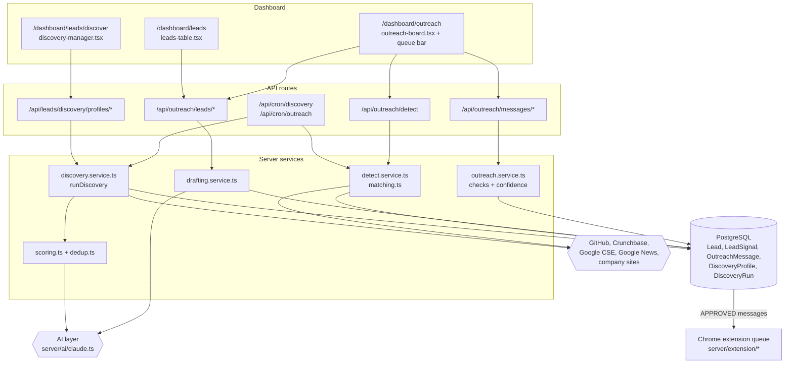
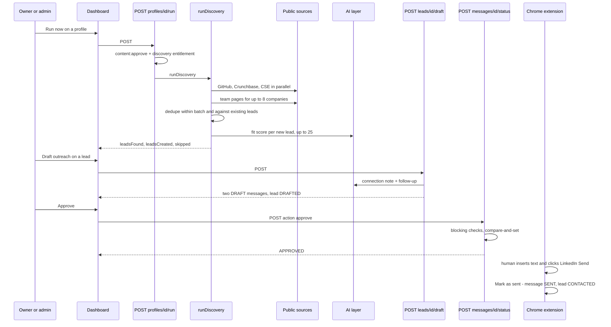
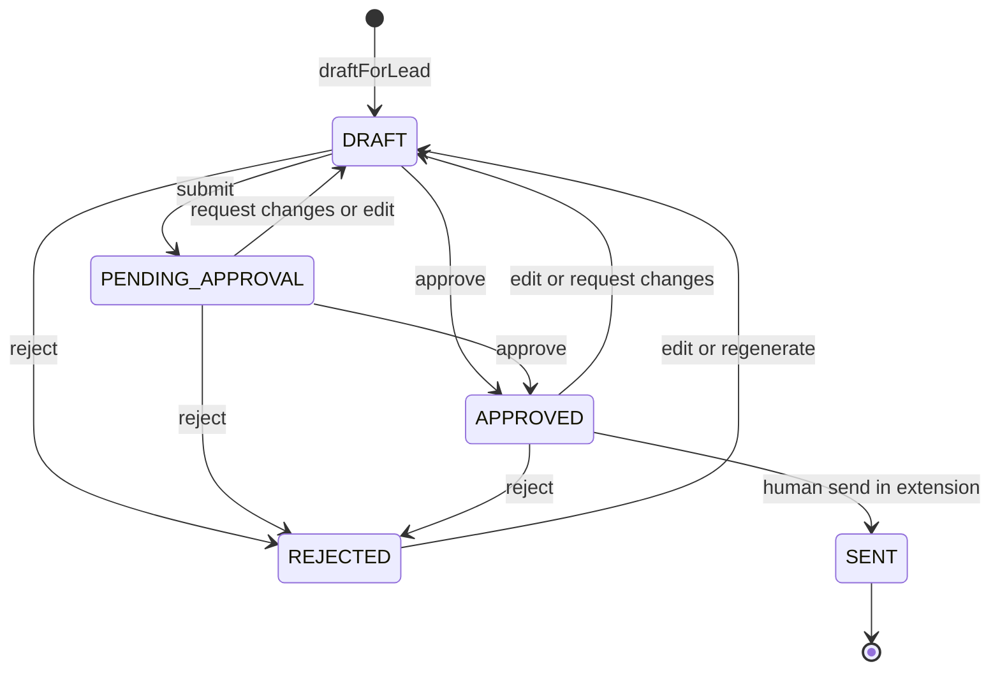
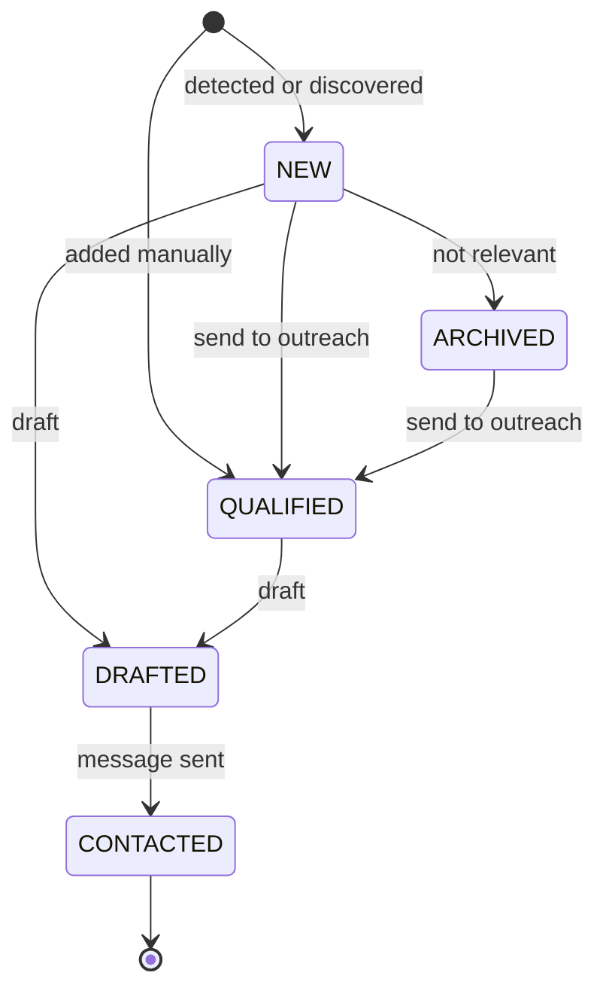
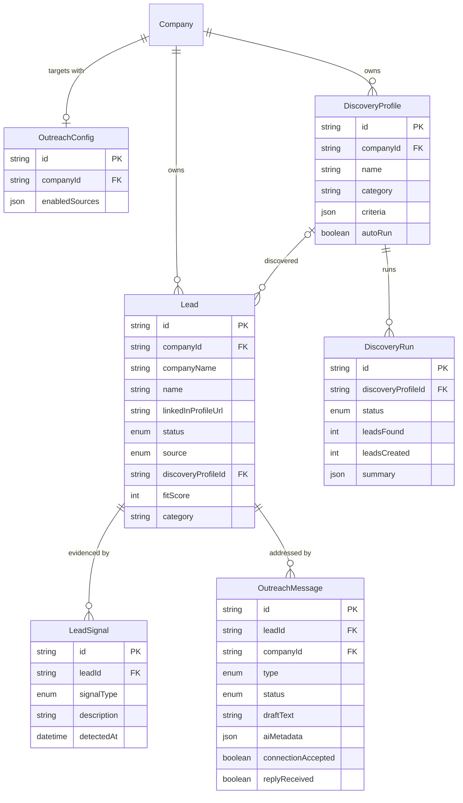

# Lead Discovery & Outreach Intelligence — Architecture

Leads enter through signal detection, discovery profiles or manual entry, and all land in one `Lead` table read by both the Leads page and the Outreach board. Drafting turns a lead into two `OutreachMessage` rows. Those move through a content-style approval state machine and leave Aura only through a human click in the Chrome extension. Every external call is to a public source or the AI layer; LinkedIn is never read or written by the server.

## Component architecture

Read top to bottom: the three dashboard screens call workspace-scoped API routes, and those routes delegate to services. Discovery and detection are the only parts that reach out to public sources. Scoring and drafting are the only parts that call the AI layer, and both have deterministic fallbacks. Approved messages leave the feature by being read from the database by the extension queue, never by a push from these services.

## Main flow

The diagram follows one lead from discovery to send. The route checks permission and the plan's monthly run limit before any network call. Approval is refused if a blocking check fails or someone else changed the message first. The final step happens in the extension ([17](../17-chrome-extension/)), which records `SENT` only after the human acts on LinkedIn.

## Lifecycle / state machine

These are the `OutreachMessage.status` transitions from `OUTREACH_TRANSITIONS` plus the extension's sync-back. Editing or regenerating always returns a message to `DRAFT`, so changed text must be approved again. `SENT` is final and cannot be edited or regenerated.

`Lead.status` is a coarse pipeline view. Status can also be set directly through `PATCH /api/outreach/leads/:id`, so this diagram shows the automatic moves, not every possible edit.

## Data model

`Lead` is the hub. A lead optionally points at the profile that discovered it (set to null if the profile is deleted), and `category` is copied onto the lead so grouping survives. Signals and messages cascade-delete with their lead. `OutreachConfig` is one row per company and drives signal detection only. Discovery uses each profile's own `criteria`.

## Design decisions

- **One lead table for both screens.** `listLeads` and `listLeadSummaries` share `leadWhere`, so a lead on the Leads page is always on the Outreach board with the same filters. This fixed the earlier "leads don't show up in Outreach" report.
- **Company granularity from public sources; people only from public team pages or the user.** No LinkedIn scraping. Person names are extracted only when an AI provider is configured, never guessed.
- **Honest degradation.** Every source reports `skipped` with a reason, and runs store per-source counts. Scoring and drafting fall back to deterministic output tagged `model: 'none'`, which also lowers the bulk-approval confidence.
- **Scores you can argue with.** Fit scores carry `fitMatched` / `fitMissed`. The deterministic scorer weights criteria groups instead of a flat floor that made every lead score 35.
- **Caps, not deductions, for bulk approval.** A missing essential (signal, brand voice, strong fit, named contact, URL) holds a draft below 70 however strong the rest is, because bulk approval means sending unread.
- **Same approval semantics as content.** The transition table, the compare-and-set update, the blocking compliance checks and version history mirror Content Studio, so the unified review can treat both alike.
- **Sending is a human act in the browser.** The server only hands approved text to the extension and records the human's confirmation. Integrity (`outreachIntact`) and the execution gate are checked again at send time.
- **Denormalized `category`.** Leads keep their requirement label even if the profile is renamed or deleted, so different requirements never mix.
