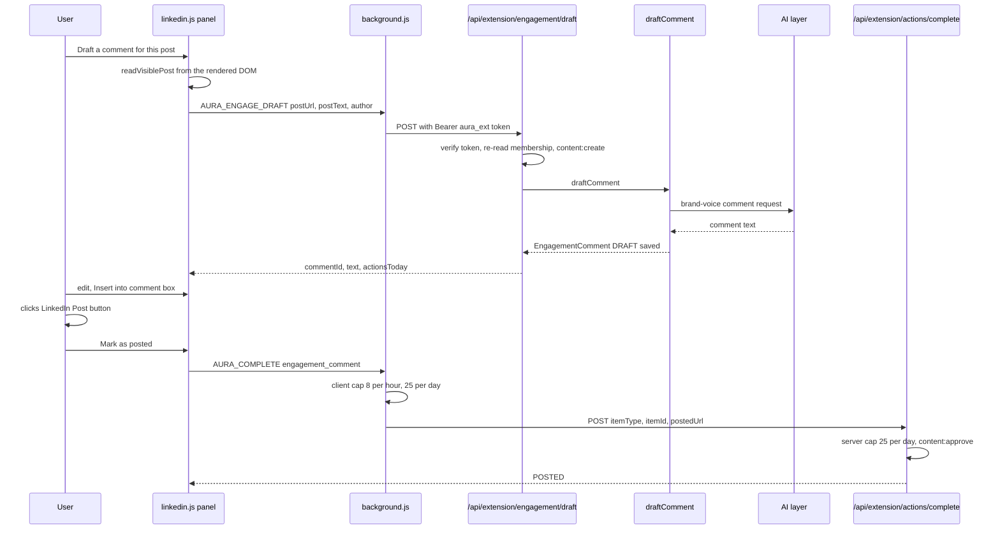
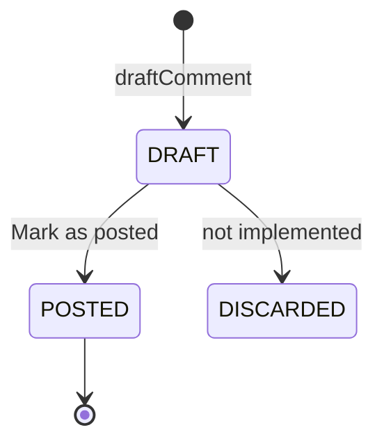
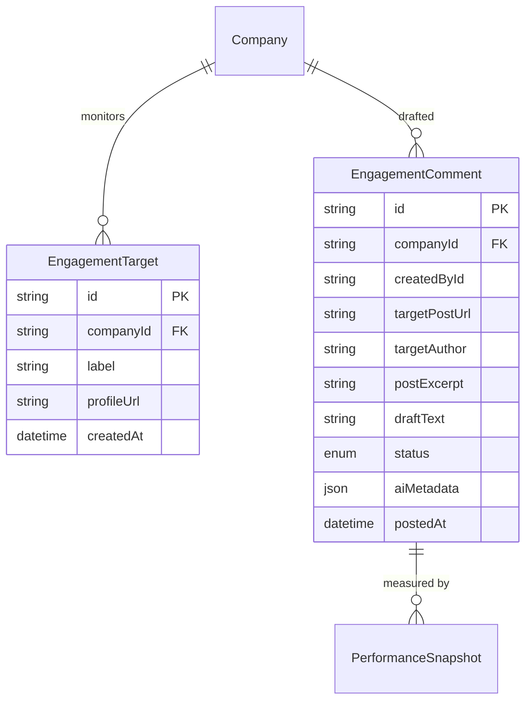

# Engagement Copilot — Architecture

The Engagement Copilot is split across the browser and the server on purpose. The extension reads the post the user is already looking at and does all the LinkedIn interaction. The server only turns the text it is given into a comment and records what the human did. The web app manages the target list and shows a read-only history.

## Component architecture

```mermaid
flowchart LR
  subgraph Browser["User's browser on linkedin.com"]
    CS["content/linkedin.js<br/>readVisiblePost + panel"]
    BG["background.js<br/>bearer token, rate caps"]
  end
  subgraph Web["Web app"]
    UIHist["/dashboard/engagement"]
    UISet["/dashboard/settings/engagement<br/>target-manager.tsx"]
  end
  RDraft["/api/extension/engagement/draft"]
  RDone["/api/extension/actions/complete"]
  RTgt["/api/engagement/targets"]
  SCom["comment.service.ts<br/>draftComment"]
  STgt["target.service.ts"]
  SAct["action.service.ts<br/>completeEngagementComment"]
  BC["Business Context +<br/>brand voice"]
  AI{{"AI layer"}}
  DB[("PostgreSQL<br/>EngagementComment<br/>EngagementTarget")]

  CS -->|"post text"| BG
  BG --> RDraft
  BG --> RDone
  RDraft --> SCom
  SCom --> BC
  SCom --> AI
  SCom --> DB
  RDone --> SAct
  SAct --> DB
  UISet --> RTgt
  RTgt --> STgt
  STgt --> DB
  UIHist -->|"listComments, listTargets"| DB
```

The left side runs in the user's browser. Only the background worker talks to Aura, and it always uses the extension bearer token. The server pieces in the middle never reach LinkedIn: `draftComment` reads Business Context and calls the AI layer, and `completeEngagementComment` only updates a row. The web pages on the right read the same tables, and the settings page writes the target list.

## Main flow

The flow has two server round-trips: one to draft and one to record the post. The actual posting happens between them, on LinkedIn, by the human. If no AI provider is configured or the call fails, `draftComment` returns the deterministic fallback, so the draft step does not fail on AI problems.

## Lifecycle / state machine

`EngagementComment.status` has three values. Only `DRAFT → POSTED` is reachable in code, and marking posted again is a no-op. `DISCARDED` exists in the enum and the history badge, but nothing sets it yet.

## Data model

The two models are independent: a comment does not reference a target. Targets are unique per `(companyId, profileUrl)`. Comments store the post excerpt they answered, so the history stays readable without going back to LinkedIn.

## Design decisions

- **The client captures, the server drafts.** LinkedIn offers no API for arbitrary third-party feeds, and scraping is ruled out, so the only post text Aura ever sees is what is already rendered in the user's own browser.
- **One human click per action, never automated.** The extension fills LinkedIn's editor but never clicks LinkedIn's submit. "Mark as posted" is a separate confirmation that syncs the status back.
- **Identity and voice only in the prompt.** The `engagement` Business Context preset leaves out the workspace audience, because the reader of a comment is someone else's audience. Knowing the company's actual field is what lets the model add a real perspective instead of filler.
- **Rate caps on both sides.** The client blocks before any API call (8/hour, 25/day). The server enforces the daily cap again as defence-in-depth (429).
- **The web app is the system of record but read-only for comments.** History lives in Aura for Marketing Memory, while all LinkedIn interaction stays in the extension.
- **Drafting is open to members, recording posts is not.** `content:create` lets MEMBERs draft, while marking a post as posted needs `content:approve`, matching the other extension sync-backs.
