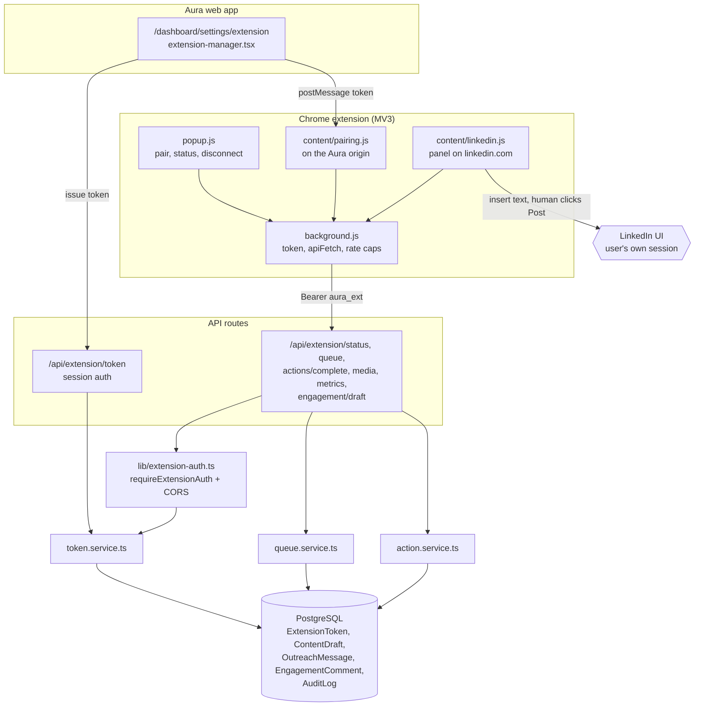
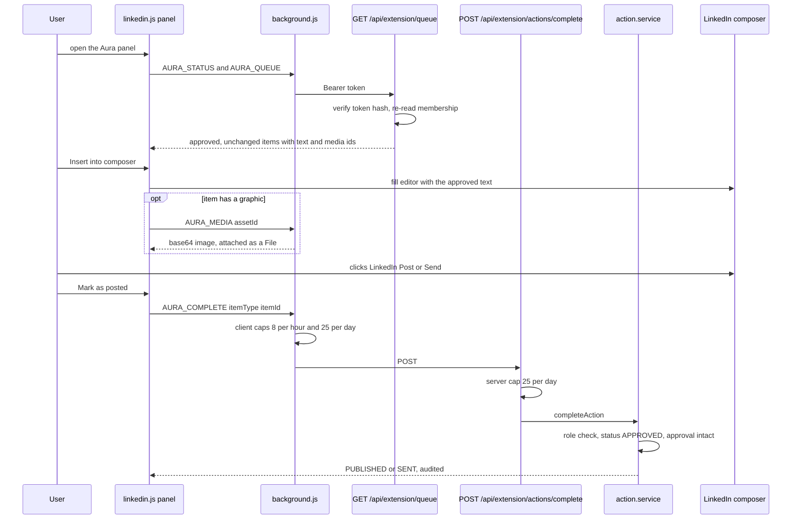
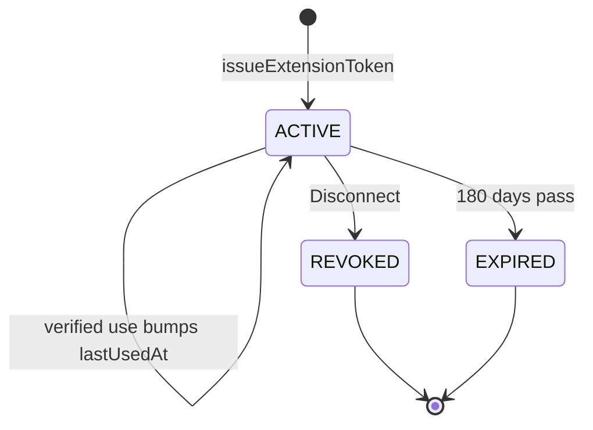
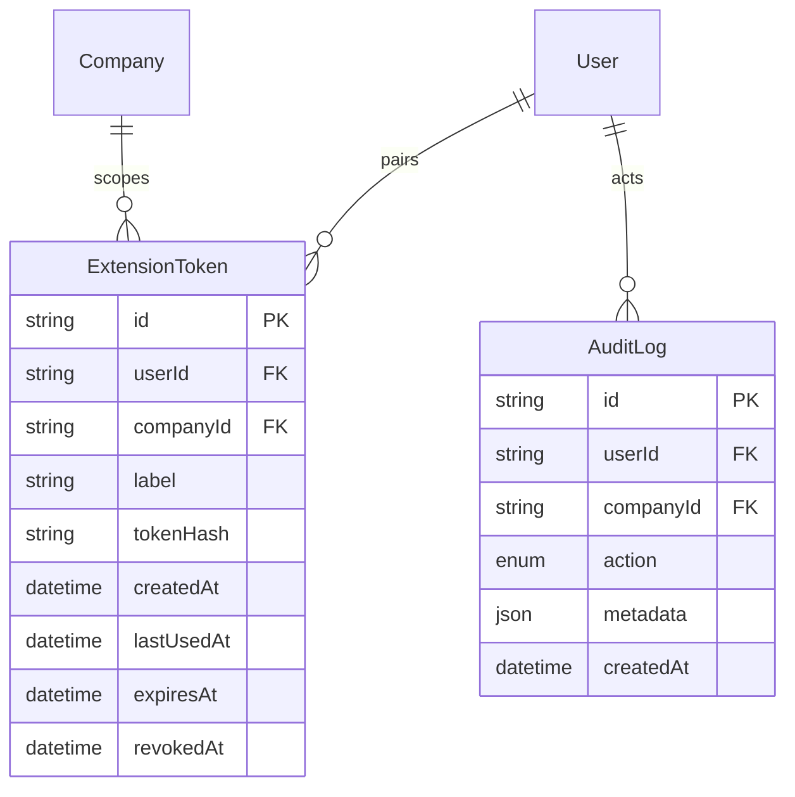

# Chrome Extension (Human Action Layer) — Architecture

The extension is a thin, human-driven client. Aura's server prepares the exact approved text and records what the human did, and the extension does everything on LinkedIn inside the user's own browser session. Authentication is a separate bearer token, so the extension never holds the web session.

## Component architecture

The settings page issues a token over the normal session and hands it to the extension through `pairing.js`. From then on, every call goes through `background.js` with the bearer token. `lib/extension-auth.ts` turns that token back into a user, a workspace and a freshly read role. The only arrow into LinkedIn starts at the content script, and it always ends with the human's own click.

## Main flow

The panel first lists what is ready. The human inserts it, posts it on LinkedIn, and then confirms. Only the confirmation changes Aura's records. If the item changed after approval, or the role no longer allows it, the sync-back is refused and nothing is marked done.

## Lifecycle / state machine

`ExtensionToken` has no status column. Its state comes from `revokedAt` and `expiresAt`, as checked by `verifyExtensionToken`. A token also stops working at once if its user loses membership in the workspace, even while it is still "active" here. The status changes of the items it acts on are documented in [15](../15-leads-and-outreach/02-ARCHITECTURE.md) and [16](../16-engagement-copilot/02-ARCHITECTURE.md).

## Data model

The extension owns one model, `ExtensionToken`, tied to a user and a workspace. Everything else it touches belongs to other features. `AuditLog` is shown because `EXTENSION_ACTION_COMPLETED` rows double as the server-side counter for the daily cap.

## Design decisions

- **A human click on LinkedIn's own button is the send.** The extension inserts text and attaches images but never submits, loops or runs on a timer. It is an assistant, not automation.
- **Separate bearer token, not the session.** A leaked extension token can reach only `/api/extension/*` for one workspace. It is stored hashed, expires and is revocable, and because it is not a cookie, CORS can allow extension origins safely.
- **Role re-read on every call.** The token carries no role. A demoted or removed member loses extension rights on their next request.
- **Approval integrity at both ends.** Items changed after approval are left out of the queue, and the sync-back refuses them too, so the posted text is always the approved text.
- **Media by reference.** Queue items carry asset metadata only, and images are fetched one at a time when the human acts. This keeps the queue, which loads on every panel open, small.
- **Defence-in-depth rate limiting.** Client caps stop a would-be bot before any request. The server's daily cap applies even to a modified client.
- **Ship with every deploy.** `package-extension.mjs` runs in the build and writes a dependency-free zip into `public/downloads`, so reviewers can install the matching version without a store listing.
