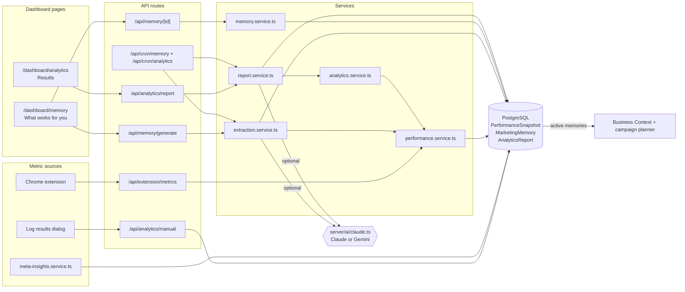
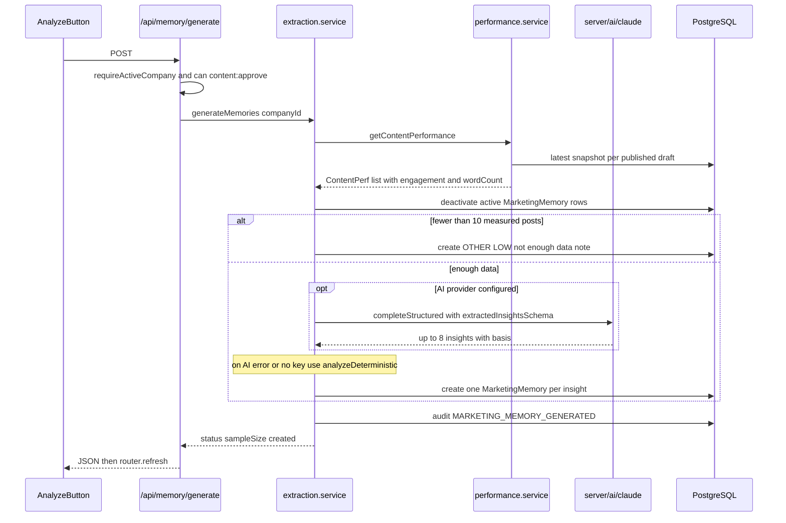
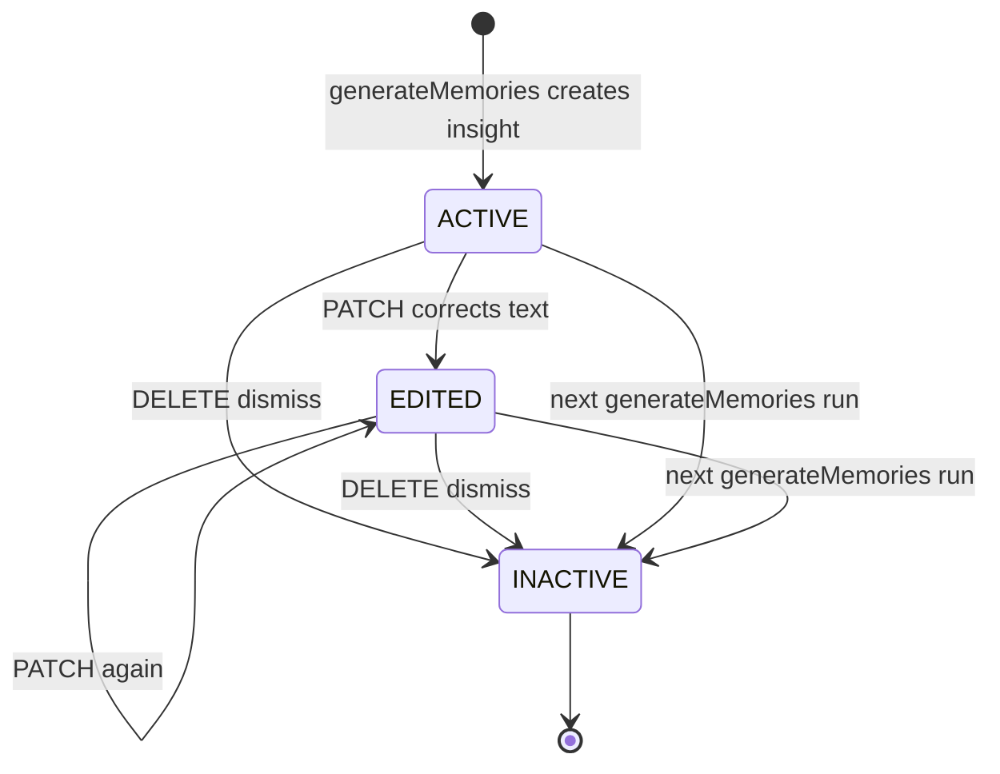
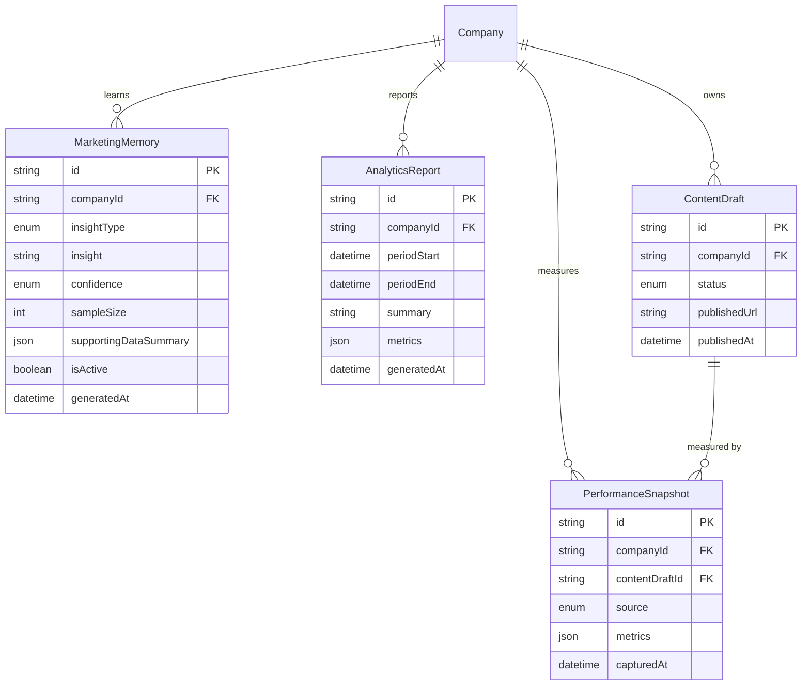

# Marketing Memory & Analytics — Architecture

Each source of real metrics writes a `PerformanceSnapshot`. Two read paths are built on top of those rows. Analytics adds them up into results and a weekly written report. Marketing Memory extracts patterns from them, and those patterns go back into the generation prompts through the Business Context and the campaign planner.

## Component architecture

Read the diagram from the sources on the left to the database on the right. All three sources end in `PerformanceSnapshot`. Only the extension path goes through `performance.service.ts`, because it has to match a post URL to a draft. `getContentPerformance` in `performance.service.ts` is the single read model that both `extraction.service.ts` and `analytics.service.ts` use. The AI client is optional on both paths, and each path has a deterministic fallback. Active `MarketingMemory` rows leave the feature through the Business Context and the campaign planner.

## Main flow

This is the on-demand "Analyze now" path. The weekly `/api/cron/memory` route runs the same `generateMemories` call for every company, without the session and permission check. The previous generation is always deactivated first, so after a run the page shows either the honest low-data note or the new set of insights, never both.

## Lifecycle / state machine

`MarketingMemory` has no status enum. Its lifecycle is the `isActive` flag plus the `editedByUser` mark in `supportingDataSummary`.

`ACTIVE` and `EDITED` rows are both `isActive = true`, and both reach prompts. `EDITED` insights are ranked first and labelled "confirmed by the company". Dismissal and regeneration both make a row inactive without deleting it, so it stays auditable. Note that regeneration also makes `EDITED` rows inactive. Separately, an active insight older than 60 days counts as `stale` in the Business Context and is left out of prompts, but it stays active.

## Data model

`PerformanceSnapshot` is the raw fact table. A draft can have many snapshots, and only the newest one per draft is used. `MarketingMemory` and `AnalyticsReport` are derived outputs with no foreign key back to the snapshots they came from. Traceability comes from `supportingDataSummary.basis` and `sampleSize`. `AnalyticsReport` is unique on `(companyId, periodStart)`, which is what makes weekly generation idempotent.

## Design decisions

- **One snapshot shape for every source.** A manual entry is a normal `PerformanceSnapshot` with `source = MANUAL`, so Analytics, Memory and content intelligence need no special cases. The measurement loop can work before any OAuth connector is approved.
- **Honesty gates over plausible output.** `MIN_SAMPLE_FOR_INSIGHTS = 10`, the `hasData` flag, the at-least-one-metric rule and the "not enough data" note all exist so the product never shows invented insights or misleading zero charts.
- **Confidence comes from sample size, not from the model.** Confidence is a transparent function of the number of measured posts (15 and 30 thresholds), so users can see why an insight is LOW or HIGH.
- **AI is optional.** Extraction and the report both work without an AI key. The deterministic analysis emits an insight only when there is a clear gap (more than 25% or 20%).
- **Soft deletes.** Dismissed and superseded insights are set inactive rather than deleted, so earlier learnings stay auditable.
- **Memory reaches prompts through the Business Context.** The main generators get memory as a `memory` section of the Business Context, ranked, de-duplicated, freshness-filtered and capped at 12. A correction calls `invalidateContextSnapshot` because the model has no `updatedAt`.
- **No server-side LinkedIn fetch.** Personal-post numbers come from the user's own page DOM through the extension. The URL fallback match handles the difference between the URL used to post and the permalink viewed later.
- **Crons are idempotent per company and alias GET to POST,** so they work with Vercel Cron or any other scheduler. A failure for one company does not stop the others.
