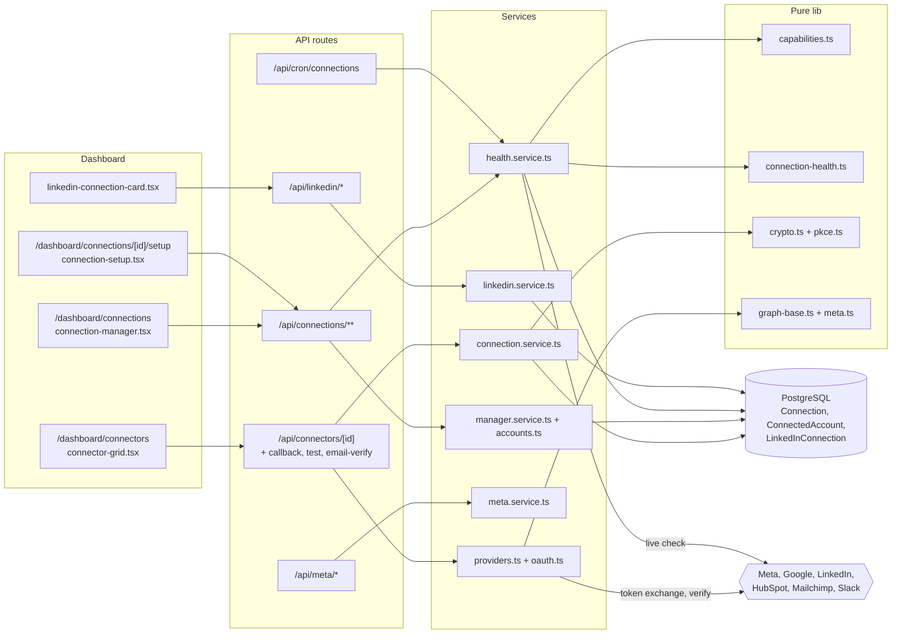
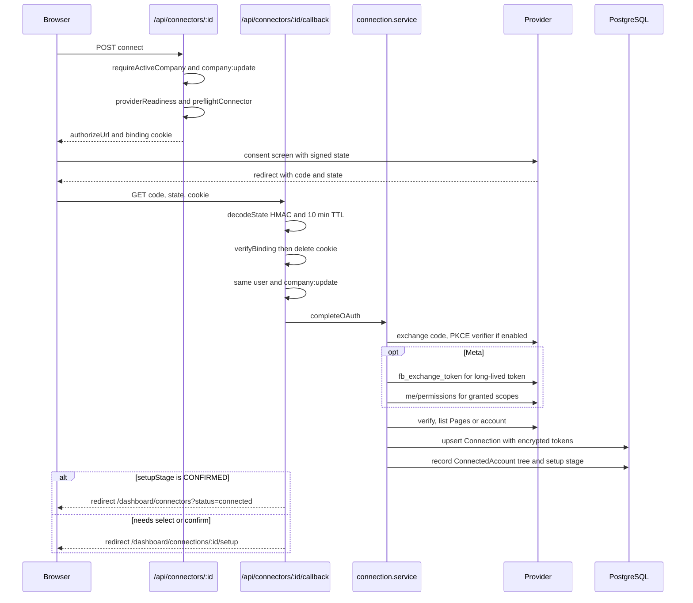
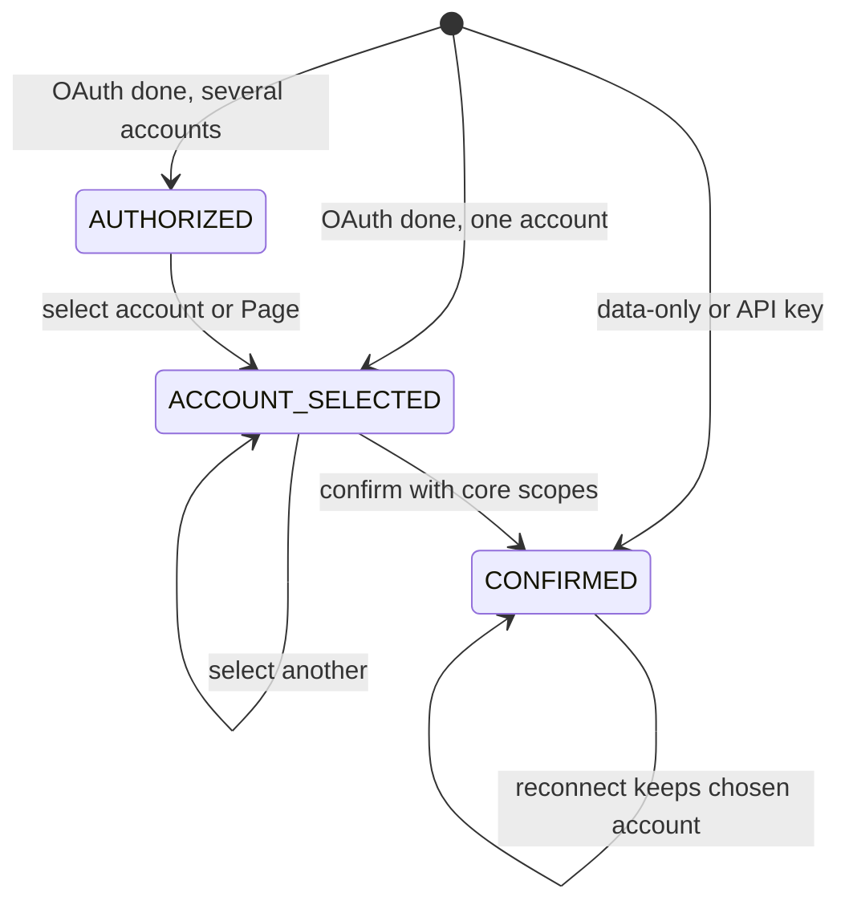
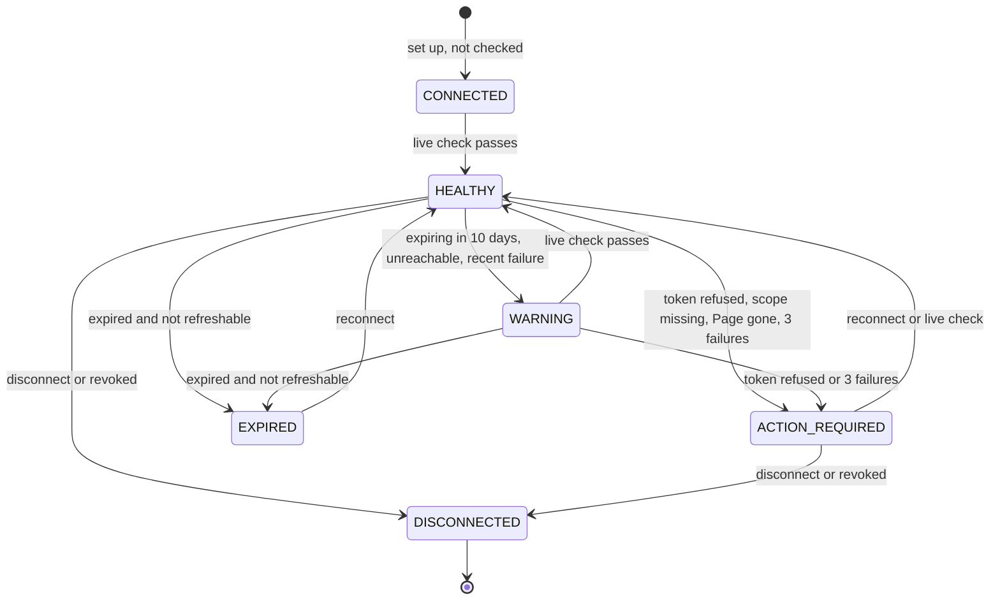
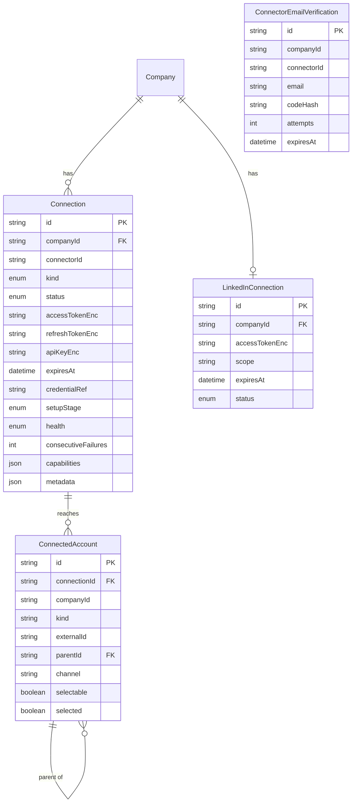

# Connections, Connectors & OAuth — Architecture

Every integration goes through one generic OAuth or API-key path (`server/connectors/*`), and the result is stored as a provider-agnostic `Connection` record. The Connection Manager (`server/connections/*` plus the pure rules in `lib/`) adds setup stages, capabilities, health and the execution gate on top of that record. LinkedIn has its own OAuth flow and table, and is mirrored into the same model.

## Component architecture

The catalog page talks to `/api/connectors/*`, which runs the generic OAuth and API-key machinery. The Connection Manager pages talk to `/api/connections/*`, which runs setup, health and capabilities. All decisions (health status, capability availability) are pure functions in `lib/`; the services load rows, call providers and save the results. Provider calls for Meta go through `graph-base.ts`, which only allows a loopback override.

## Main flow

The connect request returns a URL instead of redirecting, so the client can show preflight blockers in place. The callback trusts nothing from the path: the connector, company and user come from the HMAC'd state, and the cookie proves the same browser started the flow. Steps 4 and 5 (select, confirm) happen on the setup page only when there is a choice or something to confirm.

## Lifecycle / state machine

Setup stage (`ConnectionSetupStage`):

Health (`ConnectionHealth`):

The setup stage moves forward only. A reconnect keeps `CONFIRMED` when the chosen account still exists. For health, `CONNECTED`, `HEALTHY` and `WARNING` allow execution. `EXPIRED`, `ACTION_REQUIRED` and `DISCONNECTED` block it, and only a live check or a reconnect can move a connection out of a blocking state. An offline re-evaluation can only make the status worse.

## Data model

`Connection` is unique per (`companyId`, `connectorId`) and holds the only copy of each workspace credential, encrypted. `ConnectedAccount` is the provider → account → page tree. For Meta: the Facebook user, then each Page (selectable), then the Instagram account linked to each Page. LinkedIn's tokens live in `LinkedInConnection`; its `Connection` row is a mirror with `credentialRef = linkedin_connection`. `ConnectorEmailVerification` is not related by foreign key; it is looked up by company and connector.

## Design decisions

- **Stateless signed OAuth state.** The state is HMAC'd with `NEXTAUTH_SECRET` and expires after 10 minutes, so there is no table of pending flows to clean up. The browser binding cookie and optional PKCE close the "code from another browser" gap.
- **Connector id comes from the state, not the path.** This lets GA4 and Search Console share one Google redirect URI (`/api/connectors/google/callback`), which removes a common cause of `redirect_uri_mismatch`.
- **Preflight before redirect.** Missing credentials and a non-public app URL are caught in Aura, where the message can name the fix, instead of on the provider's error page.
- **Meta long-lived token exchange at connect time.** Without it, a Meta connection would expire within hours. Page tokens are never stored; they are derived per post.
- **One provider-agnostic record.** Health, capabilities and the execution gate work the same way for every provider, and LinkedIn is mirrored instead of migrated, so its existing flow keeps working.
- **Pure rules in `lib/`.** Health evaluation, capability checks and error descriptions have no I/O, so they are unit-tested directly and can be shared with the client.
- **Health can only get worse offline.** Clearing a blocking status needs proof (a live check or a reconnect), so a stale row never re-enables publishing.
- **Env fallback for API-key connectors.** Setting `CRUNCHBASE_API_KEY` on the deployment and connecting Crunchbase in the UI have the same effect, through one accessor (`resolveCredential`).
- **Loopback-only Graph override.** The sandbox can redirect Meta traffic, but a mistyped value can never send a business's token to another host.
