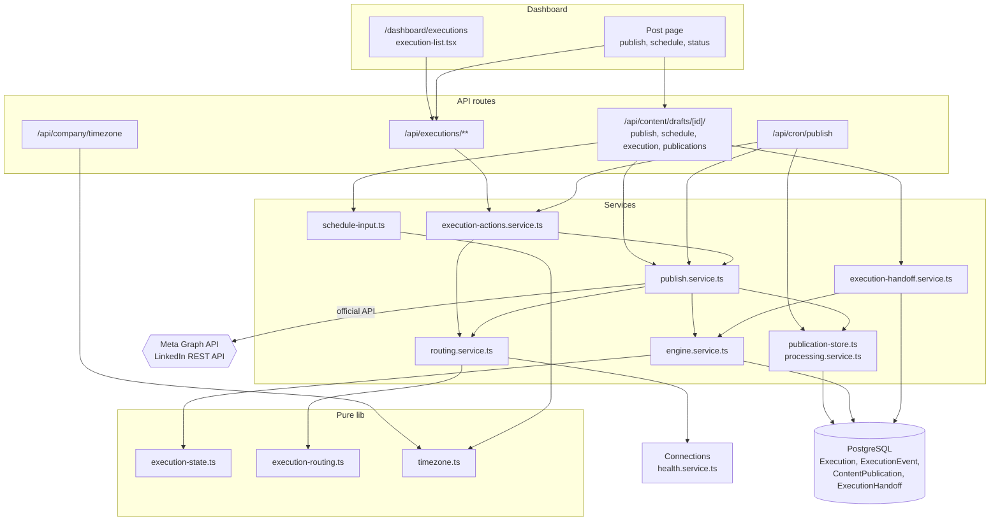
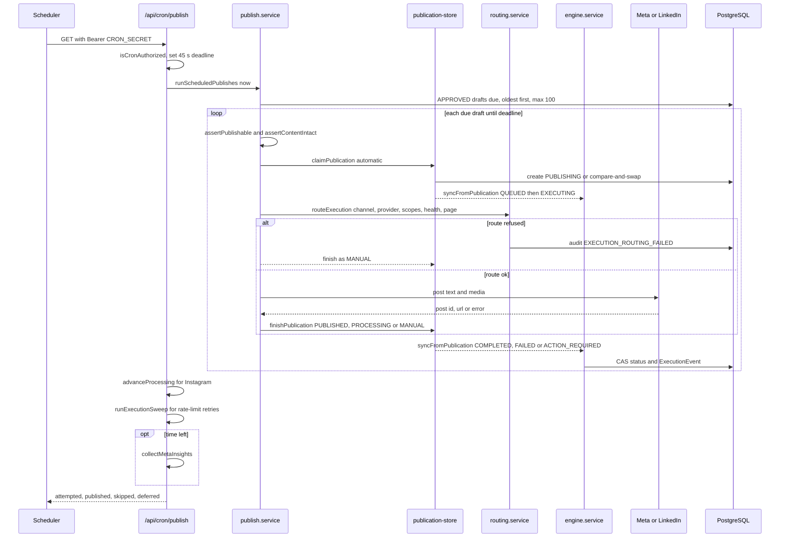
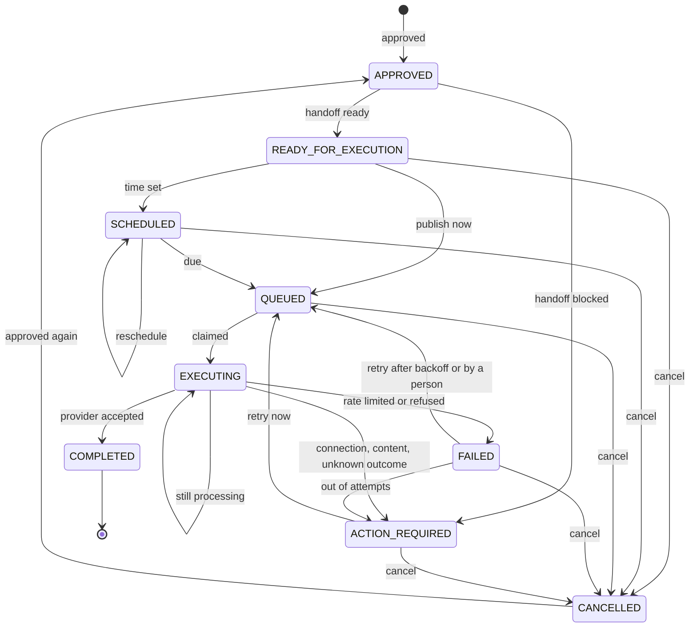
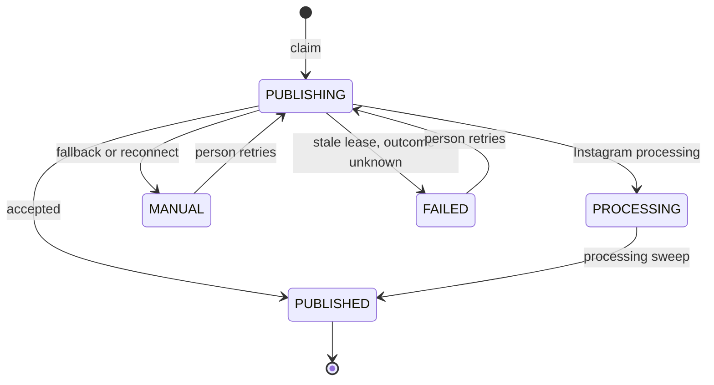
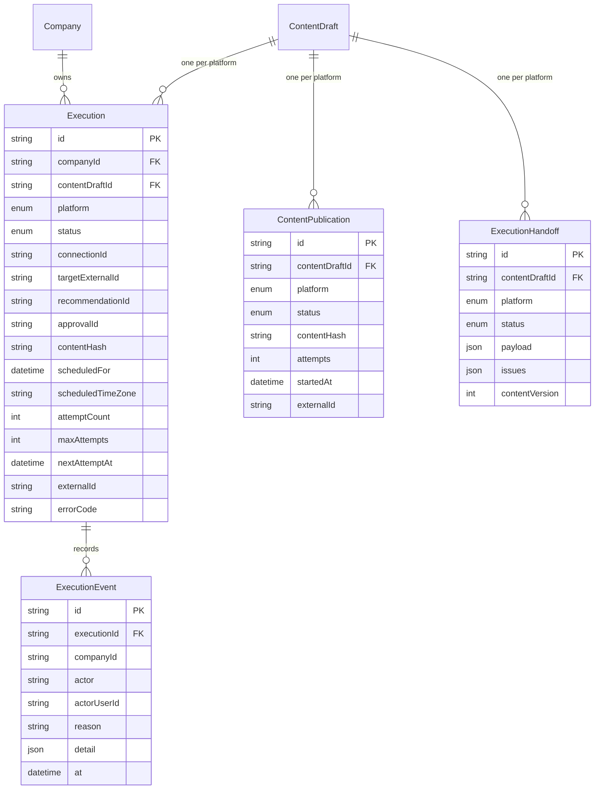

# Publishing, Execution Engine & Scheduling — Architecture

Publishing works in two layers. The **publication claim** (`ContentPublication`) makes sure a post is sent at most once. The **execution** (`Execution` + `ExecutionEvent`) is the visible lifecycle around that claim: each state change is checked against a fixed transition table and recorded. Scheduling stores UTC instants, and a protected cron route publishes whatever is due.

## Component architecture

User actions reach `publish.service.ts` either directly (publish now) or through `execution-actions.service.ts` (retry). The cron route drives the same publisher with `automatic: true`. Before any network call, `publish.service.ts` asks `routing.service.ts`, which uses the Connections health gate. Every outcome flows back into `engine.service.ts`, which is the only code that changes an execution's status.

## Main flow

"Publish now" and "Retry now" follow the same inner steps, without the loop and with a person as the actor. The claim comes before routing and the network call, so two overlapping runs can't both reach the provider. When the deadline passes, no new publish starts; the remaining drafts are reported as `deferred` and picked up on the next run.

## Lifecycle / state machine

This shows the main transitions from `TRANSITIONS` in `lib/execution-state.ts`. A few less common ones are left out: back to `APPROVED` or `READY_FOR_EXECUTION`, `APPROVED --> CANCELLED`, `QUEUED --> SCHEDULED` and `QUEUED --> COMPLETED`. `COMPLETED` has no outgoing transitions, so a published post can never run again. Only rate-limited failures go back to `QUEUED` automatically. Unknown outcomes always stop at `ACTION_REQUIRED`, for a person to check.

Publication claim (`PublicationStatus`):

`PUBLISHED` can't be claimed again. A `PUBLISHING` row older than the 3-minute lease becomes `FAILED` instead of being retried, because Aura can't tell whether the network received it. The scheduler never re-claims `FAILED` or `MANUAL` rows. Only a person can, or an execution retry for a rate limit.

## Data model

All three per-draft tables are unique on (`contentDraftId`, `platform`), so one post sent to Facebook and Instagram has two executions, two publication claims and two handoffs. `ExecutionEvent` is append-only history. Its `from` and `to` status columns are left out of the diagram only because `to` is a Mermaid keyword. The trace ids on `Execution` (`recommendationId`, `approvalId` and the others) are plain strings, not foreign keys, so deleting upstream records never breaks the publishing history.

## Design decisions

- **Claim separate from lifecycle.** The publication claim's only job is to prevent duplicate posts, and it stays small. The execution adds visibility, retries and cancellation without weakening that guarantee.
- **Compare-and-swap on every transition.** Concurrent actors (cron, a person, a second scheduler) can't overwrite each other. The loser sees the change and gets a 409.
- **Retry only when the post certainly did not go out.** Rate limits are the only automatic retry. Timeouts and interrupted attempts need a person, because posting twice is worse than posting late.
- **Route before calling the network.** Provider, permissions, health and target page are decided up front and saved on the execution, so a refusal is explained and audited instead of returned as a raw provider error.
- **Honest fallback.** When an API path is missing (X, copy-only types, wrong media), the result is `manual` with the text copied and a reason. It is never reported as published.
- **UTC storage, workspace-zone input and display.** Wall times are converted on the server in the business's IANA zone, with DST handled per date. Changing the zone never moves a scheduled instant.
- **Time-boxed cron.** A 45 s budget inside a 60 s function means a publish is never cut off halfway. The job can be called every minute and by several schedulers at once.
- **GET equals POST on the cron route.** Vercel Cron sends GET, and manual or external schedulers can use either method with the same bearer check.
