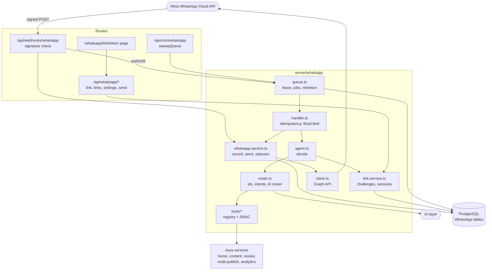
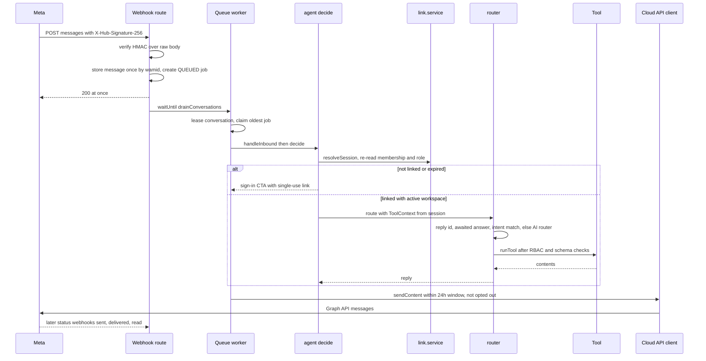
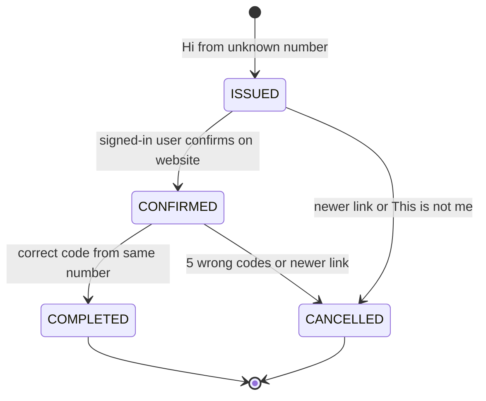
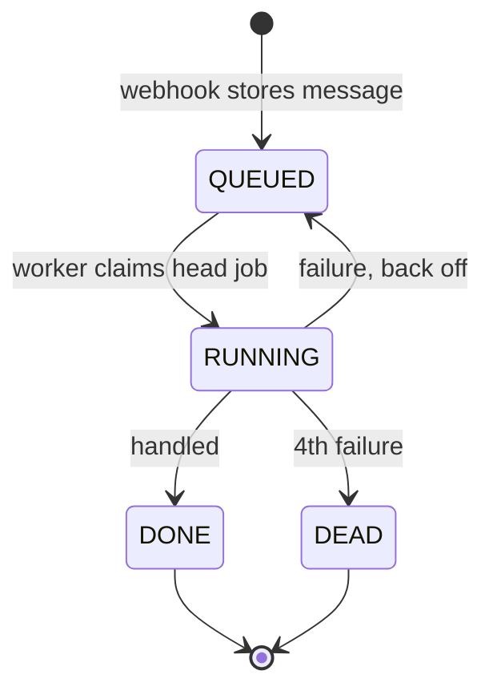
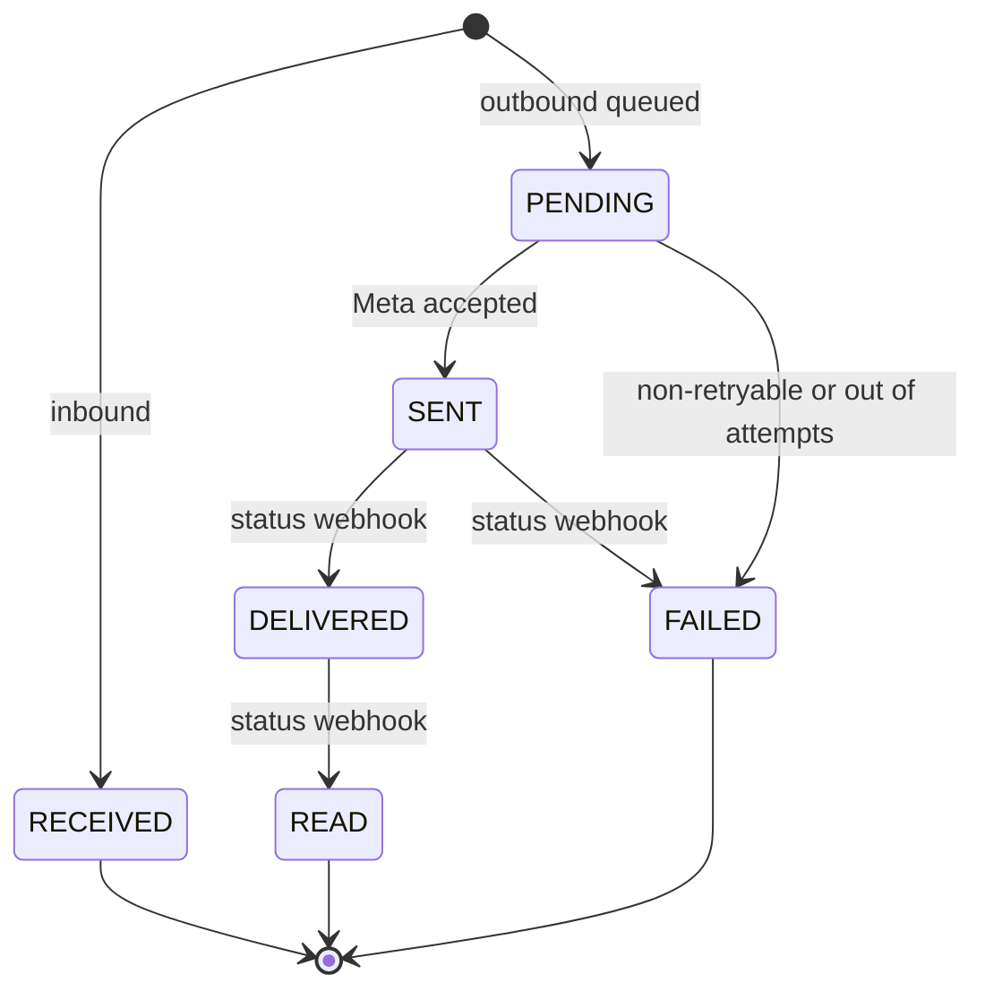
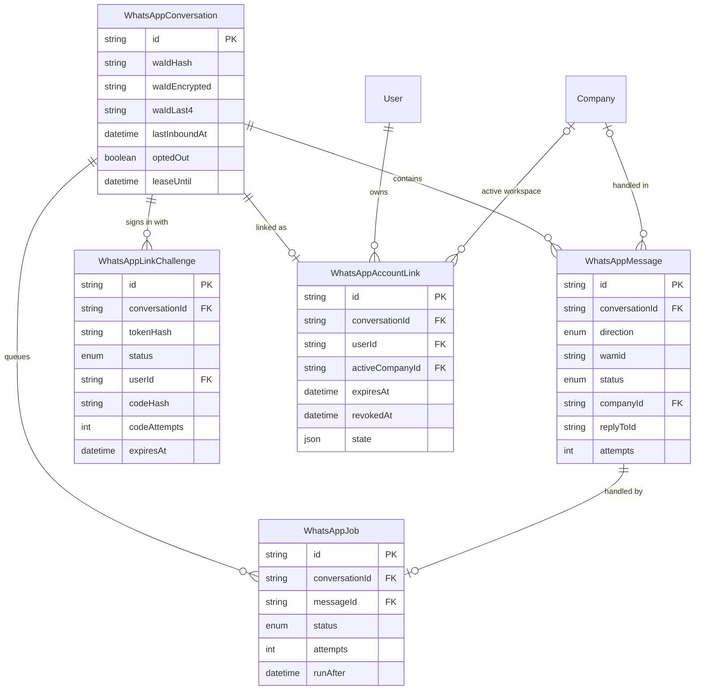

# WhatsApp AI Assistant — Architecture

The assistant is a webhook-driven pipeline with a Postgres work queue. Meta's webhook is acknowledged at once. A worker then decides the answer, re-checking the person's session, membership and role on every message, and runs one tool from a fixed registry over existing Aura services. Replies go back through the Cloud API, subject to the 24-hour window, opt-out and retry rules.

## Component architecture

Inbound traffic enters only through the signed webhook, and outbound traffic leaves only through `client.ts`. Between them, the queue serializes each conversation, the agent resolves who is speaking and in which workspace, and the router picks exactly one tool. Tools are thin wrappers over services the web app already uses, so WhatsApp gets the same rules. The website routes are the other half of sign-in and the workspace controls.

## Main flow

The webhook does only cheap work before answering Meta, and the rest runs after the response. If the worker dies, the lease expires and the cron sweep resumes. If sending is throttled, the message is retried later. The `ToolContext` is built from the resolved session, never from the message text or the model's output.

## Lifecycle / state machine

`WhatsAppLinkChallenge.status`: each step is a compare-and-swap, so a link or a code works only once. Expiry is checked by time (10 minutes for the link and again for the code) rather than stored as a separate status. `COMPLETED` creates or refreshes the `WhatsAppAccountLink` session for 30 days.

`WhatsAppJob.status`: a failed job returns to `QUEUED` with `runAfter` pushed back (15 s, 60 s, 5 min) and blocks the jobs behind it, so order is kept. A job stuck in `RUNNING` for more than 2 minutes is picked up again. `DEAD` is the dead-letter state shown on the dashboard.

`WhatsAppMessage.status`: statuses from webhooks only move forward (`shouldApplyStatus`), so out-of-order deliveries cannot move a message back. Retryable send errors keep the message `PENDING` with `nextAttemptAt` set, for up to 6 attempts.

## Data model

The conversation is one phone number, stored only as a keyed hash, an encrypted copy and the last 4 digits. It is not tied to a workspace. The link ties it to a user and an active workspace, and every message is stamped with the workspace it was handled in. That stamp is what keeps dashboards and AI history per workspace. Jobs are one-to-one with inbound messages.

## Design decisions

- **Acknowledge first, work later.** Meta gets its 200 before any AI or service call. The answer runs via `waitUntil`, with a cron sweep as a safety net. Redeliveries are harmless because `wamid` is unique.
- **A Postgres queue, no paid queue service.** Conversation leases give per-person ordering and parallelism across people, and a dead-letter state keeps failures visible.
- **Two-way linking.** The website confirmation proves Aura account ownership, and the code from the phone proves the same person holds the number. A forwarded link cannot attach the wrong number.
- **Authorization is re-derived on every message.** Membership, role and the workspace's WhatsApp switch are read fresh, so removal or demotion takes effect on the next message, not when the session expires.
- **The AI only chooses; the server decides.** The router model sees only the tools the role allows, with user text fenced as data. Its choice still passes the RBAC check, schema validation and, for changes, a single-use confirmation the model cannot produce.
- **Reuse existing services.** Approve runs `runReviewAction` and publish runs `publishToPlatforms`, the same paths as the web UI, so compliance, fact checks and double-publish protection apply unchanged.
- **Privacy by default.** Numbers are hashed and encrypted, the dashboard shows only last-4 digits, and message text expires after `WHATSAPP_RETENTION_DAYS`.
- **Meta rules in code.** Free-form replies only inside the 24-hour window, STOP honoured before anything else, and no marketing or template sends.
