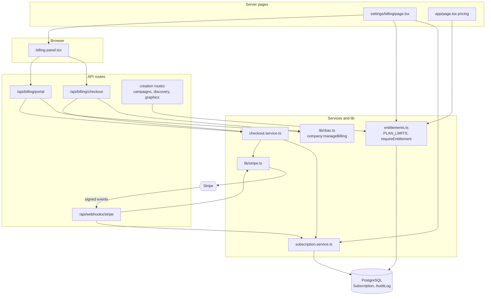
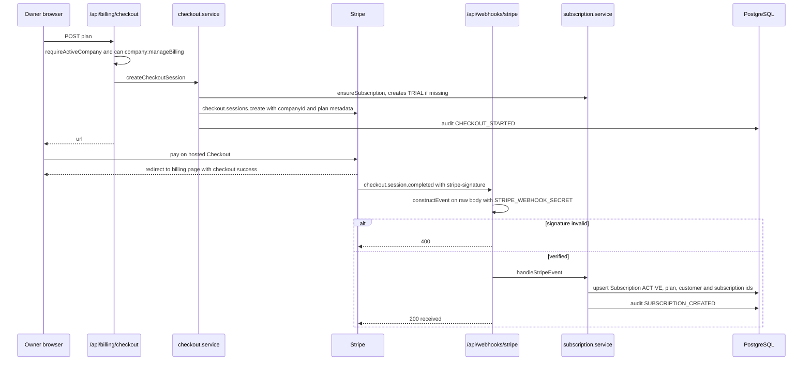
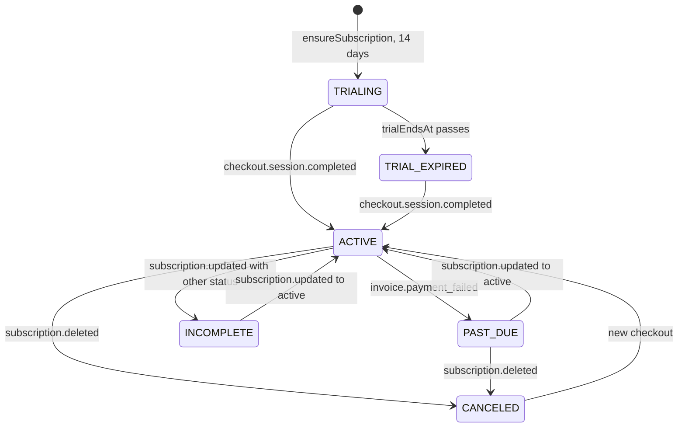
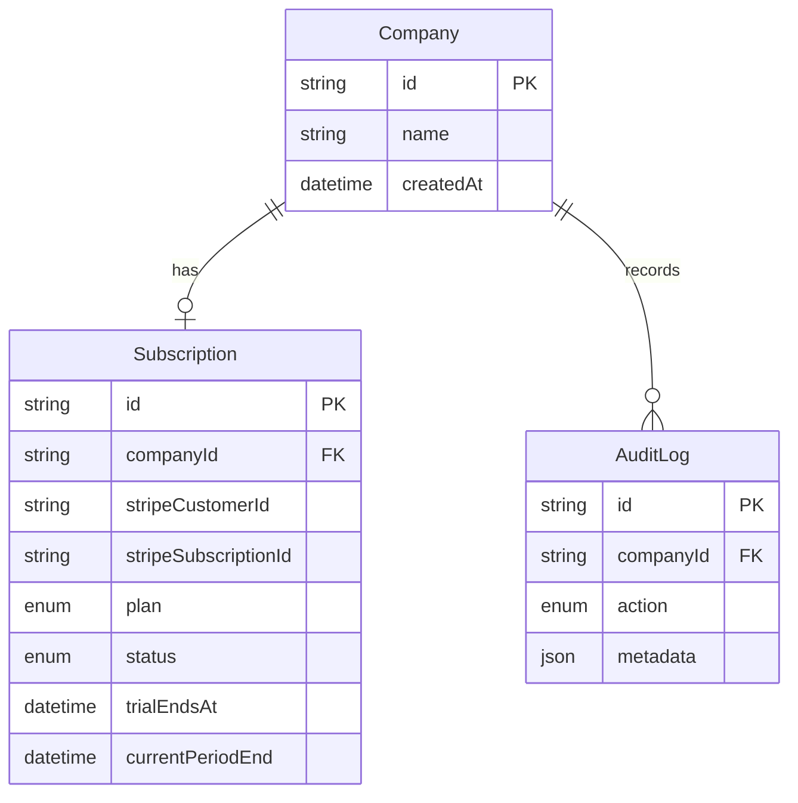

# Billing, Plans & Entitlements — Architecture

Billing has three moving parts: hosted Stripe flows started from the billing page, a signature-verified webhook that mirrors Stripe's subscription state into `Subscription`, and an entitlement check that creation routes call before doing paid or limited work. Plan limits are one table in `server/billing/entitlements.ts`.

## Component architecture

Outbound, the panel asks the API for a Checkout or Portal URL and sends the browser to Stripe. Inbound, Stripe calls the webhook, which verifies the signature through `lib/stripe.ts` and lets `subscription.service.ts` update the mirror. Independently, every creation route asks `entitlements.ts` whether the workspace may proceed.

## Main flow

The browser redirect and the webhook are independent; the plan is only considered active once the verified webhook has updated `Subscription`. If the handler throws, the route answers 500 so Stripe retries the event.

## Lifecycle / state machine

States are `SubscriptionStatus` values, plus `TRIAL_EXPIRED`, which is not stored: it is `TRIALING` with `trialEndsAt` in the past, computed by `getEffectivePlan`. Only `ACTIVE` and an unexpired `TRIALING` count as active; every other state blocks creation with 402 while leaving reads untouched.

## Data model

Each company has at most one `Subscription` (unique `companyId`), and the Stripe ids are unique so webhook events can find the row. The trial end is dated from `Company.createdAt`. Billing events are recorded in `AuditLog`.

## Design decisions

- **Prices in Stripe, limits in code.** Price ids come from env vars so pricing changes need no deploy; limits are one typed table so they are not scattered literals.
- **Hosted Checkout and Portal only**, so Aura never handles card data.
- **Signature before anything.** The webhook reads the raw body and verifies it before parsing or touching the database; handler logic is a separate function so it is unit-tested with mocked events.
- **Graceful lapse.** An ended trial or subscription makes the workspace read-only for creation (402 with an upgrade message) but never hides data.
- **Implicit trial.** A company with no `Subscription` row is an active trial, so new workspaces are never blocked by a missing row.
- **Image generation is a spend control.** The monthly graphics limit exists because each image is a paid provider call.
- **Owner-only billing.** `company:manageBilling` is held only by `OWNER`.
