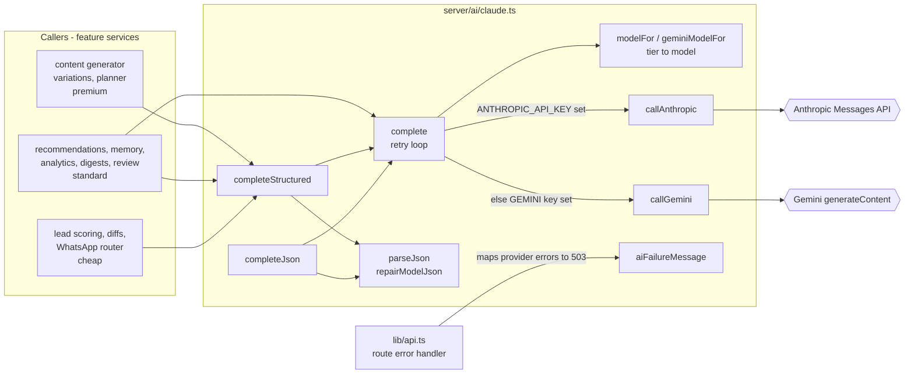
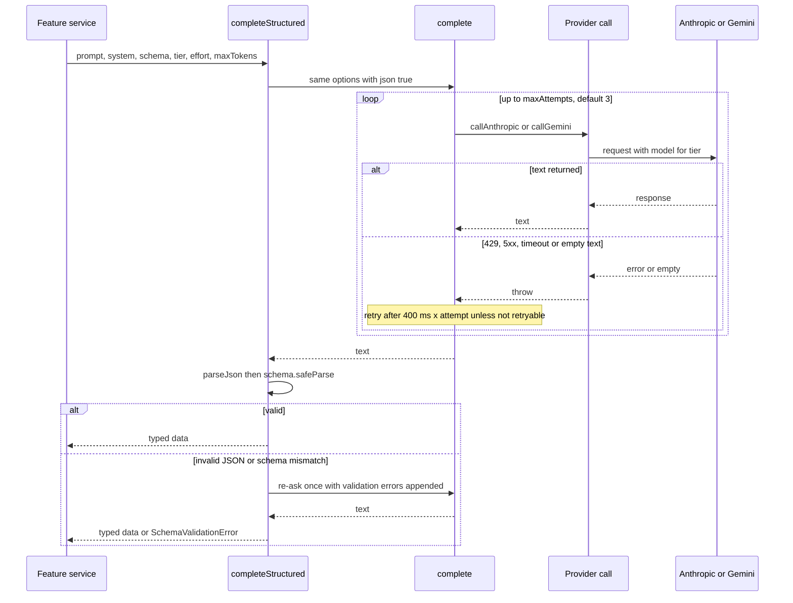
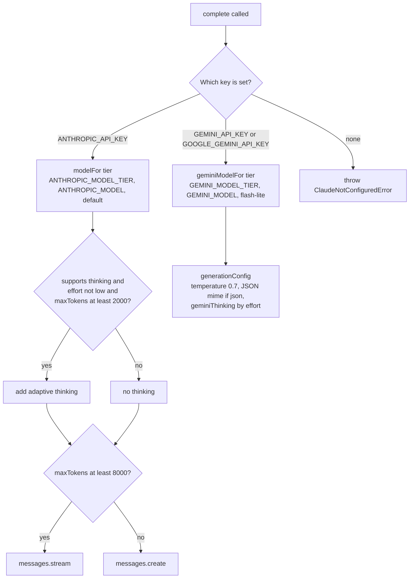

# AI Layer (Claude / Gemini Client) — Architecture

All AI text generation in Botella Aura goes through one module, `server/ai/claude.ts`. It chooses a provider (Anthropic first, Gemini as fallback) and a model per cost tier. It applies one retry and validation policy to every call, and turns provider failures into fixed, user-safe messages. Feature services only decide the prompt, the tier, the effort and their own no-AI fallback.

## Component architecture

Read left to right: feature services, grouped by the tier they usually ask for, enter through one of three public functions, and all three end in `complete()`, which owns the retry loop. `complete()` resolves the model for the tier and sends the call to Anthropic when its key is present, otherwise to Gemini. JSON answers pass back through `parseJson`. Separately, the shared route error handler in `lib/api.ts` uses `aiFailureMessage` to turn any provider error into a plain 503.

## Main flow

This is the most common path, a schema-validated generation. Transport problems are retried inside `complete()`: up to three attempts with linear backoff, but never for a missing key, a 4xx other than 429, or a spent daily quota. Content problems are handled one level up: `completeStructured` re-asks exactly once with the validation errors. It skips the re-ask when the failure came from the provider, because rephrasing cannot fix a quota or a bad key.

The second diagram expands the provider step. On Anthropic, the tier decides the model, and the model's capabilities decide whether `effort` and adaptive thinking are sent. Haiku gets neither. Thinking is skipped for small budgets, because it shares `max_tokens` with the answer. Large budgets stream. On Gemini, effort maps to a thinking level or a 2.5 thinking budget, and JSON calls request a JSON mime type, so no fences come back.

## Design decisions

- **One seam for all AI.** Model choice, prompting conventions, retries and parsing live in one file, so later features inherit a tested client instead of re-implementing it (file header; Sprint 2 doc §7).
- **Anthropic preferred, Gemini as fallback.** The code comments say Anthropic is the recommended provider for anything a customer reads. Gemini keeps the product working with a single alternative key. Old names (`isClaudeConfigured`) were kept so call sites did not change.
- **Cost tiers keyed to "is this the product?".** Post copy, plans and recommendations stay `premium`. Extraction, scoring and summaries use `standard` / `cheap`. The default is `premium`, so an unclassified call never silently gets worse.
- **Capabilities travel with the model.** Haiku rejects `output_config.effort` with a 400, so `ModelSpec` carries `supportsEffort` / `supportsAdaptiveThinking`, and overrides infer them from the model id.
- **Thinking only when affordable.** Thinking shares the output budget, so small or low-effort calls skip it. An empty answer is an `EmptyCompletionError` that the retry loop can see, not a silent empty string.
- **Timed Gemini defaults, not aliases.** `gemini-flash-latest` moved and became slow enough to break the WhatsApp router's 15 s budget. The defaults are models that were actually timed, and they can be overridden per tier.
- **Retry only what can improve.** 429/5xx/network errors are retried. Bad keys, bad requests and quotas that will not reset within 30 s fail fast, so callers can fall back. Deadline-bound callers (planner, review, WhatsApp router) pass `maxAttempts: 1` and manage their own time.
- **Validate, and re-ask once.** `completeStructured` backs the "never save malformed content" guarantee. `parseJson` repairs only the two common non-JSON habits (trailing commas, bare keys), and only after a normal parse fails.
- **Users never see provider internals.** `aiFailureMessage` produces three fixed sentences, and the raw error goes to logs and monitoring.
