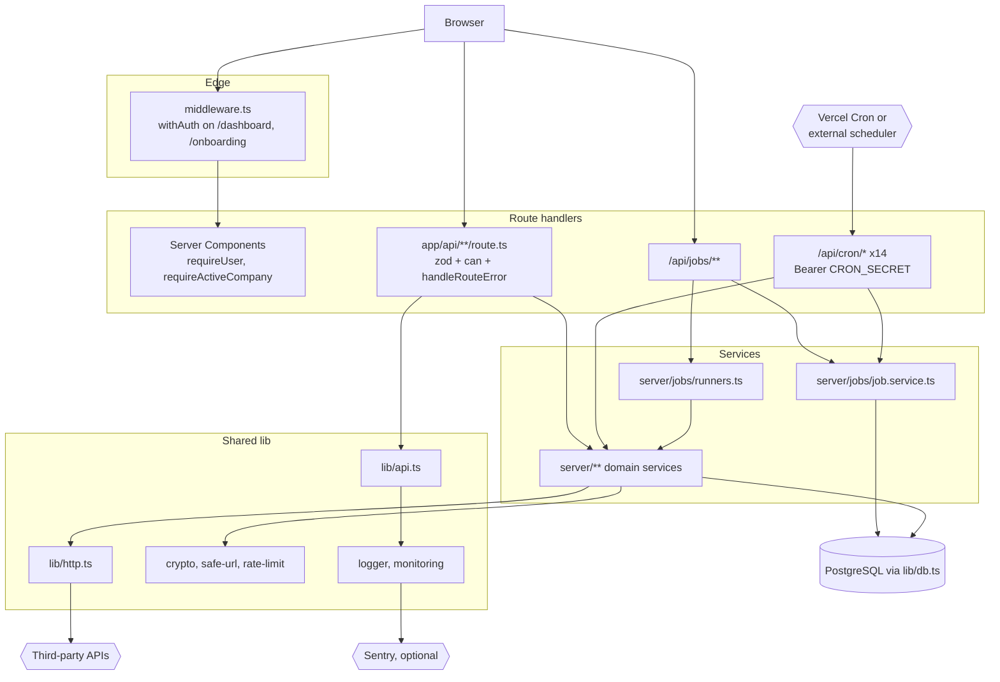
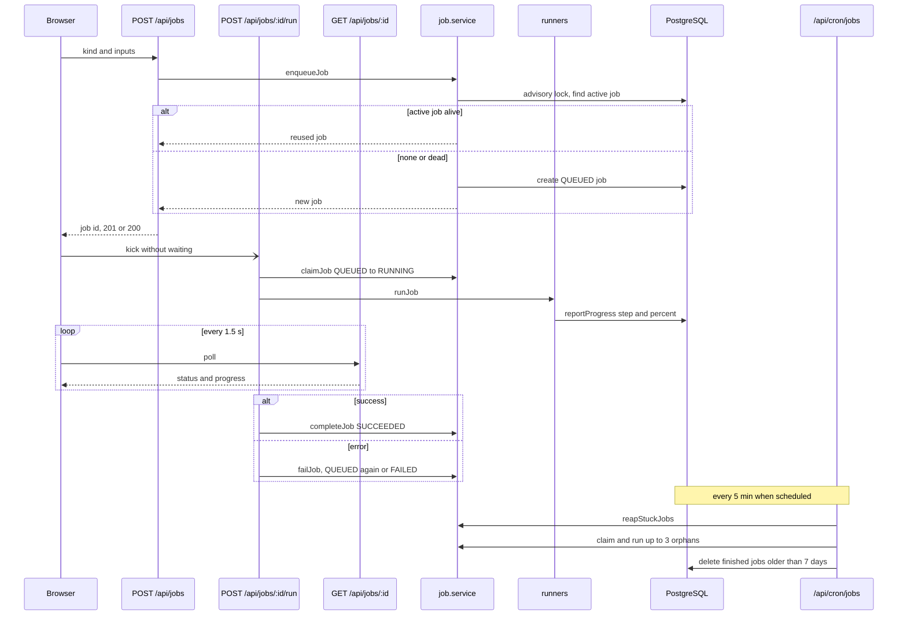
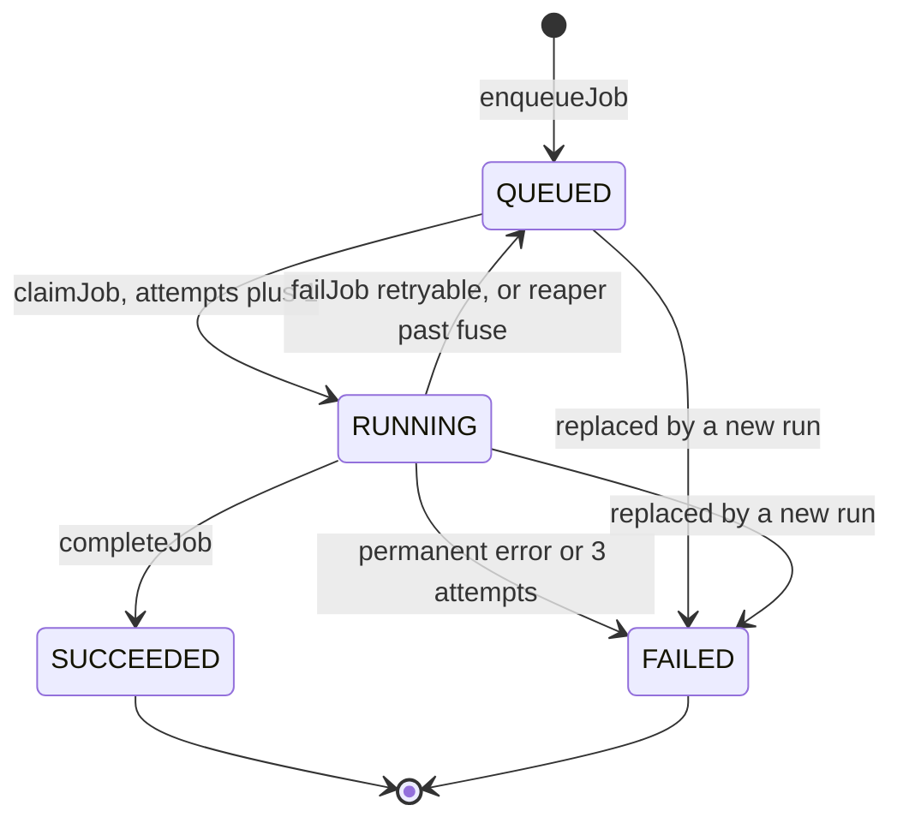
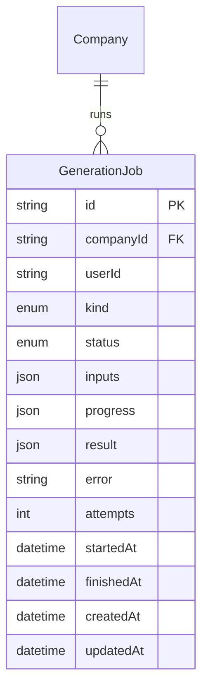
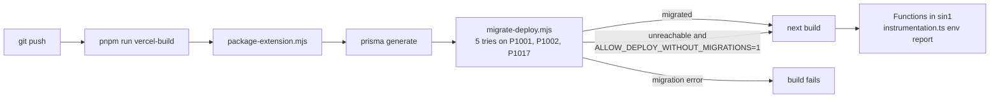

# Platform: Jobs, Cron, Security & Deployment — Architecture

Aura is one Next.js 14 App Router application on serverless functions (Vercel by default), backed by PostgreSQL through Prisma. There are no workers or queue servers. Long work runs as database-backed jobs that the browser starts and a cron route watches over, and scheduled work runs on protected HTTP endpoints that any scheduler can call.

## Component architecture

Pages pass through the edge middleware and then check the session again in Server Components. API routes stay thin: resolve the workspace, check the permission, validate with zod, call a service, and let `handleRouteError` shape any failure. Every outbound call goes through `lib/http.ts`, and every unexpected error goes through `captureException`. Cron routes reuse the same services as the UI.

## Main flow

The request that queues a job returns at once. The expensive run happens in a separate request that nobody waits on, and polling reads the progress the runner writes. If the tab closes, the run request still finishes. If the serverless instance is killed, the cron reaper requeues the job (or fails it once out of attempts), and orphaned queued jobs are picked up by the cron itself.

## Lifecycle / state machine

A job always ends in `SUCCEEDED` or `FAILED`. `claimJob` is a conditional update from `QUEUED`, so only one of the client kick, a duplicate kick or the cron can run a given attempt. An error marked `retryable === false` fails the job straight away instead of using up its three attempts. "Replaced by a new run" happens when a new request finds an active job that is past its fuse.

## Data model

`GenerationJob` is the only model this feature owns. `inputs` is kept through failures, so a retry replays exactly the same request. `updatedAt` moves on every progress write, and that is how `enqueueJob` tells a slow live run from a dead one. The indexes (`companyId`, `kind`, `status`) and (`status`, `createdAt`) serve the dedupe lookup and the reaper scan.

Deployment pipeline:

On Vercel, a database that is briefly unreachable is retried instead of failing the deploy, while a real migration error still stops the build. The escape hatch skips migrations only when explicitly set, and those migrations must then be run by hand. At boot, `instrumentation.ts` logs which integrations are configured, by variable name only.

## Design decisions

- **Database-backed jobs instead of a queue service.** A `GenerationJob` row plus an advisory lock and a conditional claim gives deduplication, exactly-one runner and retries, with nothing extra to host. It also survives the 60 s serverless limit, because the run is not tied to the request that created it.
- **The client kicks, the cron is a safety net.** Generation works on the Vercel Hobby plan without any cron. `/api/cron/jobs` only recovers killed or never-started runs.
- **Per-kind fuses.** Fast kinds (plan 2 min, images 3 min) are declared dead quickly, so pressing Generate again starts a fresh run instead of reattaching to a dead one.
- **Permanent errors are respected.** A provider error with `retryable === false` fails once, with an honest message, instead of three identical doomed attempts.
- **Plain HTTP cron endpoints.** Any scheduler (Vercel Cron, cron-job.org, GitHub Actions, curl) can call them. GET equals POST because Vercel Cron uses GET. They fail closed without `CRON_SECRET`.
- **One error envelope.** `handleRouteError` maps validation, permission, session expiry, AI-provider and annotated errors to stable status codes, and never leaks internals.
- **Dependency-free observability seams.** The logger, `captureException` and `rateLimit` have interfaces that a real sink, the Sentry SDK or Redis can replace without changing call sites.
- **Names, never values.** The env check, the endpoint printer and the DB checker report variable names and hosts only, so their output is safe to paste into logs and tickets.
- **Sandbox safety.** The Graph override is honoured only on loopback, and it is an error in production. A demo can never be mistaken for real publishing, and a token can never leave the machine.
- **Legal pages driven by data.** Unknown legal facts are shown as markers instead of invented values, and the pages are `noindex` until approved.
