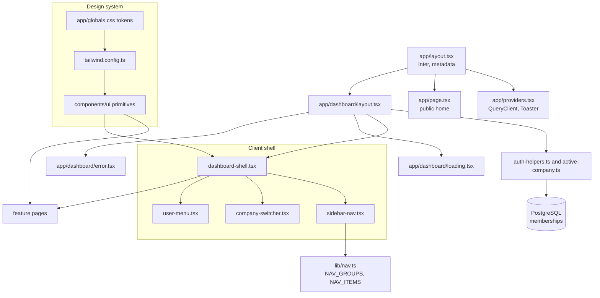
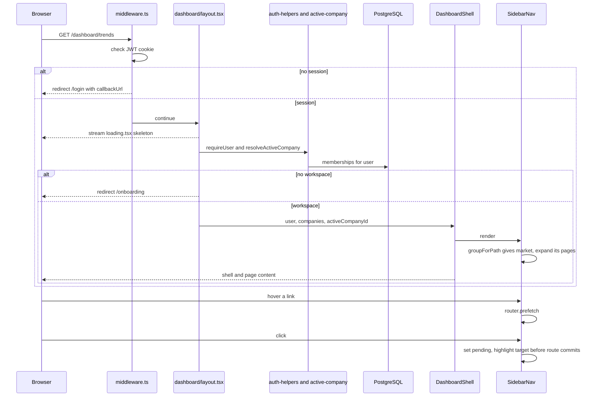

# Navigation, Dashboard Shell & Design System — Architecture

The dashboard is one server layout that guards access and hands the user and workspace list to a client shell. Navigation is data: `lib/nav.ts` declares groups and pages once, and `SidebarNav` renders whatever group the current path belongs to. Styling flows from CSS variables through Tailwind into the `components/ui` primitives.

## Component architecture

The root layout wraps everything with fonts and providers. The dashboard layout is the only place that loads data for the shell (session and memberships); the shell's children are the feature pages, with `loading.tsx` and `error.tsx` as the shared fallbacks. The design-system stack on the right is pure styling with no runtime data.

## Main flow

Middleware does the cheap session check, the layout does the workspace check, and the loading boundary is streamed while data loads so navigation feels instant. On the client, hover prefetch and the pending highlight make the sidebar respond before the next server render arrives.

## Design decisions

- **Six groups, pages shown only in context.** The sidebar used to list twenty-one links; it now shows six, expanding only the group you are in. No URL changed, so links and bookmarks keep working.
- **Navigation as data in one file.** Labels, routes, icons, groups and hover descriptions live in `lib/nav.ts`; `tests/nav-clarity.test.ts` enforces that labels describe outcomes, not internal machinery.
- **Longest-match group detection** because `/dashboard` prefixes every route.
- **Pending highlight and intent prefetch** because dashboard routes are `force-dynamic` and otherwise feel unresponsive on click.
- **Shared `loading.tsx` and `error.tsx`** so a slow page shows a skeleton immediately and a failing page keeps the shell, offers retry and shows a digest to quote.
- **Opaque sticky topbar** instead of backdrop blur, to avoid per-frame re-compositing while scrolling.
- **Tokens as HSL variables** so Tailwind opacity modifiers work and one edit re-themes the product; one accent colour, used sparingly.
- **shadcn/ui pattern** (Radix + `cva` + `cn`) for primitives, with feature-specific composition outside `components/ui`.
- **No `SessionProvider`**; the shell receives user details as props from the server.
