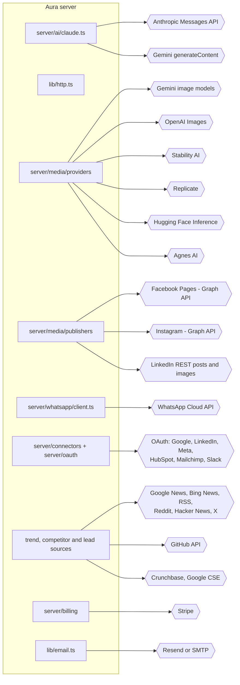

# Botella Aura — External APIs

Every third-party API the Aura server calls: what it is used for, the exact endpoints, how Aura authenticates,
which environment variables it needs, where the code lives, and its status at handover. Every outbound HTTP call
goes through `lib/http.ts` (timeouts, retries, user agent, robots.txt); every model call goes through
`server/ai/claude.ts`. Where to obtain each credential is in
[`../06-environment/ENVIRONMENT-VARIABLES.md`](../06-environment/ENVIRONMENT-VARIABLES.md).

## Summary

| API | Used for | Auth | Required? | Status at handover |
| --- | --- | --- | --- | --- |
| Anthropic Claude | All text generation, reviewer, routing, detection | API key | One AI key required | Working |
| Google Gemini (text) | Fallback text provider, tiered models | API key | One AI key required | Working (free-key quota limits) |
| Gemini image models | Default image generation, image refinement | API key | One image key for graphics | Working |
| OpenAI Images | Image generation and edits (`gpt-image-1`) | API key | Optional | Working |
| Stability AI | Image generation | API key | Optional | Working |
| Replicate | Any hosted image model | API token | Optional | Working |
| Hugging Face Inference | Free-tier image generation (FLUX.1-schnell) | Token | Optional | Working |
| Agnes AI | Image generation | API key | Optional | Working |
| Meta Graph — Facebook Pages | Publishing posts and photos, permalinks | OAuth user → Page token | Optional | Code complete; App Review pending |
| Meta Graph — Instagram | Single image, carousel, Reels publishing; insights | OAuth (Instagram API with Facebook Login) | Optional | Code complete; App Review pending |
| WhatsApp Cloud API | WhatsApp assistant messages and webhooks | System-user token + app secret | Optional | Test number working; production pending |
| LinkedIn | Sign-in (OIDC), member/organisation posts, image upload | OAuth 2.0 | Optional | Sign-in working; Page publishing needs API approval |
| Google OAuth / GA4 / Search Console | Sign-in; analytics connectors | OAuth 2.0 | Optional | Sign-in working; connectors need app setup |
| HubSpot, Mailchimp, Slack | Connector OAuth | OAuth 2.0 | Optional | Registered connectors |
| Google News, Bing News, RSS feeds | Trends, competitor news, hiring/funding signals | None | — | Working, keyless |
| Reddit | Trend source | Optional app token (RSS keyless) | Optional | Working |
| Hacker News (Firebase) | Trend source | None | — | Working |
| X / Twitter | Trend source | Bearer token | Optional, feature-flagged | Off by default |
| GitHub | Competitor releases, lead discovery | Optional token | Optional | Working |
| Crunchbase | Funding signals, enrichment | API key (paid) | Optional | Skipped when unset |
| Google Custom Search | Lead discovery web lookups | API key + CX | Optional | Skipped when unset |
| Stripe | Subscriptions, Checkout, Portal, webhooks | Secret key + webhook secret | Optional | Inherited from Sprint 6 |
| Resend / SMTP | Invite, reset, test emails | API key / SMTP credentials | Needed in production | Console fallback until set |

---

## 1. AI text providers

### Anthropic Claude
- **Endpoint:** Anthropic Messages API via the official SDK `@anthropic-ai/sdk` (`messages.create`, streaming for outputs over 8,000 tokens).
- **Code:** [`server/ai/claude.ts`](../../../server/ai/claude.ts) — `complete()`, `completeJson()`, `completeStructured({ schema })`.
- **Models:** three tiers — cheap (`claude-haiku-4-5`), standard (`claude-sonnet-5`), premium (`claude-opus-4-8`); `ANTHROPIC_MODEL` pins every tier; `ANTHROPIC_MODEL_CHEAP/_STANDARD/_PREMIUM` override one.
- **Behaviour:** adaptive thinking with an effort level; transient failures and empty completions retried up to 3 attempts in total (`MAX_ATTEMPTS`, callers working to a deadline can lower it with `maxAttempts`); structured output retried once more with the validation error fed back; `effort` omitted for Haiku.
- **Env:** `ANTHROPIC_API_KEY`, optional model variables.
- **Docs:** https://docs.anthropic.com

### Google Gemini (text)
- **Endpoint:** `POST https://generativelanguage.googleapis.com/v1beta/models/{model}:generateContent` (REST, no SDK).
- **Code:** `server/ai/claude.ts` (Gemini path).
- **Models:** per tier, default `gemini-3.5-flash-lite` for all three (timed, not assumed); `GEMINI_MODEL` pins all tiers.
- **Behaviour:** JSON calls set `responseMimeType: application/json`; effort maps to Gemini thinking (`geminiThinking`).
- **Env:** `GEMINI_API_KEY` (alias `GOOGLE_GEMINI_API_KEY`), `GEMINI_MODEL*`.
- **Docs:** https://ai.google.dev/api

## 2. Image providers (`server/media/providers/`)

All implement one `ImageGenerationProvider` interface; unconfigured providers are listed as "not set up".

| Provider | Endpoint | File | Env |
| --- | --- | --- | --- |
| Google Gemini images | `POST .../v1beta/models/{model}:generateContent` (and `:predict` for Imagen) | `gemini.ts` | `GOOGLE_AI_API_KEY`, `GOOGLE_IMAGE_MODEL` (default `gemini-3.1-flash-lite-image`, up to 4 images per call) |
| OpenAI | `POST https://api.openai.com/v1/images/generations`, `POST /v1/images/edits` (refinement) | `openai.ts` | `OPENAI_API_KEY`, `OPENAI_IMAGE_MODEL` (default `gpt-image-1`) |
| Stability AI | `POST https://api.stability.ai/v2beta/stable-image/generate/core` | `stability.ts` | `STABILITY_API_KEY`, `STABILITY_IMAGE_MODEL` |
| Replicate | `POST https://api.replicate.com/v1/predictions` | `replicate.ts` | `REPLICATE_API_TOKEN`, `REPLICATE_IMAGE_MODEL` |
| Hugging Face | `POST https://api-inference.huggingface.co/models/{model}` | `huggingface.ts` | `HUGGINGFACE_API_KEY`, `HUGGINGFACE_MODEL_ID`, `HUGGINGFACE_API_BASE` |
| Agnes AI | `POST https://api.agnes-ai.com/api/v1/images/generations` (OpenAI-compatible) | `agnes.ts` | `AGNES_API_KEY`, `AGNES_API_BASE_URL`, `AGNES_IMAGE_MODEL` |

Details: [`../02-features/12-media-graphics-and-creatives/`](../02-features/12-media-graphics-and-creatives/01-FEATURE-DETAILS.md).

## 3. Meta (Facebook, Instagram, WhatsApp)

One Graph base and URL builder in [`lib/meta.ts`](../../../lib/meta.ts) / [`lib/graph-base.ts`](../../../lib/graph-base.ts):
`https://graph.facebook.com/{META_GRAPH_VERSION}/…` (default `v23.0`). A sandbox override
(`META_GRAPH_BASE_URL`, `WHATSAPP_GRAPH_BASE_URL`) is honoured **only for loopback hosts**, so an access token can
never be sent elsewhere ([`../../SANDBOX.md`](../../SANDBOX.md)).

| Operation | Endpoint | Code |
| --- | --- | --- |
| OAuth dialog | `https://www.facebook.com/{version}/dialog/oauth` (or `config_id` for Facebook Login for Business) | `server/connectors`, `server/oauth` |
| Long-lived token exchange | `GET /oauth/access_token` | connectors |
| List Pages | `GET /me/accounts?fields=id,name,access_token&limit=100` | `server/media/publishers/facebook.ts` |
| Facebook post / photo | `POST /{pageId}/feed`, `POST /{pageId}/photos` | `facebook.ts` |
| Facebook permalink | `GET /{postId}?fields=permalink_url` | `facebook.ts` |
| Instagram container | `POST /{igUserId}/media` (image, carousel child, `REELS`) | `server/media/publishers/instagram.ts` |
| Container status | `GET /{containerId}?fields=status_code,status` (polled) | `instagram.ts` |
| Publish | `POST /{igUserId}/media_publish` | `instagram.ts` |
| Permalink | `GET /{mediaId}?fields=permalink` | `instagram.ts` |
| Deauthorize callback | Aura receives `POST /api/meta/deauthorize` (signed_request HMAC + replay window) | `app/api/meta` |
| Data deletion callback | Aura receives `POST /api/meta/data-deletion` | `app/api/meta` |
| WhatsApp send | `POST /{phoneNumberId}/messages` | `server/whatsapp/client.ts` |
| WhatsApp webhook | Aura receives `GET/POST /api/webhooks/whatsapp` (`X-Hub-Signature-256`, verify token) | `app/api/webhooks/whatsapp` |

- **Env:** `META_CLIENT_ID`, `META_CLIENT_SECRET`, `META_GRAPH_VERSION`, `META_LOGIN_CONFIG_ID`, `META_OAUTH_PKCE`, `META_REQUEST_INSIGHTS`; `WHATSAPP_ACCESS_TOKEN`, `WHATSAPP_PHONE_NUMBER_ID`, `WHATSAPP_APP_SECRET`, `WHATSAPP_VERIFY_TOKEN`, `WHATSAPP_GRAPH_API_VERSION`.
- **Instagram notes:** JPEG only (PNG/WebP re-encoded through `sharp`); Meta must be able to fetch media from `APP_URL` (presigned S3 links for private buckets).
- **Docs:** https://developers.facebook.com/docs/graph-api · https://developers.facebook.com/docs/instagram-platform · https://developers.facebook.com/docs/whatsapp/cloud-api
- **Internal docs:** [`META-INTEGRATION.md`](../../META-INTEGRATION.md), [`META-APP-SETUP.md`](../../META-APP-SETUP.md), [`META-APP-REVIEW-SUBMISSION.md`](../../META-APP-REVIEW-SUBMISSION.md), [`WHATSAPP-ASSISTANT.md`](../../WHATSAPP-ASSISTANT.md).

## 4. LinkedIn

| Operation | Endpoint | Code |
| --- | --- | --- |
| Authorize | `https://www.linkedin.com/oauth/v2/authorization` | `lib/auth-linkedin.ts`, `app/api/linkedin` |
| Token | `POST https://www.linkedin.com/oauth/v2/accessToken` | same |
| Revoke | `POST https://www.linkedin.com/oauth/v2/revoke` | connections |
| Profile (OIDC) | `GET https://api.linkedin.com/v2/userinfo` | `lib/auth-linkedin.ts` |
| Create post | `POST https://api.linkedin.com/rest/posts` (header `LinkedIn-Version: 202610`) | `lib/linkedin-api.ts`, `server/content` |
| Image upload | `POST /rest/images?action=initializeUpload` → upload → reference the image URN | `server/media/publishers/linkedin-image.ts` |

- **Scopes:** `openid profile email` (sign-in), `w_member_social` (member posts), `w_organization_social` (Page posts — needs Community Management API approval).
- **Env:** `LINKEDIN_CLIENT_ID`, `LINKEDIN_CLIENT_SECRET`, `LINKEDIN_API_VERSION`, `LINKEDIN_ORG_URN`, `LINKEDIN_OAUTH_PKCE`.
- **Docs:** https://learn.microsoft.com/en-us/linkedin/

## 5. Google (OAuth and connectors)

| Operation | Endpoint |
| --- | --- |
| Authorize | `https://accounts.google.com/o/oauth2/v2/auth` |
| Token / revoke | `https://oauth2.googleapis.com/token`, `https://oauth2.googleapis.com/revoke` |
| GA4 accounts | `GET https://analyticsadmin.googleapis.com/v1beta/accountSummaries` (scope `analytics.readonly`) |
| Search Console sites | `GET https://searchconsole.googleapis.com/webmasters/v3/sites` (scope `webmasters.readonly`) |
| Custom Search | `GET https://www.googleapis.com/customsearch/v1` |

Env: `GOOGLE_CLIENT_ID`, `GOOGLE_CLIENT_SECRET`, `GOOGLE_CSE_API_KEY`, `GOOGLE_CSE_CX`.

## 6. Other connectors (OAuth)

| Provider | Endpoints | Env |
| --- | --- | --- |
| HubSpot | `https://app.hubspot.com/oauth/authorize`, `POST https://api.hubapi.com/oauth/v1/token`, `GET /account-info/v3/details` | `HUBSPOT_CLIENT_ID`, `HUBSPOT_CLIENT_SECRET` |
| Mailchimp | `https://login.mailchimp.com/oauth2/authorize`, `/oauth2/token`, `/oauth2/metadata` | `MAILCHIMP_CLIENT_ID`, `MAILCHIMP_CLIENT_SECRET` |
| Slack | `https://slack.com/oauth/v2/authorize`, `POST https://slack.com/api/oauth.v2.access`, `auth.test` | `SLACK_CLIENT_ID`, `SLACK_CLIENT_SECRET` |

Redirect URI for each: `https://<host>/api/connectors/<connector-id>/callback` (print all with `npm run auth:endpoints`).

## 7. Public data sources (trends, competitors, leads)

| Source | Endpoint | Auth | Code |
| --- | --- | --- | --- |
| Google News search | `https://news.google.com/rss/search?q=…` (locale from workspace config) | None | `server/trends/sources`, competitors, outreach |
| Google News headlines | `https://news.google.com/rss/headlines/section/…` (localised `hl/gl/ceid`) | None | `server/trends/sources` |
| Bing News | `https://www.bing.com/news/search?format=rss` | None | trends |
| Industry feeds | Marketing Dive, Retail Dive, Restaurant Dive, Food Dive, Healthcare Dive, Banking Dive, Construction Dive, Education Dive, Hotel Management, TechCrunch, The Verge, Entrepreneur | None | `INDUSTRY_FEEDS` in `server/trends/sources` |
| Reddit | `https://www.reddit.com/r/{sub}/.rss` (keyless) or `https://oauth.reddit.com` with `POST /api/v1/access_token` | Optional app token | trends |
| Hacker News | `https://hacker-news.firebaseio.com/v0/…` | None | trends |
| X / Twitter | `GET https://api.twitter.com/2/tweets/search/recent` | Bearer token | trends (flagged off) |
| GitHub | `https://api.github.com/search/repositories`, `/search/users`, `/users/{u}`, `/repos/{owner}/{repo}/releases/latest` | Optional token | competitors, leads, outreach |
| Crunchbase | `POST https://api.crunchbase.com/api/v4/searches/organizations` | API key | outreach, leads |
| Company / competitor websites | Direct fetch, robots.txt honoured, `BotellaAuraBot` user agent | None | `server/knowledge`, `server/competitors` |

## 8. Payments and email

| API | Endpoints | Code | Env |
| --- | --- | --- | --- |
| Stripe | Checkout Sessions, Billing Portal, Subscriptions (SDK `stripe`); webhook received at `POST /api/webhooks/stripe` (signature verified before parsing) | `server/billing`, `lib/stripe.ts` | `STRIPE_SECRET_KEY`, `STRIPE_WEBHOOK_SECRET`, `STRIPE_PRICE_STARTER/_GROWTH/_AGENCY` |
| Resend | `POST https://api.resend.com/emails` | `lib/email.ts` | `RESEND_API_KEY`, `EMAIL_FROM` |
| SMTP | Any SMTP server via `nodemailer` | `lib/email.ts` | `SMTP_HOST`, `SMTP_PORT`, `SMTP_USER`, `SMTP_PASS`, `SMTP_SECURE`, `EMAIL_FROM` |

Transport order: SMTP → Resend → console log (the UI says "Email not sent" rather than reporting success).

## 9. Storage

| API | Use | Env |
| --- | --- | --- |
| S3-compatible (AWS S3, Cloudflare R2, Backblaze B2, MinIO) | Generated images and video (required for Reels); private buckets via presigned reads (15 min; 1 h for Instagram) | `ASSET_S3_ENDPOINT`, `ASSET_S3_BUCKET`, `ASSET_S3_ACCESS_KEY_ID`, `ASSET_S3_SECRET_ACCESS_KEY`, `ASSET_S3_REGION`, `ASSET_S3_PUBLIC_BASE_URL` |

Without a bucket, images are stored in Postgres and served through an authenticated route
([`../../MEDIA-STORAGE.md`](../../MEDIA-STORAGE.md)).

## Testing external APIs without accounts

| Tool | What it stands in for |
| --- | --- |
| `npm run sandbox` / `npm run sandbox check` | Meta Graph (Facebook, Instagram, WhatsApp) on localhost; drives the real publishers end to end |
| `npm run whatsapp:local serve \| say \| script` | Plays the phone against the local WhatsApp stand-in |
| `npm run load:meta-stub`, `npm run load:whatsapp` | Load tests with 1,000 simulated users |
| Verify scripts with the model stubbed at the network | Content generation, visual context, variations |

The sandbox proves Aura's own behaviour; only real credentials prove the provider accepts the traffic.
